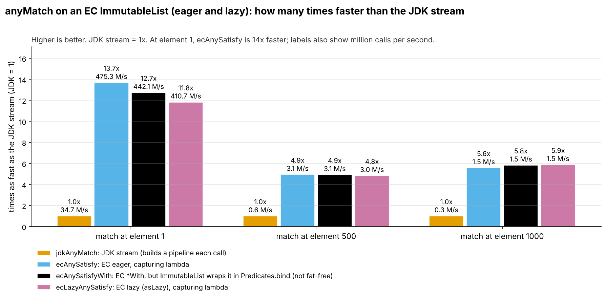
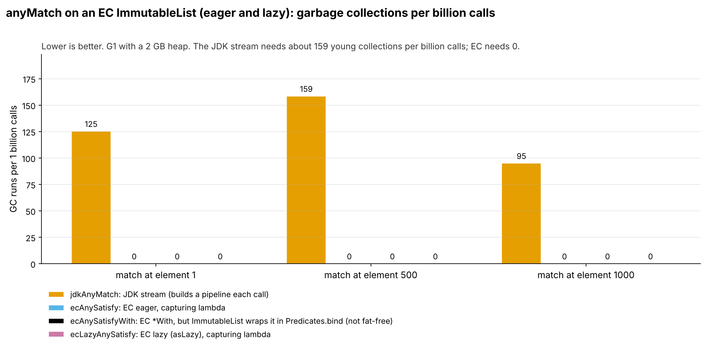
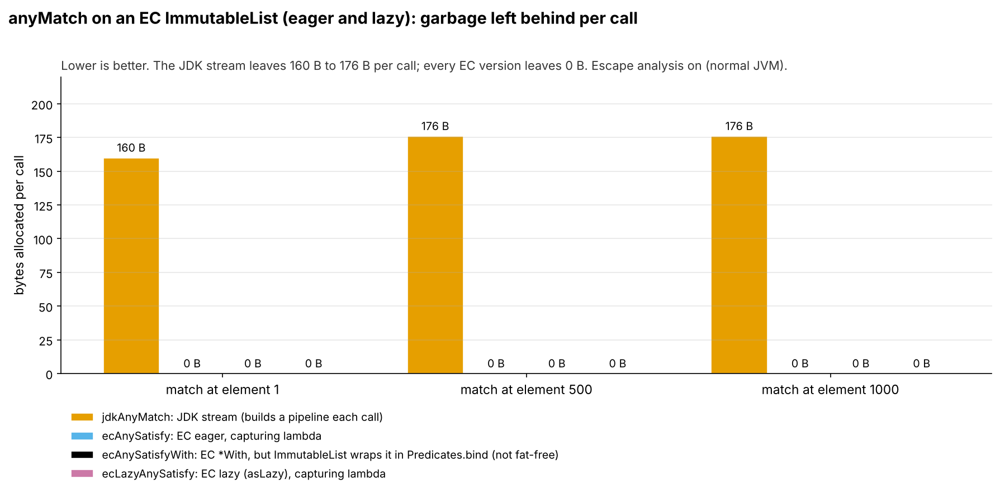
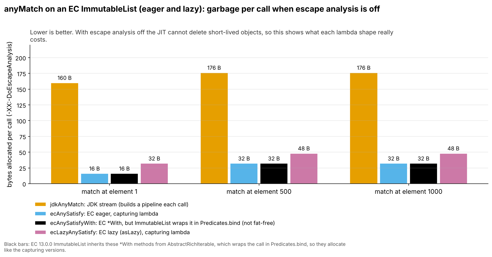
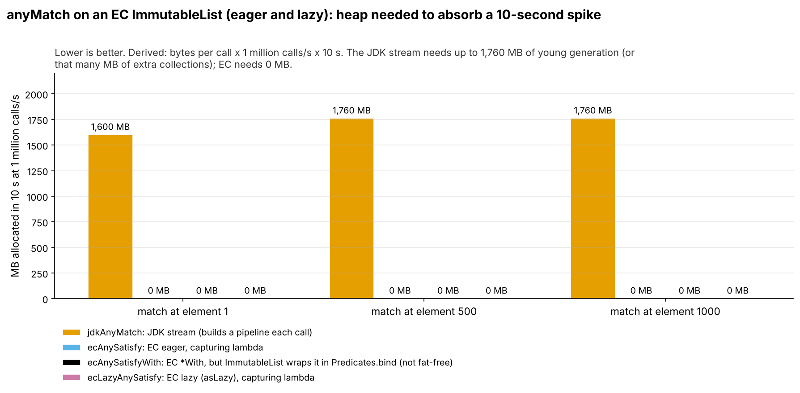
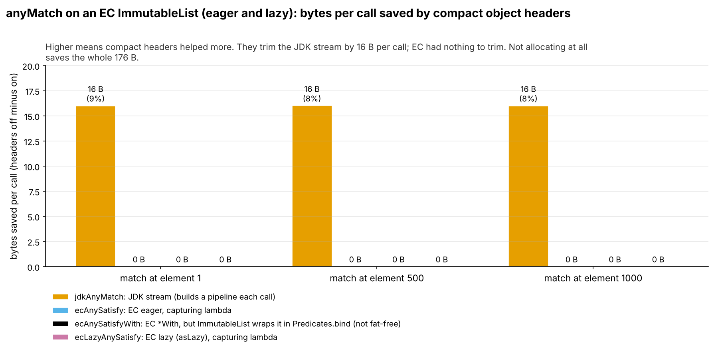

= AnyMatchEagerLazy: fat-free lambdas and garbage (run 20261015-0406)
:toc:
:toclevels: 2

Input: link:../runs/20261015-0406-AnyMatchEagerLazyResults2.adoc[20261015-0406-AnyMatchEagerLazyResults2.adoc]. Environment: Claude cloud sandbox (4 vCPU Intel Xeon KVM guest, OpenJDK 25.0.4), not the local Mac, so absolute timings will differ from a run on the Mac. Bytes and object counts do not depend on the machine.

== Summary

On an EC `ImmutableList`, `anySatisfy`, `anySatisfyWith` and `asLazy().anySatisfy` all leave 0 bytes per call and trigger no GC. The JDK `stream().anyMatch()` on a `java.util.List` leaves 6 to 7 objects (160 to 176 B) per call. With escape analysis off, the `ImmutableList` `anySatisfyWith` is *not* fat-free in EC 13.0.0: it allocates the same as the capturing version (see below), which is worth raising with the EC project.

== Head-to-head (compact headers on)

Throughput = 1000 ÷ ns per call. Calls measured = 40 s ÷ ns per call. Objects per call come from the object-count run; bytes per call from `gc.alloc.rate.norm`.

[cols="3,2,1,1,1,1,1,1",options="header"]
|===
|Implementation |Kind |Throughput (M calls/s) |Time per call (ns) |Objects per call |Bytes per call |GC runs per 1B calls |GC time per 1B calls (ms)
8+h|test = 1
|`jdkAnyMatch` |JDK stream |34.7 |28.8 ± 1.44 |6.00 |160 |125 |287
|`ecAnySatisfy` |EC eager, capturing |475 |2.10 ± 0.11 |0 |≈0 |0 |0
|`ecAnySatisfyWith` |EC fat-free (*With) |442 |2.26 ± 0.14 |0 |≈0 |0 |0
|`ecLazyAnySatisfy` |EC lazy, capturing |411 |2.44 ± 0.17 |0 |≈0 |0 |0
8+a|`ecAnySatisfy` vs JDK: 13.7x faster, 6.00 fewer objects and 160 fewer bytes per call, 0 vs 125 GC runs per billion calls +
`ecAnySatisfyWith` vs JDK: 12.7x faster, 6.00 fewer objects and 160 fewer bytes per call, 0 vs 125 GC runs per billion calls +
`ecLazyAnySatisfy` vs JDK: 11.8x faster, 6.00 fewer objects and 160 fewer bytes per call, 0 vs 125 GC runs per billion calls
8+h|test = 500
|`jdkAnyMatch` |JDK stream |0.63 |1,585 ± 182 |7.00 |176 |159 |793
|`ecAnySatisfy` |EC eager, capturing |3.12 |321 ± 16.3 |0 |≈0 |0 |0
|`ecAnySatisfyWith` |EC fat-free (*With) |3.10 |322 ± 17.4 |0 |≈0 |0 |0
|`ecLazyAnySatisfy` |EC lazy, capturing |3.05 |328 ± 17.2 |0 |≈0 |0 |0
8+a|`ecAnySatisfy` vs JDK: 4.9x faster, 7.00 fewer objects and 176 fewer bytes per call, 0 vs 159 GC runs per billion calls +
`ecAnySatisfyWith` vs JDK: 4.9x faster, 7.00 fewer objects and 176 fewer bytes per call, 0 vs 159 GC runs per billion calls +
`ecLazyAnySatisfy` vs JDK: 4.8x faster, 7.00 fewer objects and 176 fewer bytes per call, 0 vs 159 GC runs per billion calls
8+h|test = 1000
|`jdkAnyMatch` |JDK stream |0.26 |3,799 ± 329 |7.00 |176 |95.0 |475
|`ecAnySatisfy` |EC eager, capturing |1.47 |681 ± 48.7 |0 |≈0 |0 |0
|`ecAnySatisfyWith` |EC fat-free (*With) |1.54 |651 ± 34.8 |0 |≈0 |0 |0
|`ecLazyAnySatisfy` |EC lazy, capturing |1.55 |646 ± 45.6 |0 |≈0 |0 |0
8+a|`ecAnySatisfy` vs JDK: 5.6x faster, 7.00 fewer objects and 176 fewer bytes per call, 0 vs 95.0 GC runs per billion calls +
`ecAnySatisfyWith` vs JDK: 5.8x faster, 7.00 fewer objects and 176 fewer bytes per call, 0 vs 95.0 GC runs per billion calls +
`ecLazyAnySatisfy` vs JDK: 5.9x faster, 7.00 fewer objects and 176 fewer bytes per call, 0 vs 95.0 GC runs per billion calls
|===

.Speed relative to the JDK stream, compact headers on.

Mermaid source: link:charts/20261015-0406-AnyMatchEagerLazy-throughput.mmd[20261015-0406-AnyMatchEagerLazy-throughput.mmd]

.Garbage collections per billion calls, compact headers on.

Mermaid source: link:charts/20261015-0406-AnyMatchEagerLazy-gc-per-billion.mmd[20261015-0406-AnyMatchEagerLazy-gc-per-billion.mmd]

== Garbage: where it comes from

*JDK (measured).* Same 6 to 7 objects as in `AnyMatchUtility`: `ReferencePipeline$Head`, `RandomAccessSpliterator`, `MatchOps$MatchOp`, `MatchOps$1MatchSink`, a `MatchOps` lambda, the captured lambda, and the `Integer` box at `test = 500/1000`.

*EC (measured).* Nothing at or above 0.5 objects per call for any variant, eager or lazy.

=== Objects per call by class (object-count run, compact headers on)

....
jdkAnyMatch test=1: 6.00 objects, 160 B per call
      1.00 x java.util.stream.ReferencePipeline$Head  (48 B)
      1.00 x java.util.AbstractList$RandomAccessSpliterator  (32 B)
      1.00 x java.util.stream.MatchOps$1MatchSink  (24 B)
      1.00 x java.util.stream.MatchOps$MatchOp  (24 B)
      1.00 x conf.session.shakers.AnyMatchEagerLazyBenchmark$$Lambda  (16 B)
      1.00 x java.util.stream.MatchOps$$Lambda  (16 B)
ecAnySatisfy test=1: 0.00 objects, 0 B per call
ecAnySatisfyWith test=1: 0.00 objects, 0 B per call
ecLazyAnySatisfy test=1: 0.00 objects, 0 B per call
jdkAnyMatch test=500: 7.00 objects, 176 B per call
      1.00 x java.util.stream.ReferencePipeline$Head  (48 B)
      1.00 x java.util.AbstractList$RandomAccessSpliterator  (32 B)
      1.00 x java.util.stream.MatchOps$1MatchSink  (24 B)
      1.00 x java.util.stream.MatchOps$MatchOp  (24 B)
      1.00 x java.lang.Integer  (16 B)
      1.00 x java.util.stream.MatchOps$$Lambda  (16 B)
      1.00 x conf.session.shakers.AnyMatchEagerLazyBenchmark$$Lambda  (16 B)
ecAnySatisfy test=500: 0.00 objects, 0 B per call
ecAnySatisfyWith test=500: 0.00 objects, 0 B per call
ecLazyAnySatisfy test=500: 0.00 objects, 0 B per call
jdkAnyMatch test=1000: 7.00 objects, 176 B per call
      1.00 x java.util.stream.ReferencePipeline$Head  (48 B)
      1.00 x java.util.AbstractList$RandomAccessSpliterator  (32 B)
      1.00 x java.util.stream.MatchOps$1MatchSink  (24 B)
      1.00 x java.util.stream.MatchOps$MatchOp  (24 B)
      1.00 x java.lang.Integer  (16 B)
      1.00 x java.util.stream.MatchOps$$Lambda  (16 B)
      1.00 x conf.session.shakers.AnyMatchEagerLazyBenchmark$$Lambda  (16 B)
ecAnySatisfy test=1000: 0.00 objects, 0 B per call
ecAnySatisfyWith test=1000: 0.00 objects, 0 B per call
ecLazyAnySatisfy test=1000: 0.00 objects, 0 B per call
....

.Bytes allocated per call (gc.alloc.rate.norm), compact headers on.

Mermaid source: link:charts/20261015-0406-AnyMatchEagerLazy-bytes-per-call.mmd[20261015-0406-AnyMatchEagerLazy-bytes-per-call.mmd]

=== Escape analysis off (upper bound for lambda garbage)

Same benchmarks with `-XX:-DoEscapeAnalysis`. Real applications cannot count on escape analysis (megamorphic call sites, code that is not inlined), so this shows what each lambda shape costs when it does not help. It is an upper bound, not typical production behaviour.

[cols="3,2,1,1,1,1",options="header"]
|===
|Implementation |Kind |Bytes per call, EA on |Bytes per call, EA off |Time per call EA on (ns) |Time per call EA off (ns)
6+h|test = 1
|`jdkAnyMatch` |JDK stream |160 |160 |28.8 |30.7
|`ecAnySatisfy` |EC eager, capturing |≈0 |16 |2.10 |3.73
|`ecAnySatisfyWith` |EC fat-free (*With) |≈0 |16 |2.26 |4.13
|`ecLazyAnySatisfy` |EC lazy, capturing |≈0 |32 |2.44 |6.52
6+h|test = 500
|`jdkAnyMatch` |JDK stream |176 |176 |1,585 |1,701
|`ecAnySatisfy` |EC eager, capturing |≈0 |32 |321 |381
|`ecAnySatisfyWith` |EC fat-free (*With) |≈0 |32 |322 |367
|`ecLazyAnySatisfy` |EC lazy, capturing |≈0 |48 |328 |344
6+h|test = 1000
|`jdkAnyMatch` |JDK stream |176 |176 |3,799 |3,507
|`ecAnySatisfy` |EC eager, capturing |≈0 |32 |681 |742
|`ecAnySatisfyWith` |EC fat-free (*With) |≈0 |32 |651 |737
|`ecLazyAnySatisfy` |EC lazy, capturing |≈0 |48 |646 |737
|===

With escape analysis off: `ecAnySatisfy` 16 B / 32 B, `ecLazyAnySatisfy` 32 B / 48 B (adds the `LazyIterable` adapter), and `ecAnySatisfyWith` **16 B / 32 B, the same as the capturing version**. Reason (checked in the EC 13.0.0 bytecode): `ImmutableArrayList` inherits `anySatisfyWith` from `AbstractRichIterable`, which calls `Predicates.bind(predicate, parameter)` and allocates a bound predicate on every call. The `Iterate.anySatisfyWith` utility used in `AnyMatchUtility` loops directly and does not. Only `detectWithOptional` is overridden in `ImmutableArrayList`.

.Bytes per call with -XX:-DoEscapeAnalysis: the upper bound for lambda garbage.

Mermaid source: link:charts/20261015-0406-AnyMatchEagerLazy-ea-off-bytes.mmd[20261015-0406-AnyMatchEagerLazy-ea-off-bytes.mmd]

== Spikes and heap headroom (derived, not measured)

Formulas: allocation rate (MB/s) = bytes per call × calls/s ÷ 10^6. Young collections per minute = allocation rate ÷ 512 MB (example young generation) × 60. Allocated during a 10 s spike = bytes per call × calls/s × 10 s: the young-generation space the spike needs, or the collections it causes when that space is not there. Loads are application-wide, across all threads.

[cols="3,1,1,1,1,1",options="header"]
|===
|Implementation |Bytes per call |MB/s at 1 M calls/s |MB/s at 10 M calls/s |Young GCs per minute at 10 M calls/s |MB allocated in a 10 s spike at 10 M calls/s
6+h|test = 1
|`jdkAnyMatch` |160 |160 |1,600 |188 |16,000
|`ecAnySatisfy` |≈0 |0 |0 |0 |0
|`ecAnySatisfyWith` |≈0 |0 |0 |0 |0
|`ecLazyAnySatisfy` |≈0 |0 |0 |0 |0
6+h|test = 500
|`jdkAnyMatch` |176 |176 |1,760 |206 |17,600
|`ecAnySatisfy` |≈0 |≈0 |0.01 |≈0 |0.10
|`ecAnySatisfyWith` |≈0 |≈0 |0.01 |≈0 |0.10
|`ecLazyAnySatisfy` |≈0 |≈0 |0.01 |≈0 |0.10
6+h|test = 1000
|`jdkAnyMatch` |176 |176 |1,760 |206 |17,601
|`ecAnySatisfy` |≈0 |≈0 |0.02 |≈0 |0.20
|`ecAnySatisfyWith` |≈0 |≈0 |0.02 |≈0 |0.20
|`ecLazyAnySatisfy` |≈0 |≈0 |0.02 |≈0 |0.20
|===

JMH also reports `gc.alloc.rate` (MB/s), but that number scales with how fast the benchmark runs, so a faster method can show a higher MB/s while allocating the same per call. `gc.alloc.rate.norm` (bytes per call) is the number to size heaps with.

.Young-generation memory a 10 s spike at 1 million calls/s allocates (derived).

Mermaid source: link:charts/20261015-0406-AnyMatchEagerLazy-spike-headroom.mmd[20261015-0406-AnyMatchEagerLazy-spike-headroom.mmd]

== Compact object headers

[cols="3,1,1,1,1,1,1",options="header"]
|===
|Implementation |Bytes per call on |Bytes per call off |Saved |Objects per call on |Objects per call off |Time per call on / off (ns)
7+h|test = 1
|`jdkAnyMatch` |160 |176 |9% |6.00 |6.00 |28.8 / 32.4
|`ecAnySatisfy` |≈0 |≈0 |n/a |0 |0 |2.10 / 2.19
|`ecAnySatisfyWith` |≈0 |≈0 |n/a |0 |0 |2.26 / 1.88
|`ecLazyAnySatisfy` |≈0 |≈0 |n/a |0 |0 |2.44 / 2.35
7+h|test = 500
|`jdkAnyMatch` |176 |192 |8% |7.00 |7.00 |1,585 / 3,918
|`ecAnySatisfy` |≈0 |≈0 |n/a |0 |0 |321 / 272
|`ecAnySatisfyWith` |≈0 |≈0 |n/a |0 |0 |322 / 281
|`ecLazyAnySatisfy` |≈0 |≈0 |n/a |0 |0 |328 / 277
7+h|test = 1000
|`jdkAnyMatch` |176 |192 |8% |7.00 |7.00 |3,799 / 3,624
|`ecAnySatisfy` |≈0 |≈0 |n/a |0 |0 |681 / 547
|`ecAnySatisfyWith` |≈0 |≈0 |n/a |0 |0 |651 / 542
|`ecLazyAnySatisfy` |≈0 |≈0 |n/a |0 |0 |646 / 552
|===

Bytes per call here are `gc.alloc.rate.norm` from the main runs. Where that is a few bytes below the object-count total, the JIT scalar-replaced one pipeline object in some forks; the object-count run (exact per-class counts) is the reference for what each call allocates.

JDK garbage: 160 to 176 B (test = 1) and 176 to 192 B (500/1000) without compact headers, about 9% saved. EC: nothing to save.

Unexpected, measured: EC loops 13 to 20% faster (at `test = 500/1000`) with compact headers off. *Inferred:* class-pointer decoding in `Integer.equals`. `jdkAnyMatch` at `test = 500` with compact headers off took 3,918 ns against about 1,585 ns elsewhere; its error is ±3,208 ns, so treat that single cell as noise.

.Bytes per call saved by -XX:+UseCompactObjectHeaders (off minus on).

Mermaid source: link:charts/20261015-0406-AnyMatchEagerLazy-coh-bytes.mmd[20261015-0406-AnyMatchEagerLazy-coh-bytes.mmd]

== Supporting analysis

*Eager vs lazy.* With escape analysis on, `asLazy()` adds no measurable time and no garbage. With it off, it adds one 16 B adapter per call.

=== Raw GC totals (compact headers on, per 40 s measurement)

Raw totals are shown for completeness only. Do not compare them across implementations: a faster method fits more calls into the same 40 s.

[cols="3,1,1,1,1",options="header"]
|===
|Implementation |test |calls measured |gc.count |gc.time (ms)
|`jdkAnyMatch` |1 |1.39e+09 |174 |398
|`ecAnySatisfy` |1 |1.9e+10 |0 |0
|`ecAnySatisfyWith` |1 |1.77e+10 |0 |0
|`ecLazyAnySatisfy` |1 |1.64e+10 |0 |0
|`jdkAnyMatch` |500 |2.52e+07 |4.00 |20.0
|`ecAnySatisfy` |500 |1.25e+08 |0 |0
|`ecAnySatisfyWith` |500 |1.24e+08 |0 |0
|`ecLazyAnySatisfy` |500 |1.22e+08 |0 |0
|`jdkAnyMatch` |1000 |1.05e+07 |1.00 |5.00
|`ecAnySatisfy` |1000 |5.87e+07 |0 |0
|`ecAnySatisfyWith` |1000 |6.14e+07 |0 |0
|`ecLazyAnySatisfy` |1000 |6.19e+07 |0 |0
|===

== Caveats

One machine (a cloud VM, not dedicated hardware), one JDK build (OpenJDK 25.0.4 from Ubuntu), G1 with a fixed 2 GB heap. Microbenchmarks, not an application. Mechanisms are read from the class histograms where shown; anything else is labelled inferred.

== Reproduce

Run folder: `assets/runs/20261015-0406/`. Results: `assets/runs/20261015-0406-AnyMatchEagerLazyResults2.adoc`.

....
mvn -f pom-bench.xml clean compile
mvn -f pom-bench.xml package
# main runs, CONFIG/FLAGS = coh-on: -XX:+UseCompactObjectHeaders | coh-off: -XX:-UseCompactObjectHeaders
#                          ea-off: -XX:+UseCompactObjectHeaders -XX:-DoEscapeAnalysis
java -jar target-bench/microbenchmarks.jar "conf\.session\.shakers\.AnyMatchEagerLazyBenchmark\." \
  -prof gc -jvmArgsAppend "-XX:+UseG1GC -Xms2g -Xmx2g ${FLAGS}" \
  -rf text -rff assets/runs/20261015-0406/AnyMatchEagerLazy-${CONFIG}.txt -o assets/runs/20261015-0406/AnyMatchEagerLazy-${CONFIG}.log
# object counts, COH = -XX:+UseCompactObjectHeaders | -XX:-UseCompactObjectHeaders
java -jar target-bench/microbenchmarks.jar "conf\.session\.shakers\." -f 1 -wi 5 -w 1s -i 3 -r 100ms \
  -jvmArgs "-XX:+UseParallelGC -Xms12g -Xmx12g -Xmn10g ${COH}" -prof prof.HistoProfiler -prof gc \
  -rf text -rff assets/runs/20261015-0406/all-${CONFIG}.txt -o assets/runs/20261015-0406/all-${CONFIG}.log
# HISTO lines go to the console, not to the -o file; they were saved to assets/runs/20261015-0406/all-${CONFIG}.histo
....
