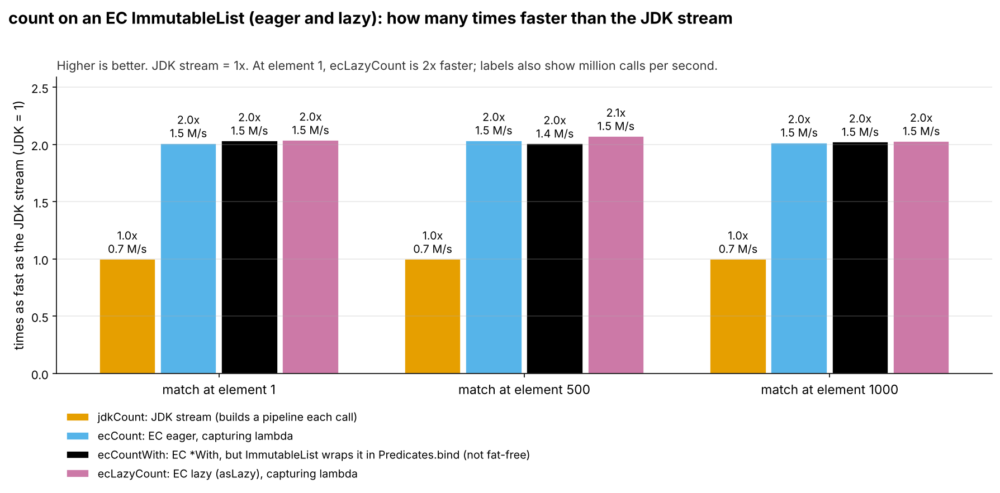
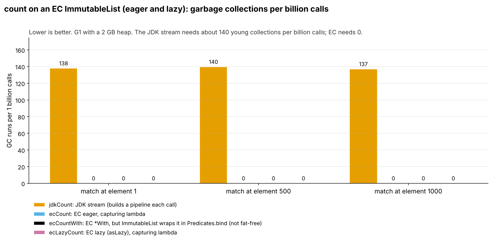
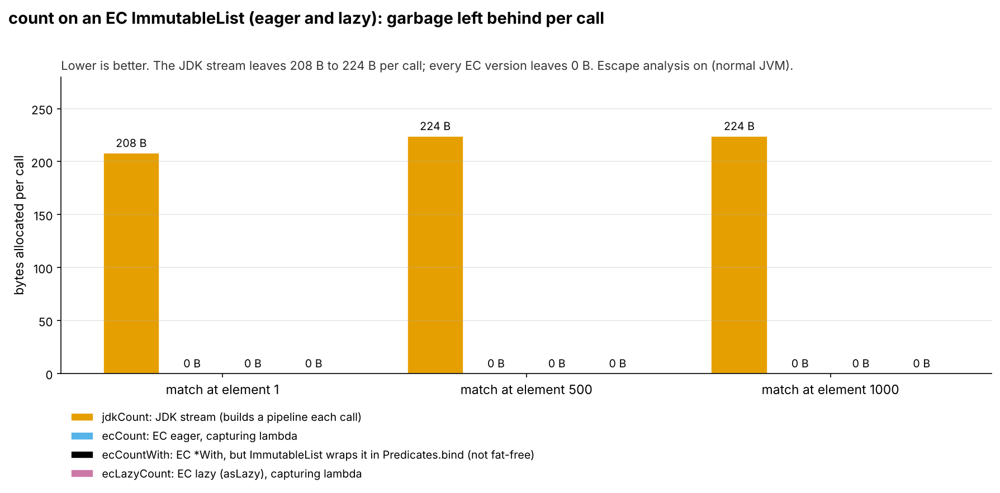
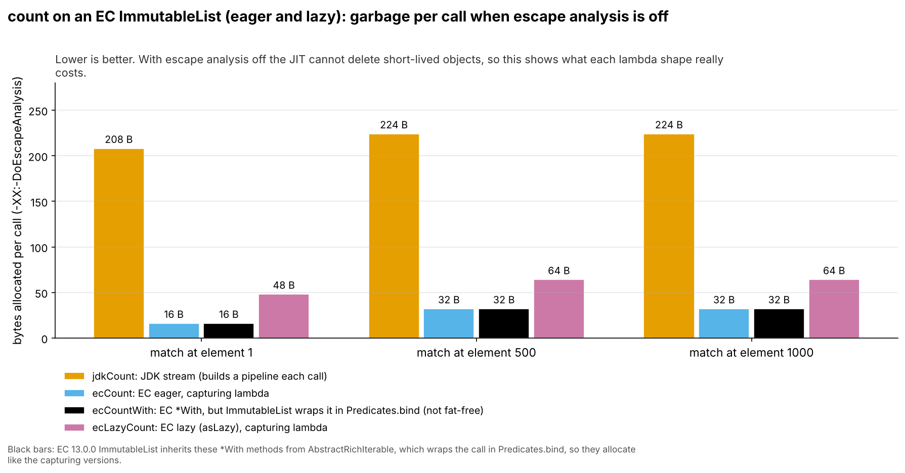
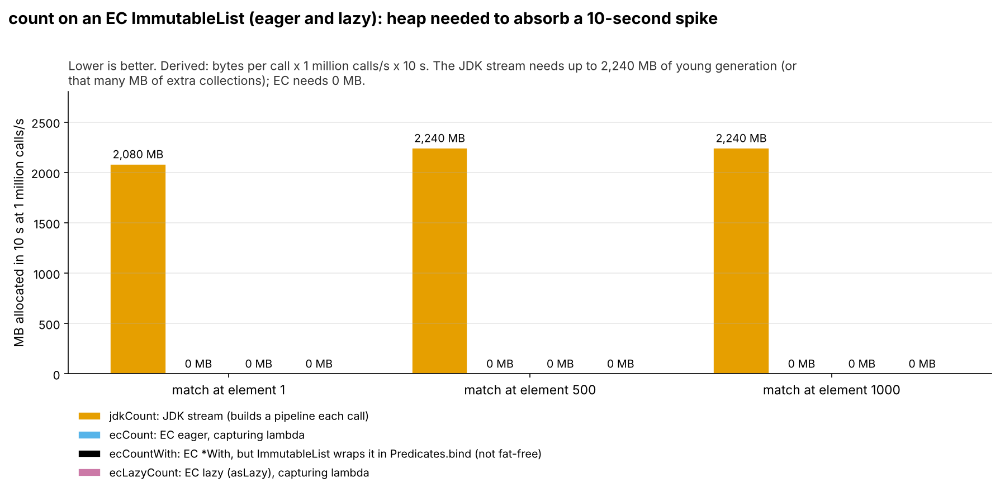
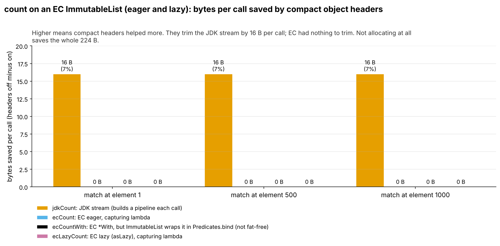

= CountEagerLazy: fat-free lambdas and garbage (run 20261015-0406)
:toc:
:toclevels: 2

Input: link:../runs/20261015-0406-CountEagerLazyResults2.adoc[20261015-0406-CountEagerLazyResults2.adoc]. Environment: Claude cloud sandbox (4 vCPU Intel Xeon KVM guest, OpenJDK 25.0.4), not the local Mac, so absolute timings will differ from a run on the Mac. Bytes and object counts do not depend on the machine.

== Summary

On an EC `ImmutableList`, `count`, `countWith` and `asLazy().count` all leave 0 bytes per call and trigger no GC. The JDK `stream().filter().count()` leaves 7 to 8 objects (208 to 224 B) per call. Count scans all 1000 elements, so time per call is flat; EC is about twice as fast.

== Head-to-head (compact headers on)

Throughput = 1000 ÷ ns per call. Calls measured = 40 s ÷ ns per call. Objects per call come from the object-count run; bytes per call from `gc.alloc.rate.norm`.

[cols="3,2,1,1,1,1,1,1",options="header"]
|===
|Implementation |Kind |Throughput (M calls/s) |Time per call (ns) |Objects per call |Bytes per call |GC runs per 1B calls |GC time per 1B calls (ms)
8+h|test = 1
|`jdkCount` |JDK stream |0.73 |1,379 ± 72.8 |7.00 |208 |138 |482
|`ecCount` |EC eager, capturing |1.46 |686 ± 28.0 |0 |≈0 |0 |0
|`ecCountWith` |EC fat-free (*With) |1.47 |678 ± 41.5 |0 |≈0 |0 |0
|`ecLazyCount` |EC lazy, capturing |1.48 |676 ± 38.0 |0 |≈0 |0 |0
8+a|`ecCount` vs JDK: 2.0x faster, 7.00 fewer objects and 208 fewer bytes per call, 0 vs 138 GC runs per billion calls +
`ecCountWith` vs JDK: 2.0x faster, 7.00 fewer objects and 208 fewer bytes per call, 0 vs 138 GC runs per billion calls +
`ecLazyCount` vs JDK: 2.0x faster, 7.00 fewer objects and 208 fewer bytes per call, 0 vs 138 GC runs per billion calls
8+h|test = 500
|`jdkCount` |JDK stream |0.72 |1,397 ± 61.3 |8.00 |224 |140 |524
|`ecCount` |EC eager, capturing |1.46 |686 ± 27.0 |0 |≈0 |0 |0
|`ecCountWith` |EC fat-free (*With) |1.44 |696 ± 42.7 |0 |≈0 |0 |0
|`ecLazyCount` |EC lazy, capturing |1.48 |674 ± 45.0 |0 |≈0 |0 |0
8+a|`ecCount` vs JDK: 2.0x faster, 8.00 fewer objects and 224 fewer bytes per call, 0 vs 140 GC runs per billion calls +
`ecCountWith` vs JDK: 2.0x faster, 8.00 fewer objects and 224 fewer bytes per call, 0 vs 140 GC runs per billion calls +
`ecLazyCount` vs JDK: 2.1x faster, 8.00 fewer objects and 224 fewer bytes per call, 0 vs 140 GC runs per billion calls
8+h|test = 1000
|`jdkCount` |JDK stream |0.73 |1,370 ± 83.1 |8.00 |224 |137 |514
|`ecCount` |EC eager, capturing |1.47 |680 ± 38.5 |0 |≈0 |0 |0
|`ecCountWith` |EC fat-free (*With) |1.48 |678 ± 56.9 |0 |≈0 |0 |0
|`ecLazyCount` |EC lazy, capturing |1.48 |675 ± 45.2 |0 |≈0 |0 |0
8+a|`ecCount` vs JDK: 2.0x faster, 8.00 fewer objects and 224 fewer bytes per call, 0 vs 137 GC runs per billion calls +
`ecCountWith` vs JDK: 2.0x faster, 8.00 fewer objects and 224 fewer bytes per call, 0 vs 137 GC runs per billion calls +
`ecLazyCount` vs JDK: 2.0x faster, 8.00 fewer objects and 224 fewer bytes per call, 0 vs 137 GC runs per billion calls
|===

.Speed relative to the JDK stream, compact headers on.

Mermaid source: link:charts/20261015-0406-CountEagerLazy-throughput.mmd[20261015-0406-CountEagerLazy-throughput.mmd]

.Garbage collections per billion calls, compact headers on.

Mermaid source: link:charts/20261015-0406-CountEagerLazy-gc-per-billion.mmd[20261015-0406-CountEagerLazy-gc-per-billion.mmd]

== Garbage: where it comes from

*JDK (measured).* Same 7 to 8 objects as in `CountUtility`: `ReferencePipeline$2`, `ReferencePipeline$Head`, `RandomAccessSpliterator`, `ReduceOps$CountingSink$OfRef`, `ReferencePipeline$2$1`, `ReduceOps$5`, the captured lambda, and the box at 500/1000.

*EC (measured).* Nothing at or above 0.5 objects per call.

=== Objects per call by class (object-count run, compact headers on)

....
jdkCount test=1: 7.00 objects, 208 B per call
      1.00 x java.util.stream.ReferencePipeline$2  (56 B)
      1.00 x java.util.stream.ReferencePipeline$Head  (48 B)
      1.00 x java.util.AbstractList$RandomAccessSpliterator  (32 B)
      1.00 x java.util.stream.ReduceOps$CountingSink$OfRef  (24 B)
      1.00 x java.util.stream.ReferencePipeline$2$1  (16 B)
      1.00 x conf.session.shakers.CountEagerLazyBenchmark$$Lambda  (16 B)
      1.00 x java.util.stream.ReduceOps$5  (16 B)
ecCount test=1: 0.00 objects, 0 B per call
ecCountWith test=1: 0.00 objects, 0 B per call
ecLazyCount test=1: 0.00 objects, 0 B per call
jdkCount test=500: 8.00 objects, 224 B per call
      1.00 x java.util.stream.ReferencePipeline$2  (56 B)
      1.00 x java.util.stream.ReferencePipeline$Head  (48 B)
      1.00 x java.util.AbstractList$RandomAccessSpliterator  (32 B)
      1.00 x java.util.stream.ReduceOps$CountingSink$OfRef  (24 B)
      1.00 x java.lang.Integer  (16 B)
      1.00 x java.util.stream.ReferencePipeline$2$1  (16 B)
      1.00 x java.util.stream.ReduceOps$5  (16 B)
      1.00 x conf.session.shakers.CountEagerLazyBenchmark$$Lambda  (16 B)
ecCount test=500: 0.00 objects, 0 B per call
ecCountWith test=500: 0.00 objects, 0 B per call
ecLazyCount test=500: 0.00 objects, 0 B per call
jdkCount test=1000: 8.00 objects, 224 B per call
      1.00 x java.util.stream.ReferencePipeline$2  (56 B)
      1.00 x java.util.stream.ReferencePipeline$Head  (48 B)
      1.00 x java.util.AbstractList$RandomAccessSpliterator  (32 B)
      1.00 x java.util.stream.ReduceOps$CountingSink$OfRef  (24 B)
      1.00 x java.lang.Integer  (16 B)
      1.00 x java.util.stream.ReferencePipeline$2$1  (16 B)
      1.00 x java.util.stream.ReduceOps$5  (16 B)
      1.00 x conf.session.shakers.CountEagerLazyBenchmark$$Lambda  (16 B)
ecCount test=1000: 0.00 objects, 0 B per call
ecCountWith test=1000: 0.00 objects, 0 B per call
ecLazyCount test=1000: 0.00 objects, 0 B per call
....

.Bytes allocated per call (gc.alloc.rate.norm), compact headers on.

Mermaid source: link:charts/20261015-0406-CountEagerLazy-bytes-per-call.mmd[20261015-0406-CountEagerLazy-bytes-per-call.mmd]

=== Escape analysis off (upper bound for lambda garbage)

Same benchmarks with `-XX:-DoEscapeAnalysis`. Real applications cannot count on escape analysis (megamorphic call sites, code that is not inlined), so this shows what each lambda shape costs when it does not help. It is an upper bound, not typical production behaviour.

[cols="3,2,1,1,1,1",options="header"]
|===
|Implementation |Kind |Bytes per call, EA on |Bytes per call, EA off |Time per call EA on (ns) |Time per call EA off (ns)
6+h|test = 1
|`jdkCount` |JDK stream |208 |208 |1,379 |1,475
|`ecCount` |EC eager, capturing |≈0 |16 |686 |719
|`ecCountWith` |EC fat-free (*With) |≈0 |16 |678 |705
|`ecLazyCount` |EC lazy, capturing |≈0 |48 |676 |838
6+h|test = 500
|`jdkCount` |JDK stream |224 |224 |1,397 |1,405
|`ecCount` |EC eager, capturing |≈0 |32 |686 |780
|`ecCountWith` |EC fat-free (*With) |≈0 |32 |696 |807
|`ecLazyCount` |EC lazy, capturing |≈0 |64 |674 |798
6+h|test = 1000
|`jdkCount` |JDK stream |224 |224 |1,370 |1,366
|`ecCount` |EC eager, capturing |≈0 |32 |680 |745
|`ecCountWith` |EC fat-free (*With) |≈0 |32 |678 |787
|`ecLazyCount` |EC lazy, capturing |≈0 |64 |675 |797
|===

With escape analysis off: `ecCount` 16 B / 32 B, `ecLazyCount` 48 B / 64 B, and `ecCountWith` **16 B / 32 B, the same as the capturing version**: `ImmutableArrayList.countWith` is inherited from `AbstractRichIterable` and allocates a `Predicates.bind` wrapper per call (EC 13.0.0 bytecode). `Iterate.countWith` (see `CountUtility`) does not.

.Bytes per call with -XX:-DoEscapeAnalysis: the upper bound for lambda garbage.

Mermaid source: link:charts/20261015-0406-CountEagerLazy-ea-off-bytes.mmd[20261015-0406-CountEagerLazy-ea-off-bytes.mmd]

== Spikes and heap headroom (derived, not measured)

Formulas: allocation rate (MB/s) = bytes per call × calls/s ÷ 10^6. Young collections per minute = allocation rate ÷ 512 MB (example young generation) × 60. Allocated during a 10 s spike = bytes per call × calls/s × 10 s: the young-generation space the spike needs, or the collections it causes when that space is not there. Loads are application-wide, across all threads.

[cols="3,1,1,1,1,1",options="header"]
|===
|Implementation |Bytes per call |MB/s at 1 M calls/s |MB/s at 10 M calls/s |Young GCs per minute at 10 M calls/s |MB allocated in a 10 s spike at 10 M calls/s
6+h|test = 1
|`jdkCount` |208 |208 |2,080 |244 |20,800
|`ecCount` |≈0 |≈0 |0.02 |≈0 |0.20
|`ecCountWith` |≈0 |≈0 |0.02 |≈0 |0.20
|`ecLazyCount` |≈0 |≈0 |0.02 |≈0 |0.20
6+h|test = 500
|`jdkCount` |224 |224 |2,240 |263 |22,400
|`ecCount` |≈0 |≈0 |0.02 |≈0 |0.20
|`ecCountWith` |≈0 |≈0 |0.02 |≈0 |0.20
|`ecLazyCount` |≈0 |≈0 |0.02 |≈0 |0.20
6+h|test = 1000
|`jdkCount` |224 |224 |2,240 |263 |22,400
|`ecCount` |≈0 |≈0 |0.02 |≈0 |0.20
|`ecCountWith` |≈0 |≈0 |0.02 |≈0 |0.20
|`ecLazyCount` |≈0 |≈0 |0.02 |≈0 |0.20
|===

JMH also reports `gc.alloc.rate` (MB/s), but that number scales with how fast the benchmark runs, so a faster method can show a higher MB/s while allocating the same per call. `gc.alloc.rate.norm` (bytes per call) is the number to size heaps with.

.Young-generation memory a 10 s spike at 1 million calls/s allocates (derived).

Mermaid source: link:charts/20261015-0406-CountEagerLazy-spike-headroom.mmd[20261015-0406-CountEagerLazy-spike-headroom.mmd]

== Compact object headers

[cols="3,1,1,1,1,1,1",options="header"]
|===
|Implementation |Bytes per call on |Bytes per call off |Saved |Objects per call on |Objects per call off |Time per call on / off (ns)
7+h|test = 1
|`jdkCount` |208 |224 |7% |7.00 |7.00 |1,379 / 1,193
|`ecCount` |≈0 |≈0 |n/a |0 |0 |686 / 525
|`ecCountWith` |≈0 |≈0 |n/a |0 |0 |678 / 564
|`ecLazyCount` |≈0 |≈0 |n/a |0 |0 |676 / 547
7+h|test = 500
|`jdkCount` |224 |240 |7% |8.00 |8.00 |1,397 / 1,395
|`ecCount` |≈0 |≈0 |n/a |0 |0 |686 / 542
|`ecCountWith` |≈0 |≈0 |n/a |0 |0 |696 / 641
|`ecLazyCount` |≈0 |≈0 |n/a |0 |0 |674 / 555
7+h|test = 1000
|`jdkCount` |224 |240 |7% |8.00 |8.00 |1,370 / 1,387
|`ecCount` |≈0 |≈0 |n/a |0 |0 |680 / 548
|`ecCountWith` |≈0 |≈0 |n/a |0 |0 |678 / 588
|`ecLazyCount` |≈0 |≈0 |n/a |0 |0 |675 / 564
|===

Bytes per call here are `gc.alloc.rate.norm` from the main runs. Where that is a few bytes below the object-count total, the JIT scalar-replaced one pipeline object in some forks; the object-count run (exact per-class counts) is the reference for what each call allocates.

JDK garbage: 208 B vs 224 B (test = 1) and 224 B vs 240 B (500/1000) with and without compact headers, about 7% saved. EC: nothing to save. EC loops were 8 to 21% faster with compact headers off (*inferred:* class-pointer decoding).

.Bytes per call saved by -XX:+UseCompactObjectHeaders (off minus on).

Mermaid source: link:charts/20261015-0406-CountEagerLazy-coh-bytes.mmd[20261015-0406-CountEagerLazy-coh-bytes.mmd]

== Supporting analysis

*Eager vs lazy.* No difference with escape analysis on. With it off, `asLazy().count` allocates 32 B more than eager `count`.

=== Raw GC totals (compact headers on, per 40 s measurement)

Raw totals are shown for completeness only. Do not compare them across implementations: a faster method fits more calls into the same 40 s.

[cols="3,1,1,1,1",options="header"]
|===
|Implementation |test |calls measured |gc.count |gc.time (ms)
|`jdkCount` |1 |2.9e+07 |4.00 |14.0
|`ecCount` |1 |5.83e+07 |0 |0
|`ecCountWith` |1 |5.9e+07 |0 |0
|`ecLazyCount` |1 |5.91e+07 |0 |0
|`jdkCount` |500 |2.86e+07 |4.00 |15.0
|`ecCount` |500 |5.83e+07 |0 |0
|`ecCountWith` |500 |5.75e+07 |0 |0
|`ecLazyCount` |500 |5.94e+07 |0 |0
|`jdkCount` |1000 |2.92e+07 |4.00 |15.0
|`ecCount` |1000 |5.89e+07 |0 |0
|`ecCountWith` |1000 |5.9e+07 |0 |0
|`ecLazyCount` |1000 |5.92e+07 |0 |0
|===

== Caveats

One machine (a cloud VM, not dedicated hardware), one JDK build (OpenJDK 25.0.4 from Ubuntu), G1 with a fixed 2 GB heap. Microbenchmarks, not an application. Mechanisms are read from the class histograms where shown; anything else is labelled inferred.

== Reproduce

Run folder: `assets/runs/20261015-0406/`. Results: `assets/runs/20261015-0406-CountEagerLazyResults2.adoc`.

....
mvn -f pom-bench.xml clean compile
mvn -f pom-bench.xml package
# main runs, CONFIG/FLAGS = coh-on: -XX:+UseCompactObjectHeaders | coh-off: -XX:-UseCompactObjectHeaders
#                          ea-off: -XX:+UseCompactObjectHeaders -XX:-DoEscapeAnalysis
java -jar target-bench/microbenchmarks.jar "conf\.session\.shakers\.CountEagerLazyBenchmark\." \
  -prof gc -jvmArgsAppend "-XX:+UseG1GC -Xms2g -Xmx2g ${FLAGS}" \
  -rf text -rff assets/runs/20261015-0406/CountEagerLazy-${CONFIG}.txt -o assets/runs/20261015-0406/CountEagerLazy-${CONFIG}.log
# object counts, COH = -XX:+UseCompactObjectHeaders | -XX:-UseCompactObjectHeaders
java -jar target-bench/microbenchmarks.jar "conf\.session\.shakers\." -f 1 -wi 5 -w 1s -i 3 -r 100ms \
  -jvmArgs "-XX:+UseParallelGC -Xms12g -Xmx12g -Xmn10g ${COH}" -prof prof.HistoProfiler -prof gc \
  -rf text -rff assets/runs/20261015-0406/all-${CONFIG}.txt -o assets/runs/20261015-0406/all-${CONFIG}.log
# HISTO lines go to the console, not to the -o file; they were saved to assets/runs/20261015-0406/all-${CONFIG}.histo
....
