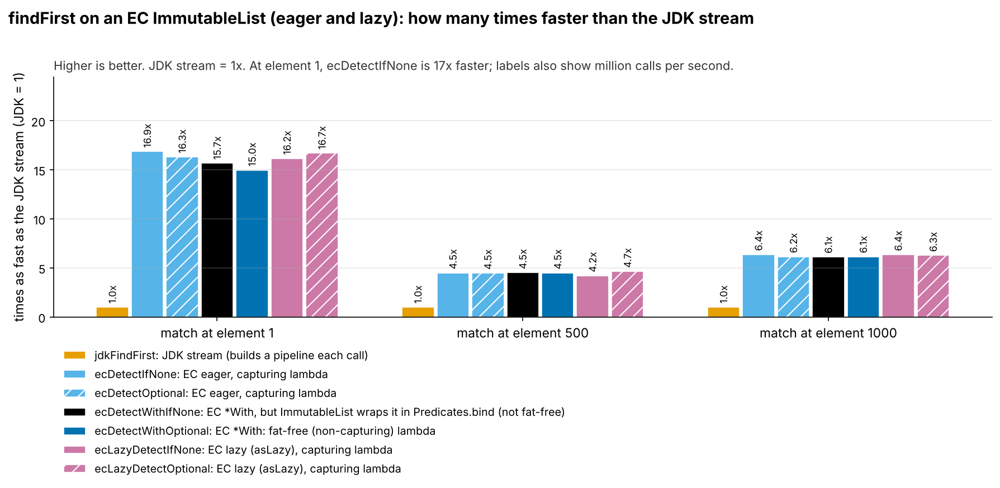
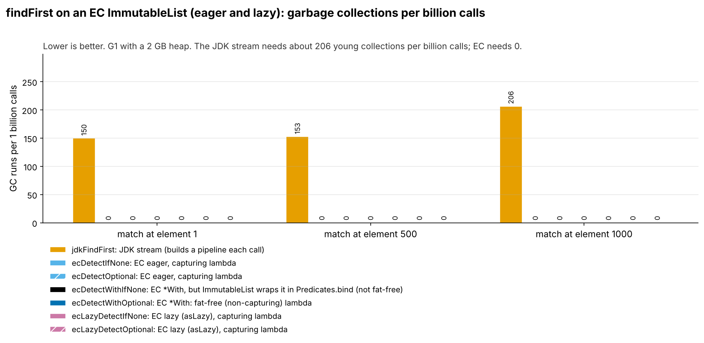
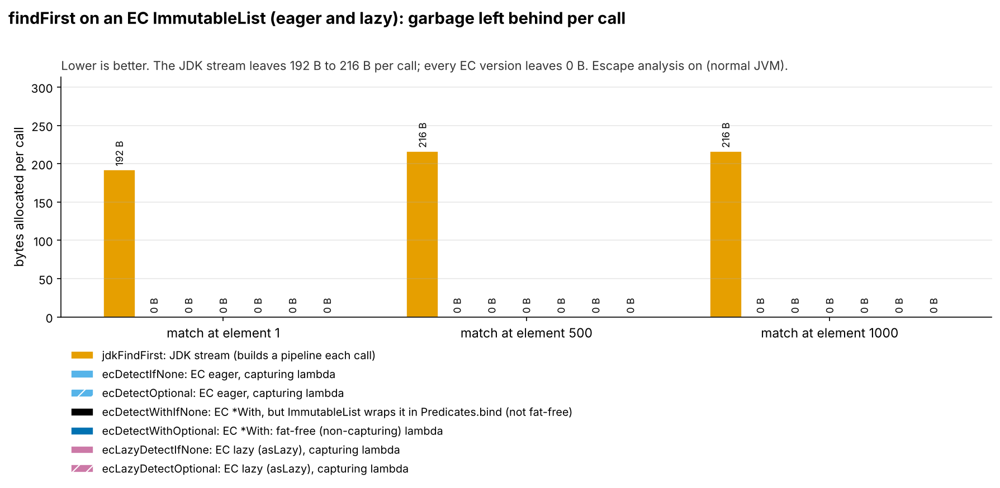
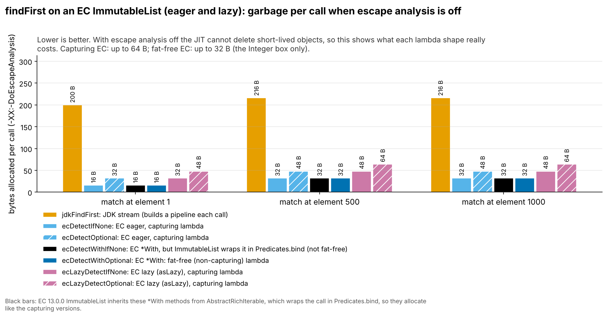
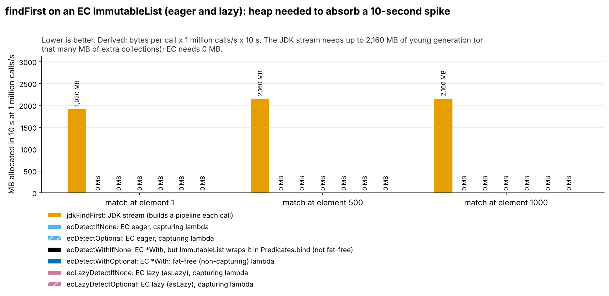
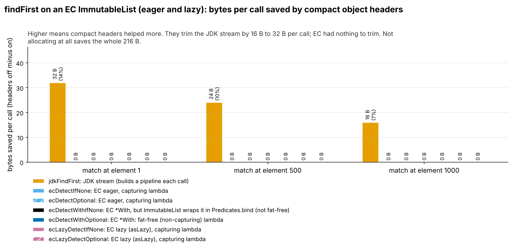

= FindFirstEagerLazy: fat-free lambdas and garbage (run 20261015-0406)
:toc:
:toclevels: 2

Input: link:../runs/20261015-0406-FindFirstEagerLazyResults2.adoc[20261015-0406-FindFirstEagerLazyResults2.adoc]. Environment: Claude cloud sandbox (4 vCPU Intel Xeon KVM guest, OpenJDK 25.0.4), not the local Mac, so absolute timings will differ from a run on the Mac. Bytes and object counts do not depend on the machine.

== Summary

On an EC `ImmutableList`, all six EC variants (`detectOptional`, `detectWithOptional`, `detectIfNone`, `detectWithIfNone`, and the lazy `detectOptional` / `detectIfNone`) leave 0 bytes per call and trigger no GC. The JDK `stream().filter().findFirst()` leaves 7 to 8 objects (192 to 216 B) per call.

== Head-to-head (compact headers on)

Throughput = 1000 ÷ ns per call. Calls measured = 40 s ÷ ns per call. Objects per call come from the object-count run; bytes per call from `gc.alloc.rate.norm`.

[cols="3,2,1,1,1,1,1,1",options="header"]
|===
|Implementation |Kind |Throughput (M calls/s) |Time per call (ns) |Objects per call |Bytes per call |GC runs per 1B calls |GC time per 1B calls (ms)
8+h|test = 1
|`jdkFindFirst` |JDK stream |26.5 |37.7 ± 2.03 |7.00 |192 |150 |347
|`ecDetectIfNone` |EC eager, capturing |447 |2.24 ± 0.16 |0 |≈0 |0 |0
|`ecDetectOptional` |EC eager, capturing |433 |2.31 ± 0.14 |0 |≈0 |0 |0
|`ecDetectWithIfNone` |EC fat-free (*With) |415 |2.41 ± 0.16 |0 |≈0 |0 |0
|`ecDetectWithOptional` |EC fat-free (*With) |397 |2.52 ± 0.27 |0 |≈0 |0 |0
|`ecLazyDetectIfNone` |EC lazy, capturing |428 |2.33 ± 0.18 |0 |≈0 |0 |0
|`ecLazyDetectOptional` |EC lazy, capturing |443 |2.26 ± 0.10 |0 |≈0 |0 |0
8+a|`ecDetectIfNone` vs JDK: 16.9x faster, 7.00 fewer objects and 192 fewer bytes per call, 0 vs 150 GC runs per billion calls +
`ecDetectOptional` vs JDK: 16.3x faster, 7.00 fewer objects and 192 fewer bytes per call, 0 vs 150 GC runs per billion calls +
`ecDetectWithIfNone` vs JDK: 15.7x faster, 7.00 fewer objects and 192 fewer bytes per call, 0 vs 150 GC runs per billion calls +
`ecDetectWithOptional` vs JDK: 15.0x faster, 7.00 fewer objects and 192 fewer bytes per call, 0 vs 150 GC runs per billion calls +
`ecLazyDetectIfNone` vs JDK: 16.2x faster, 7.00 fewer objects and 192 fewer bytes per call, 0 vs 150 GC runs per billion calls +
`ecLazyDetectOptional` vs JDK: 16.7x faster, 7.00 fewer objects and 192 fewer bytes per call, 0 vs 150 GC runs per billion calls
8+h|test = 500
|`jdkFindFirst` |JDK stream |0.65 |1,527 ± 131 |8.00 |216 |153 |573
|`ecDetectIfNone` |EC eager, capturing |2.95 |339 ± 14.3 |0 |≈0 |0 |0
|`ecDetectOptional` |EC eager, capturing |2.92 |342 ± 16.5 |0 |≈0 |0 |0
|`ecDetectWithIfNone` |EC fat-free (*With) |2.96 |338 ± 20.5 |0 |≈0 |0 |0
|`ecDetectWithOptional` |EC fat-free (*With) |2.94 |340 ± 22.8 |0 |≈0 |0 |0
|`ecLazyDetectIfNone` |EC lazy, capturing |2.75 |364 ± 24.6 |0 |≈0 |0 |0
|`ecLazyDetectOptional` |EC lazy, capturing |3.05 |328 ± 12.3 |0 |≈0 |0 |0
8+a|`ecDetectIfNone` vs JDK: 4.5x faster, 8.00 fewer objects and 216 fewer bytes per call, 0 vs 153 GC runs per billion calls +
`ecDetectOptional` vs JDK: 4.5x faster, 8.00 fewer objects and 216 fewer bytes per call, 0 vs 153 GC runs per billion calls +
`ecDetectWithIfNone` vs JDK: 4.5x faster, 8.00 fewer objects and 216 fewer bytes per call, 0 vs 153 GC runs per billion calls +
`ecDetectWithOptional` vs JDK: 4.5x faster, 8.00 fewer objects and 216 fewer bytes per call, 0 vs 153 GC runs per billion calls +
`ecLazyDetectIfNone` vs JDK: 4.2x faster, 8.00 fewer objects and 216 fewer bytes per call, 0 vs 153 GC runs per billion calls +
`ecLazyDetectOptional` vs JDK: 4.7x faster, 8.00 fewer objects and 216 fewer bytes per call, 0 vs 153 GC runs per billion calls
8+h|test = 1000
|`jdkFindFirst` |JDK stream |0.24 |4,126 ± 729 |8.00 |216 |206 |1,238
|`ecDetectIfNone` |EC eager, capturing |1.55 |647 ± 25.1 |0 |≈0 |0 |0
|`ecDetectOptional` |EC eager, capturing |1.49 |671 ± 32.0 |0 |≈0 |0 |0
|`ecDetectWithIfNone` |EC fat-free (*With) |1.48 |675 ± 26.3 |0 |≈0 |0 |0
|`ecDetectWithOptional` |EC fat-free (*With) |1.49 |672 ± 48.5 |0 |≈0 |0 |0
|`ecLazyDetectIfNone` |EC lazy, capturing |1.54 |649 ± 25.2 |0 |≈0 |0 |0
|`ecLazyDetectOptional` |EC lazy, capturing |1.52 |657 ± 50.5 |0 |≈0 |0 |0
8+a|`ecDetectIfNone` vs JDK: 6.4x faster, 8.00 fewer objects and 216 fewer bytes per call, 0 vs 206 GC runs per billion calls +
`ecDetectOptional` vs JDK: 6.2x faster, 8.00 fewer objects and 216 fewer bytes per call, 0 vs 206 GC runs per billion calls +
`ecDetectWithIfNone` vs JDK: 6.1x faster, 8.00 fewer objects and 216 fewer bytes per call, 0 vs 206 GC runs per billion calls +
`ecDetectWithOptional` vs JDK: 6.1x faster, 8.00 fewer objects and 216 fewer bytes per call, 0 vs 206 GC runs per billion calls +
`ecLazyDetectIfNone` vs JDK: 6.4x faster, 8.00 fewer objects and 216 fewer bytes per call, 0 vs 206 GC runs per billion calls +
`ecLazyDetectOptional` vs JDK: 6.3x faster, 8.00 fewer objects and 216 fewer bytes per call, 0 vs 206 GC runs per billion calls
|===

.Speed relative to the JDK stream, compact headers on.

Mermaid source: link:charts/20261015-0406-FindFirstEagerLazy-throughput.mmd[20261015-0406-FindFirstEagerLazy-throughput.mmd]

.Garbage collections per billion calls, compact headers on.

Mermaid source: link:charts/20261015-0406-FindFirstEagerLazy-gc-per-billion.mmd[20261015-0406-FindFirstEagerLazy-gc-per-billion.mmd]

== Garbage: where it comes from

*JDK (measured).* Same objects as in `FindFirstUtility`, including the `Optional` that escapes through the pipeline.

*EC (measured).* Nothing at or above 0.5 objects per call; the `Optional` returned by `detectOptional` is removed by escape analysis.

=== Objects per call by class (object-count run, compact headers on)

....
jdkFindFirst test=1: 7.00 objects, 200 B per call
      1.00 x java.util.stream.ReferencePipeline$2  (56 B)
      1.00 x java.util.stream.ReferencePipeline$Head  (48 B)
      1.00 x java.util.AbstractList$RandomAccessSpliterator  (32 B)
      1.00 x java.util.stream.ReferencePipeline$2$1  (16 B)
      1.00 x java.util.stream.FindOps$FindSink$OfRef  (16 B)
      1.00 x conf.session.shakers.FindFirstEagerLazyBenchmark$$Lambda  (16 B)
      1.00 x java.util.Optional  (16 B)
ecDetectIfNone test=1: 0.00 objects, 0 B per call
ecDetectOptional test=1: 0.00 objects, 0 B per call
ecDetectWithIfNone test=1: 0.00 objects, 0 B per call
ecDetectWithOptional test=1: 0.00 objects, 0 B per call
ecLazyDetectIfNone test=1: 0.00 objects, 0 B per call
ecLazyDetectOptional test=1: 0.00 objects, 0 B per call
jdkFindFirst test=500: 8.00 objects, 216 B per call
      1.00 x java.util.stream.ReferencePipeline$2  (56 B)
      1.00 x java.util.stream.ReferencePipeline$Head  (48 B)
      1.00 x java.util.AbstractList$RandomAccessSpliterator  (32 B)
      1.00 x java.lang.Integer  (16 B)
      1.00 x conf.session.shakers.FindFirstEagerLazyBenchmark$$Lambda  (16 B)
      1.00 x java.util.stream.ReferencePipeline$2$1  (16 B)
      1.00 x java.util.stream.FindOps$FindSink$OfRef  (16 B)
      1.00 x java.util.Optional  (16 B)
ecDetectIfNone test=500: 0.00 objects, 0 B per call
ecDetectOptional test=500: 0.00 objects, 0 B per call
ecDetectWithIfNone test=500: 0.00 objects, 0 B per call
ecDetectWithOptional test=500: 0.00 objects, 0 B per call
ecLazyDetectIfNone test=500: 0.00 objects, 0 B per call
ecLazyDetectOptional test=500: 0.00 objects, 0 B per call
jdkFindFirst test=1000: 8.00 objects, 216 B per call
      1.00 x java.util.stream.ReferencePipeline$2  (56 B)
      1.00 x java.util.stream.ReferencePipeline$Head  (48 B)
      1.00 x java.util.AbstractList$RandomAccessSpliterator  (32 B)
      1.00 x java.lang.Integer  (16 B)
      1.00 x java.util.stream.ReferencePipeline$2$1  (16 B)
      1.00 x conf.session.shakers.FindFirstEagerLazyBenchmark$$Lambda  (16 B)
      1.00 x java.util.stream.FindOps$FindSink$OfRef  (16 B)
      1.00 x java.util.Optional  (16 B)
ecDetectIfNone test=1000: 0.00 objects, 0 B per call
ecDetectOptional test=1000: 0.00 objects, 0 B per call
ecDetectWithIfNone test=1000: 0.00 objects, 0 B per call
ecDetectWithOptional test=1000: 0.00 objects, 0 B per call
ecLazyDetectIfNone test=1000: 0.00 objects, 0 B per call
ecLazyDetectOptional test=1000: 0.00 objects, 0 B per call
....

.Bytes allocated per call (gc.alloc.rate.norm), compact headers on.

Mermaid source: link:charts/20261015-0406-FindFirstEagerLazy-bytes-per-call.mmd[20261015-0406-FindFirstEagerLazy-bytes-per-call.mmd]

=== Escape analysis off (upper bound for lambda garbage)

Same benchmarks with `-XX:-DoEscapeAnalysis`. Real applications cannot count on escape analysis (megamorphic call sites, code that is not inlined), so this shows what each lambda shape costs when it does not help. It is an upper bound, not typical production behaviour.

[cols="3,2,1,1,1,1",options="header"]
|===
|Implementation |Kind |Bytes per call, EA on |Bytes per call, EA off |Time per call EA on (ns) |Time per call EA off (ns)
6+h|test = 1
|`jdkFindFirst` |JDK stream |192 |200 |37.7 |39.0
|`ecDetectIfNone` |EC eager, capturing |≈0 |16 |2.24 |3.71
|`ecDetectOptional` |EC eager, capturing |≈0 |32 |2.31 |8.83
|`ecDetectWithIfNone` |EC fat-free (*With) |≈0 |16 |2.41 |4.01
|`ecDetectWithOptional` |EC fat-free (*With) |≈0 |16 |2.52 |4.08
|`ecLazyDetectIfNone` |EC lazy, capturing |≈0 |32 |2.33 |6.82
|`ecLazyDetectOptional` |EC lazy, capturing |≈0 |48 |2.26 |13.2
6+h|test = 500
|`jdkFindFirst` |JDK stream |216 |216 |1,527 |1,560
|`ecDetectIfNone` |EC eager, capturing |≈0 |32 |339 |383
|`ecDetectOptional` |EC eager, capturing |≈0 |48 |342 |358
|`ecDetectWithIfNone` |EC fat-free (*With) |≈0 |32 |338 |360
|`ecDetectWithOptional` |EC fat-free (*With) |≈0 |32 |340 |374
|`ecLazyDetectIfNone` |EC lazy, capturing |≈0 |48 |364 |355
|`ecLazyDetectOptional` |EC lazy, capturing |≈0 |64 |328 |343
6+h|test = 1000
|`jdkFindFirst` |JDK stream |216 |216 |4,126 |3,750
|`ecDetectIfNone` |EC eager, capturing |≈0 |32 |647 |768
|`ecDetectOptional` |EC eager, capturing |≈0 |48 |671 |797
|`ecDetectWithIfNone` |EC fat-free (*With) |≈0 |32 |675 |760
|`ecDetectWithOptional` |EC fat-free (*With) |≈0 |32 |672 |748
|`ecLazyDetectIfNone` |EC lazy, capturing |≈0 |48 |649 |776
|`ecLazyDetectOptional` |EC lazy, capturing |≈0 |64 |657 |742
|===

With escape analysis off: `ecDetectIfNone` 16 B / 32 B; `ecDetectWithIfNone` **16 B / 32 B, the same as the capturing version** (inherited from `AbstractRichIterable`, allocates a `Predicates.bind` wrapper); `ecDetectOptional` 32 B / 48 B; `ecDetectWithOptional` 16 B / 32 B (overridden in `ImmutableArrayList`, so only the `Optional` plus the box); `ecLazyDetectIfNone` 32 B / 48 B; `ecLazyDetectOptional` 48 B / 64 B. So on an `ImmutableList` only `detectWithOptional` is genuinely fat-free in EC 13.0.0.

.Bytes per call with -XX:-DoEscapeAnalysis: the upper bound for lambda garbage.

Mermaid source: link:charts/20261015-0406-FindFirstEagerLazy-ea-off-bytes.mmd[20261015-0406-FindFirstEagerLazy-ea-off-bytes.mmd]

== Spikes and heap headroom (derived, not measured)

Formulas: allocation rate (MB/s) = bytes per call × calls/s ÷ 10^6. Young collections per minute = allocation rate ÷ 512 MB (example young generation) × 60. Allocated during a 10 s spike = bytes per call × calls/s × 10 s: the young-generation space the spike needs, or the collections it causes when that space is not there. Loads are application-wide, across all threads.

[cols="3,1,1,1,1,1",options="header"]
|===
|Implementation |Bytes per call |MB/s at 1 M calls/s |MB/s at 10 M calls/s |Young GCs per minute at 10 M calls/s |MB allocated in a 10 s spike at 10 M calls/s
6+h|test = 1
|`jdkFindFirst` |192 |192 |1,920 |225 |19,200
|`ecDetectIfNone` |≈0 |0 |0 |0 |0
|`ecDetectOptional` |≈0 |0 |0 |0 |0
|`ecDetectWithIfNone` |≈0 |0 |0 |0 |0
|`ecDetectWithOptional` |≈0 |0 |0 |0 |0
|`ecLazyDetectIfNone` |≈0 |0 |0 |0 |0
|`ecLazyDetectOptional` |≈0 |0 |0 |0 |0
6+h|test = 500
|`jdkFindFirst` |216 |216 |2,160 |253 |21,600
|`ecDetectIfNone` |≈0 |≈0 |0.01 |≈0 |0.10
|`ecDetectOptional` |≈0 |≈0 |0.01 |≈0 |0.10
|`ecDetectWithIfNone` |≈0 |≈0 |0.01 |≈0 |0.10
|`ecDetectWithOptional` |≈0 |≈0 |0.01 |≈0 |0.10
|`ecLazyDetectIfNone` |≈0 |≈0 |0.01 |≈0 |0.10
|`ecLazyDetectOptional` |≈0 |≈0 |0.01 |≈0 |0.10
6+h|test = 1000
|`jdkFindFirst` |216 |216 |2,160 |253 |21,601
|`ecDetectIfNone` |≈0 |≈0 |0.02 |≈0 |0.20
|`ecDetectOptional` |≈0 |≈0 |0.02 |≈0 |0.20
|`ecDetectWithIfNone` |≈0 |≈0 |0.02 |≈0 |0.20
|`ecDetectWithOptional` |≈0 |≈0 |0.02 |≈0 |0.20
|`ecLazyDetectIfNone` |≈0 |≈0 |0.02 |≈0 |0.20
|`ecLazyDetectOptional` |≈0 |≈0 |0.02 |≈0 |0.20
|===

JMH also reports `gc.alloc.rate` (MB/s), but that number scales with how fast the benchmark runs, so a faster method can show a higher MB/s while allocating the same per call. `gc.alloc.rate.norm` (bytes per call) is the number to size heaps with.

.Young-generation memory a 10 s spike at 1 million calls/s allocates (derived).

Mermaid source: link:charts/20261015-0406-FindFirstEagerLazy-spike-headroom.mmd[20261015-0406-FindFirstEagerLazy-spike-headroom.mmd]

== Compact object headers

[cols="3,1,1,1,1,1,1",options="header"]
|===
|Implementation |Bytes per call on |Bytes per call off |Saved |Objects per call on |Objects per call off |Time per call on / off (ns)
7+h|test = 1
|`jdkFindFirst` |192 |224 |14% |7.00 |7.00 |37.7 / 39.0
|`ecDetectIfNone` |≈0 |≈0 |n/a |0 |0 |2.24 / 2.41
|`ecDetectOptional` |≈0 |≈0 |n/a |0 |0 |2.31 / 2.05
|`ecDetectWithIfNone` |≈0 |≈0 |n/a |0 |0 |2.41 / 2.28
|`ecDetectWithOptional` |≈0 |≈0 |n/a |0 |0 |2.52 / 2.20
|`ecLazyDetectIfNone` |≈0 |≈0 |n/a |0 |0 |2.33 / 2.22
|`ecLazyDetectOptional` |≈0 |≈0 |n/a |0 |0 |2.26 / 2.33
7+h|test = 500
|`jdkFindFirst` |216 |240 |10% |8.00 |8.00 |1,527 / 1,260
|`ecDetectIfNone` |≈0 |≈0 |n/a |0 |0 |339 / 292
|`ecDetectOptional` |≈0 |≈0 |n/a |0 |0 |342 / 265
|`ecDetectWithIfNone` |≈0 |≈0 |n/a |0 |0 |338 / 269
|`ecDetectWithOptional` |≈0 |≈0 |n/a |0 |0 |340 / 265
|`ecLazyDetectIfNone` |≈0 |≈0 |n/a |0 |0 |364 / 272
|`ecLazyDetectOptional` |≈0 |≈0 |n/a |0 |0 |328 / 276
7+h|test = 1000
|`jdkFindFirst` |216 |232 |7% |8.00 |8.00 |4,126 / 2,752
|`ecDetectIfNone` |≈0 |≈0 |n/a |0 |0 |647 / 543
|`ecDetectOptional` |≈0 |≈0 |n/a |0 |0 |671 / 539
|`ecDetectWithIfNone` |≈0 |≈0 |n/a |0 |0 |675 / 509
|`ecDetectWithOptional` |≈0 |≈0 |n/a |0 |0 |672 / 509
|`ecLazyDetectIfNone` |≈0 |≈0 |n/a |0 |0 |649 / 508
|`ecLazyDetectOptional` |≈0 |≈0 |n/a |0 |0 |657 / 530
|===

Bytes per call here are `gc.alloc.rate.norm` from the main runs. Where that is a few bytes below the object-count total, the JIT scalar-replaced one pipeline object in some forks; the object-count run (exact per-class counts) is the reference for what each call allocates.

JDK garbage: 192 to 200 B vs 224 B (test = 1) and 216 B vs 232 to 240 B (500/1000), about 10% saved. EC: nothing to save. EC loops were 14 to 25% faster (at `test = 500/1000`) with compact headers off (*inferred:* class-pointer decoding).

.Bytes per call saved by -XX:+UseCompactObjectHeaders (off minus on).

Mermaid source: link:charts/20261015-0406-FindFirstEagerLazy-coh-bytes.mmd[20261015-0406-FindFirstEagerLazy-coh-bytes.mmd]

== Supporting analysis

*Eager vs lazy.* No difference with escape analysis on. With it off, each lazy variant adds one 16 B adapter.

=== Raw GC totals (compact headers on, per 40 s measurement)

Raw totals are shown for completeness only. Do not compare them across implementations: a faster method fits more calls into the same 40 s.

[cols="3,1,1,1,1",options="header"]
|===
|Implementation |test |calls measured |gc.count |gc.time (ms)
|`jdkFindFirst` |1 |1.06e+09 |159 |368
|`ecDetectIfNone` |1 |1.79e+10 |0 |0
|`ecDetectOptional` |1 |1.73e+10 |0 |0
|`ecDetectWithIfNone` |1 |1.66e+10 |0 |0
|`ecDetectWithOptional` |1 |1.59e+10 |0 |0
|`ecLazyDetectIfNone` |1 |1.71e+10 |0 |0
|`ecLazyDetectOptional` |1 |1.77e+10 |0 |0
|`jdkFindFirst` |500 |2.62e+07 |4.00 |15.0
|`ecDetectIfNone` |500 |1.18e+08 |0 |0
|`ecDetectOptional` |500 |1.17e+08 |0 |0
|`ecDetectWithIfNone` |500 |1.18e+08 |0 |0
|`ecDetectWithOptional` |500 |1.18e+08 |0 |0
|`ecLazyDetectIfNone` |500 |1.1e+08 |0 |0
|`ecLazyDetectOptional` |500 |1.22e+08 |0 |0
|`jdkFindFirst` |1000 |9.69e+06 |2.00 |12.0
|`ecDetectIfNone` |1000 |6.18e+07 |0 |0
|`ecDetectOptional` |1000 |5.96e+07 |0 |0
|`ecDetectWithIfNone` |1000 |5.93e+07 |0 |0
|`ecDetectWithOptional` |1000 |5.96e+07 |0 |0
|`ecLazyDetectIfNone` |1000 |6.17e+07 |0 |0
|`ecLazyDetectOptional` |1000 |6.09e+07 |0 |0
|===

== Caveats

One machine (a cloud VM, not dedicated hardware), one JDK build (OpenJDK 25.0.4 from Ubuntu), G1 with a fixed 2 GB heap. Microbenchmarks, not an application. Mechanisms are read from the class histograms where shown; anything else is labelled inferred.

== Reproduce

Run folder: `assets/runs/20261015-0406/`. Results: `assets/runs/20261015-0406-FindFirstEagerLazyResults2.adoc`.

....
mvn -f pom-bench.xml clean compile
mvn -f pom-bench.xml package
# main runs, CONFIG/FLAGS = coh-on: -XX:+UseCompactObjectHeaders | coh-off: -XX:-UseCompactObjectHeaders
#                          ea-off: -XX:+UseCompactObjectHeaders -XX:-DoEscapeAnalysis
java -jar target-bench/microbenchmarks.jar "conf\.session\.shakers\.FindFirstEagerLazyBenchmark\." \
  -prof gc -jvmArgsAppend "-XX:+UseG1GC -Xms2g -Xmx2g ${FLAGS}" \
  -rf text -rff assets/runs/20261015-0406/FindFirstEagerLazy-${CONFIG}.txt -o assets/runs/20261015-0406/FindFirstEagerLazy-${CONFIG}.log
# object counts, COH = -XX:+UseCompactObjectHeaders | -XX:-UseCompactObjectHeaders
java -jar target-bench/microbenchmarks.jar "conf\.session\.shakers\." -f 1 -wi 5 -w 1s -i 3 -r 100ms \
  -jvmArgs "-XX:+UseParallelGC -Xms12g -Xmx12g -Xmn10g ${COH}" -prof prof.HistoProfiler -prof gc \
  -rf text -rff assets/runs/20261015-0406/all-${CONFIG}.txt -o assets/runs/20261015-0406/all-${CONFIG}.log
# HISTO lines go to the console, not to the -o file; they were saved to assets/runs/20261015-0406/all-${CONFIG}.histo
....
