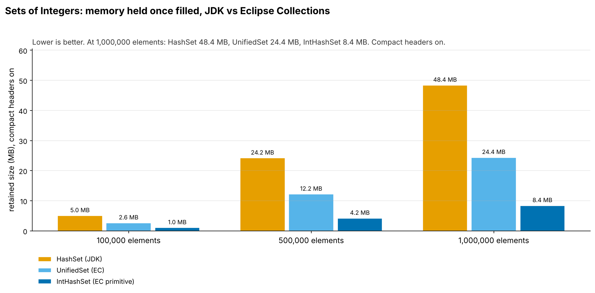
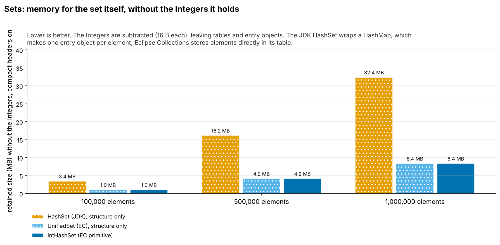
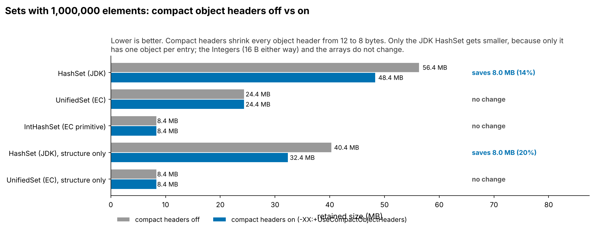

= Sets: JDK HashSet vs EC UnifiedSet and IntHashSet (JOL baselines 20261015-1503)
:toc:
:toclevels: 2

`SetMemoryTest` fills each set with the `Integer`s (or `int`s) 1 to n, for n = 100,000 to 1,000,000. The "structure only" rows subtract 16 B per `Integer`, leaving the set's own tables and entry objects. Sizes are JOL retained sizes (`GraphLayout.parseInstance(x).totalSize()`): every object reachable from the collection, measured once it is filled. They show memory *footprint*, not what building the collection allocated along the way, and not speed. Environment: Run 2026-10-15 in the Claude cloud sandbox, not the local Mac. JOL retained sizes do not depend on the machine. (openjdk version "25.0.4.1" 2026-08-18). JOL sizes depend on the JVM layout (compressed references, object alignment, header size), not the machine. The results files `src/test/java/conf/session/movers/SetMemoryResults-coh-off.md` and `SetMemoryResults-coh-on.md` start with the JDK, JOL and Eclipse Collections versions and the full JVM details.

== Summary

* *The JDK `HashSet` holds twice as much as `UnifiedSet`:* 48.4 MB against 24.4 MB at 1,000,000 `Integer`s. `IntHashSet` holds 8.4 MB, about 6x less than `HashSet`.
* *Without the `Integer`s the gap is 4x:* `HashSet` itself takes 32.4 MB, `UnifiedSet` 8.4 MB. `HashSet` is a `HashMap` that makes a `HashMap$Node` per element (24 B with compact headers, 32 B without) next to its table; `UnifiedSet` puts the element straight into its table (derived: 1,000,000 × 24 B + 2^21 slots × 4 B ≈ 32.4 MB).
* *`IntHashSet` is the same size as `UnifiedSet` without its `Integer`s* (8.4 MB): an `int[]` instead of an `Object[]` of the same length, and no boxes.
* *Compact headers save 8.0 MB on `HashSet`* (one 8 B saving per node) and nothing on the EC sets, which have no per-element objects besides the `Integer`s.
* *The tables double at different sizes:* `HashSet` and `UnifiedSet` at 200k, 400k and 800k elements, `IntHashSet` at 200k, 300k and 600k, so it keeps more empty slots (a lower load factor, inferred from the steps).

== Memory held once filled

.Retained size of each set, compact headers on

Mermaid source: link:mermaid/20261015-1503-SetMemory-footprint.mmd[20261015-1503-SetMemory-footprint.mmd]

== The structure alone

.Retained size without the Integers, compact headers on

Mermaid source: link:mermaid/20261015-1503-SetMemory-structure-only.mmd[20261015-1503-SetMemory-structure-only.mmd]

== Compact headers off vs on

.Retained size at 1,000,000 elements, compact headers off vs on

Mermaid source: link:mermaid/20261015-1503-SetMemory-coh.mmd[20261015-1503-SetMemory-coh.mmd]

[cols="3,1,1,1",options="header"]
|===
|Collection (1,000,000 elements) |Headers off (B) |Headers on (B) |Saved
|HashSet (JDK) |56,388,704 |48,388,688 |8,000,016 B (14%)
|UnifiedSet (EC) |24,388,656 |24,388,648 |8 B (0%)
|IntHashSet (EC primitive) |8,388,664 |8,388,656 |8 B (0%)
|HashSet (JDK), structure only |40,388,704 |32,388,688 |8,000,016 B (20%)
|UnifiedSet (EC), structure only |8,388,656 |8,388,648 |8 B (0%)
|===

== Every measurement

[cols="3,1,1,1,1",options="header"]
|===
|Collection |Elements |Headers off (B) |Headers on (B) |B per element (on)
|HashSet (JDK) |100,000 |5,848,672 |5,048,656 |50.5
|HashSet (JDK) |200,000 |11,697,248 |10,097,232 |50.5
|HashSet (JDK) |300,000 |16,497,248 |14,097,232 |47.0
|HashSet (JDK) |400,000 |23,394,400 |20,194,384 |50.5
|HashSet (JDK) |500,000 |28,194,400 |24,194,384 |48.4
|HashSet (JDK) |600,000 |32,994,400 |28,194,384 |47.0
|HashSet (JDK) |700,000 |37,794,400 |32,194,384 |46.0
|HashSet (JDK) |800,000 |46,788,704 |40,388,688 |50.5
|HashSet (JDK) |900,000 |51,588,704 |44,388,688 |49.3
|HashSet (JDK) |1,000,000 |56,388,704 |48,388,688 |48.4
|UnifiedSet (EC) |100,000 |2,648,624 |2,648,616 |26.5
|UnifiedSet (EC) |200,000 |5,297,200 |5,297,192 |26.5
|UnifiedSet (EC) |300,000 |6,897,200 |6,897,192 |23.0
|UnifiedSet (EC) |400,000 |10,594,352 |10,594,344 |26.5
|UnifiedSet (EC) |500,000 |12,194,352 |12,194,344 |24.4
|UnifiedSet (EC) |600,000 |13,794,352 |13,794,344 |23.0
|UnifiedSet (EC) |700,000 |15,394,352 |15,394,344 |22.0
|UnifiedSet (EC) |800,000 |21,188,656 |21,188,648 |26.5
|UnifiedSet (EC) |900,000 |22,788,656 |22,788,648 |25.3
|UnifiedSet (EC) |1,000,000 |24,388,656 |24,388,648 |24.4
|IntHashSet (EC primitive) |100,000 |1,048,632 |1,048,624 |10.5
|IntHashSet (EC primitive) |200,000 |2,097,208 |2,097,200 |10.5
|IntHashSet (EC primitive) |300,000 |4,194,360 |4,194,352 |14.0
|IntHashSet (EC primitive) |400,000 |4,194,360 |4,194,352 |10.5
|IntHashSet (EC primitive) |500,000 |4,194,360 |4,194,352 |8.4
|IntHashSet (EC primitive) |600,000 |8,388,664 |8,388,656 |14.0
|IntHashSet (EC primitive) |700,000 |8,388,664 |8,388,656 |12.0
|IntHashSet (EC primitive) |800,000 |8,388,664 |8,388,656 |10.5
|IntHashSet (EC primitive) |900,000 |8,388,664 |8,388,656 |9.3
|IntHashSet (EC primitive) |1,000,000 |8,388,664 |8,388,656 |8.4
|HashSet (JDK), structure only |100,000 |4,248,672 |3,448,656 |34.5
|HashSet (JDK), structure only |200,000 |8,497,248 |6,897,232 |34.5
|HashSet (JDK), structure only |300,000 |11,697,248 |9,297,232 |31.0
|HashSet (JDK), structure only |400,000 |16,994,400 |13,794,384 |34.5
|HashSet (JDK), structure only |500,000 |20,194,400 |16,194,384 |32.4
|HashSet (JDK), structure only |600,000 |23,394,400 |18,594,384 |31.0
|HashSet (JDK), structure only |700,000 |26,594,400 |20,994,384 |30.0
|HashSet (JDK), structure only |800,000 |33,988,704 |27,588,688 |34.5
|HashSet (JDK), structure only |900,000 |37,188,704 |29,988,688 |33.3
|HashSet (JDK), structure only |1,000,000 |40,388,704 |32,388,688 |32.4
|UnifiedSet (EC), structure only |100,000 |1,048,624 |1,048,616 |10.5
|UnifiedSet (EC), structure only |200,000 |2,097,200 |2,097,192 |10.5
|UnifiedSet (EC), structure only |300,000 |2,097,200 |2,097,192 |7.0
|UnifiedSet (EC), structure only |400,000 |4,194,352 |4,194,344 |10.5
|UnifiedSet (EC), structure only |500,000 |4,194,352 |4,194,344 |8.4
|UnifiedSet (EC), structure only |600,000 |4,194,352 |4,194,344 |7.0
|UnifiedSet (EC), structure only |700,000 |4,194,352 |4,194,344 |6.0
|UnifiedSet (EC), structure only |800,000 |8,388,656 |8,388,648 |10.5
|UnifiedSet (EC), structure only |900,000 |8,388,656 |8,388,648 |9.3
|UnifiedSet (EC), structure only |1,000,000 |8,388,656 |8,388,648 |8.4
|===

== Caveats

* JOL counts every reachable object once. Values 1 to 127 come from the `Integer` cache and are shared; with 100,000 or more elements that is under 0.13% of the `Integer`s.
* Retained size includes unused capacity (empty array slots), so a grown collection is larger than a presized one.
* Layout explanations marked "derived" are arithmetic from the measured totals and the JVM details, not separate measurements.

== Reproduce

....
mvn test -Dtest=SetMemoryTest -Dsurefire.failIfNoSpecifiedTests=false \
  -DargLine="-XX:-UseCompactObjectHeaders -Djdk.attach.allowAttachSelf=true -XX:+EnableDynamicAgentLoading"
# then again with -XX:+UseCompactObjectHeaders; save the printed lines as
# src/test/java/conf/session/movers/SetMemoryResults-coh-{off,on}.md
python3 assets/tools/movers/movers.py . 20261015-1503
....
