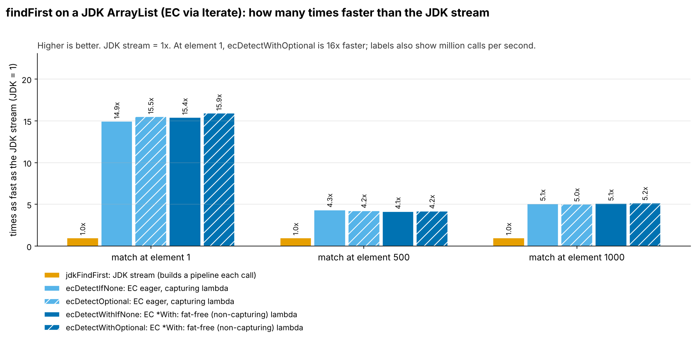
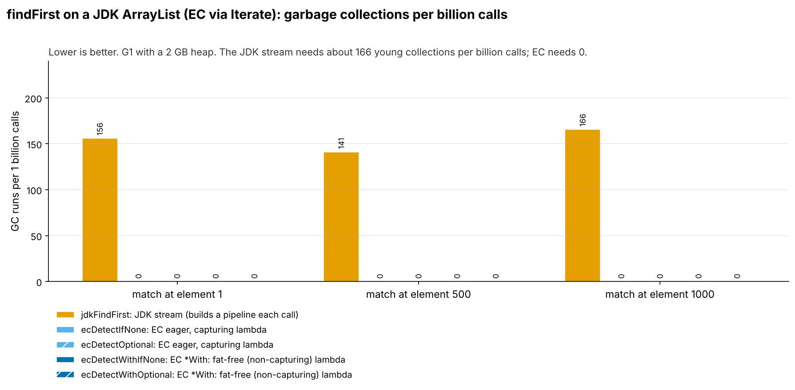
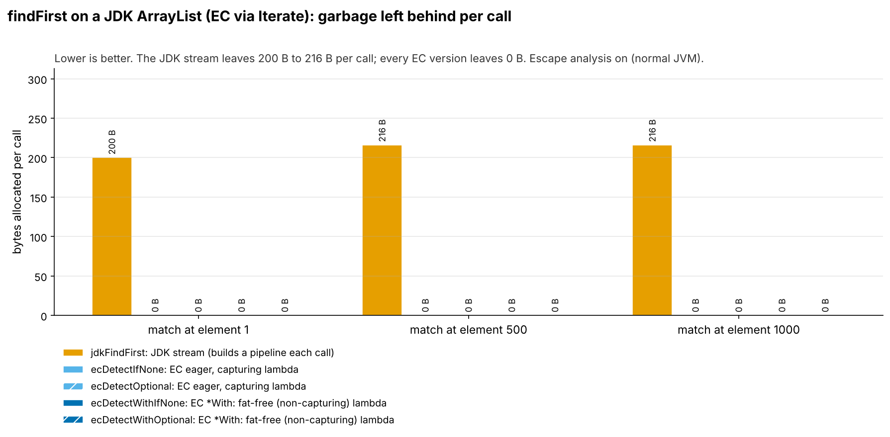
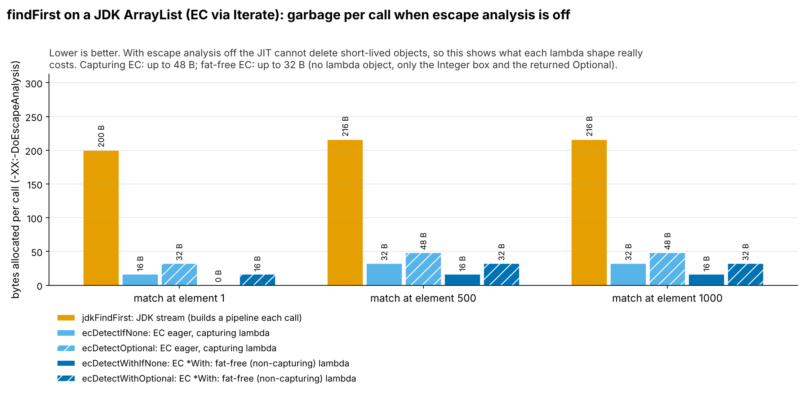
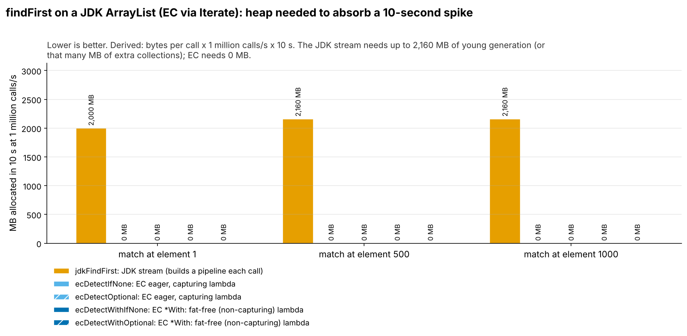
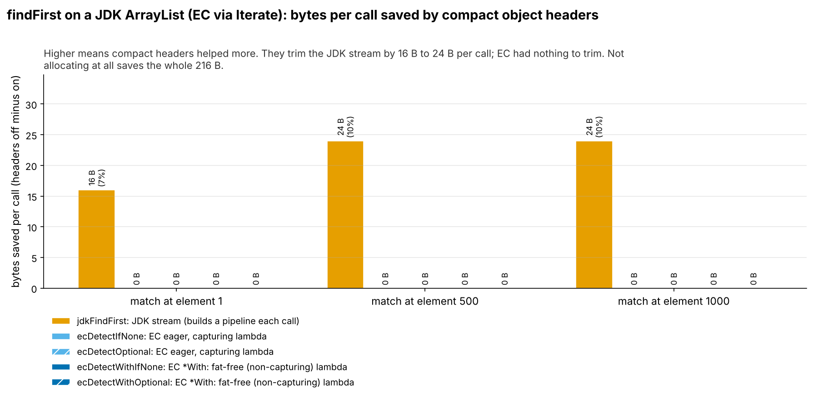

= FindFirstUtility: fat-free lambdas and garbage (run 20261015-0406)
:toc:
:toclevels: 2

Input: link:../../runs/shakers/20261015-0406-FindFirstUtilityResults2.adoc[20261015-0406-FindFirstUtilityResults2.adoc]. Environment: Claude cloud sandbox (KVM guest), not the local Mac (openjdk version "25.0.4.1" 2026-08-18). Absolute timings depend on the machine; bytes and object counts do not.

== Summary

Every `stream().filter().findFirst().orElse(0)` call leaves 7 to 8 objects (200 to 216 bytes) behind. All four EC variants on the same `java.util.List` (`detectOptional`, `detectWithOptional`, `detectIfNone`, `detectWithIfNone`) leave none and trigger no GC, including the two that return an `Optional`: escape analysis removes it because the caller unwraps it straight away. At 10 million calls per second the stream version needs about 2 GB/s of young-generation space.

== Head-to-head (compact headers on)

Throughput = 1000 ÷ ns per call. Calls measured = 40 s ÷ ns per call. Objects per call come from the object-count run; bytes per call from `gc.alloc.rate.norm`.

[cols="3,2,1,1,1,1,1,1",options="header"]
|===
|Implementation |Kind |Throughput (M calls/s) |Time per call (ns) |Objects per call |Bytes per call |GC runs per 1B calls |GC time per 1B calls (ms)
8+h|test = 1
|`jdkFindFirst` |JDK stream |26.9 |37.1 ± 2.20 |7.00 |200 |156 |364
|`ecDetectIfNone` |EC eager, capturing |402 |2.49 ± 0.12 |0 |≈0 |0 |0
|`ecDetectOptional` |EC eager, capturing |418 |2.40 ± 0.11 |0 |≈0 |0 |0
|`ecDetectWithIfNone` |EC fat-free (*With) |415 |2.41 ± 0.14 |0 |≈0 |0 |0
|`ecDetectWithOptional` |EC fat-free (*With) |429 |2.33 ± 0.13 |0 |≈0 |0 |0
8+a|`ecDetectIfNone` vs JDK: 14.9x faster, 7.00 fewer objects and 200 fewer bytes per call, 0 vs 156 GC runs per billion calls +
`ecDetectOptional` vs JDK: 15.5x faster, 7.00 fewer objects and 200 fewer bytes per call, 0 vs 156 GC runs per billion calls +
`ecDetectWithIfNone` vs JDK: 15.4x faster, 7.00 fewer objects and 200 fewer bytes per call, 0 vs 156 GC runs per billion calls +
`ecDetectWithOptional` vs JDK: 15.9x faster, 7.00 fewer objects and 200 fewer bytes per call, 0 vs 156 GC runs per billion calls
8+h|test = 500
|`jdkFindFirst` |JDK stream |0.71 |1,411 ± 97.0 |8.00 |216 |141 |494
|`ecDetectIfNone` |EC eager, capturing |3.07 |325 ± 12.8 |0 |≈0 |0 |0
|`ecDetectOptional` |EC eager, capturing |3.01 |332 ± 11.3 |0 |≈0 |0 |0
|`ecDetectWithIfNone` |EC fat-free (*With) |2.93 |342 ± 21.0 |0 |≈0 |0 |0
|`ecDetectWithOptional` |EC fat-free (*With) |2.95 |338 ± 18.9 |0 |≈0 |0 |0
8+a|`ecDetectIfNone` vs JDK: 4.3x faster, 8.00 fewer objects and 216 fewer bytes per call, 0 vs 141 GC runs per billion calls +
`ecDetectOptional` vs JDK: 4.2x faster, 8.00 fewer objects and 216 fewer bytes per call, 0 vs 141 GC runs per billion calls +
`ecDetectWithIfNone` vs JDK: 4.1x faster, 8.00 fewer objects and 216 fewer bytes per call, 0 vs 141 GC runs per billion calls +
`ecDetectWithOptional` vs JDK: 4.2x faster, 8.00 fewer objects and 216 fewer bytes per call, 0 vs 141 GC runs per billion calls
8+h|test = 1000
|`jdkFindFirst` |JDK stream |0.30 |3,312 ± 512 |8.00 |216 |166 |828
|`ecDetectIfNone` |EC eager, capturing |1.54 |651 ± 20.7 |0 |≈0 |0 |0
|`ecDetectOptional` |EC eager, capturing |1.51 |662 ± 40.0 |0 |≈0 |0 |0
|`ecDetectWithIfNone` |EC fat-free (*With) |1.54 |649 ± 23.5 |0 |≈0 |0 |0
|`ecDetectWithOptional` |EC fat-free (*With) |1.56 |642 ± 40.2 |0 |≈0 |0 |0
8+a|`ecDetectIfNone` vs JDK: 5.1x faster, 8.00 fewer objects and 216 fewer bytes per call, 0 vs 166 GC runs per billion calls +
`ecDetectOptional` vs JDK: 5.0x faster, 8.00 fewer objects and 216 fewer bytes per call, 0 vs 166 GC runs per billion calls +
`ecDetectWithIfNone` vs JDK: 5.1x faster, 8.00 fewer objects and 216 fewer bytes per call, 0 vs 166 GC runs per billion calls +
`ecDetectWithOptional` vs JDK: 5.2x faster, 8.00 fewer objects and 216 fewer bytes per call, 0 vs 166 GC runs per billion calls
|===

.Speed relative to the JDK stream, compact headers on.

Mermaid source: link:mermaid/20261015-0406-FindFirstUtility-throughput.mmd[20261015-0406-FindFirstUtility-throughput.mmd]

.Garbage collections per billion calls, compact headers on.

Mermaid source: link:mermaid/20261015-0406-FindFirstUtility-gc-per-billion.mmd[20261015-0406-FindFirstUtility-gc-per-billion.mmd]

== Garbage: where it comes from

*Pipeline garbage (JDK only, measured).* `ReferencePipeline$2` (56 B), `ReferencePipeline$Head` (48 B), `AbstractList$RandomAccessSpliterator` (32 B), `ReferencePipeline$2$1` (16 B), `FindOps$FindSink$OfRef` (16 B) and the `Optional` (16 B).

*Lambda garbage (measured).* The captured method reference (16 B) and, for `test = 500/1000`, the `Integer` box (16 B).

*The `Optional`.* Both `findFirst` and `detectOptional` must return an `Optional`. In the JDK it escapes through the pipeline and is always allocated. In EC it is created and unwrapped in the same inlined call, so escape analysis removes it (measured: 0 B with escape analysis on, 16 B with it off).

=== Objects per call by class (object-count run, compact headers on)

....
jdkFindFirst test=1: 7.00 objects, 200 B per call
      1.00 x java.util.stream.ReferencePipeline$2  (56 B)
      1.00 x java.util.stream.ReferencePipeline$Head  (48 B)
      1.00 x java.util.AbstractList$RandomAccessSpliterator  (32 B)
      1.00 x conf.session.shakers.FindFirstUtilityBenchmark$$Lambda  (16 B)
      1.00 x java.util.stream.ReferencePipeline$2$1  (16 B)
      1.00 x java.util.stream.FindOps$FindSink$OfRef  (16 B)
      1.00 x java.util.Optional  (16 B)
ecDetectIfNone test=1: 0.00 objects, 0 B per call
ecDetectOptional test=1: 0.00 objects, 0 B per call
ecDetectWithIfNone test=1: 0.00 objects, 0 B per call
ecDetectWithOptional test=1: 0.00 objects, 0 B per call
jdkFindFirst test=500: 8.00 objects, 216 B per call
      1.00 x java.util.stream.ReferencePipeline$2  (56 B)
      1.00 x java.util.stream.ReferencePipeline$Head  (48 B)
      1.00 x java.util.AbstractList$RandomAccessSpliterator  (32 B)
      1.00 x java.lang.Integer  (16 B)
      1.00 x java.util.stream.ReferencePipeline$2$1  (16 B)
      1.00 x java.util.stream.FindOps$FindSink$OfRef  (16 B)
      1.00 x conf.session.shakers.FindFirstUtilityBenchmark$$Lambda  (16 B)
      1.00 x java.util.Optional  (16 B)
ecDetectIfNone test=500: 0.00 objects, 0 B per call
ecDetectOptional test=500: 0.00 objects, 0 B per call
ecDetectWithIfNone test=500: 0.00 objects, 0 B per call
ecDetectWithOptional test=500: 0.00 objects, 0 B per call
jdkFindFirst test=1000: 8.00 objects, 216 B per call
      1.00 x java.util.stream.ReferencePipeline$2  (56 B)
      1.00 x java.util.stream.ReferencePipeline$Head  (48 B)
      1.00 x java.util.AbstractList$RandomAccessSpliterator  (32 B)
      1.00 x java.lang.Integer  (16 B)
      1.00 x java.util.stream.ReferencePipeline$2$1  (16 B)
      1.00 x java.util.stream.FindOps$FindSink$OfRef  (16 B)
      1.00 x conf.session.shakers.FindFirstUtilityBenchmark$$Lambda  (16 B)
      1.00 x java.util.Optional  (16 B)
ecDetectIfNone test=1000: 0.00 objects, 0 B per call
ecDetectOptional test=1000: 0.00 objects, 0 B per call
ecDetectWithIfNone test=1000: 0.00 objects, 0 B per call
ecDetectWithOptional test=1000: 0.00 objects, 0 B per call
....

.Bytes allocated per call (gc.alloc.rate.norm), compact headers on.

Mermaid source: link:mermaid/20261015-0406-FindFirstUtility-bytes-per-call.mmd[20261015-0406-FindFirstUtility-bytes-per-call.mmd]

=== Escape analysis off (upper bound for lambda garbage)

Same benchmarks with `-XX:-DoEscapeAnalysis`. Real applications cannot count on escape analysis (megamorphic call sites, code that is not inlined), so this shows what each lambda shape costs when it does not help. It is an upper bound, not typical production behaviour.

[cols="3,2,1,1,1,1",options="header"]
|===
|Implementation |Kind |Bytes per call, EA on |Bytes per call, EA off |Time per call EA on (ns) |Time per call EA off (ns)
6+h|test = 1
|`jdkFindFirst` |JDK stream |200 |200 |37.1 |41.6
|`ecDetectIfNone` |EC eager, capturing |≈0 |16 |2.49 |3.62
|`ecDetectOptional` |EC eager, capturing |≈0 |32 |2.40 |8.79
|`ecDetectWithIfNone` |EC fat-free (*With) |≈0 |≈0 |2.41 |2.24
|`ecDetectWithOptional` |EC fat-free (*With) |≈0 |16 |2.33 |4.00
6+h|test = 500
|`jdkFindFirst` |JDK stream |216 |216 |1,411 |1,575
|`ecDetectIfNone` |EC eager, capturing |≈0 |32 |325 |369
|`ecDetectOptional` |EC eager, capturing |≈0 |48 |332 |340
|`ecDetectWithIfNone` |EC fat-free (*With) |≈0 |16 |342 |389
|`ecDetectWithOptional` |EC fat-free (*With) |≈0 |32 |338 |389
6+h|test = 1000
|`jdkFindFirst` |JDK stream |216 |216 |3,312 |3,887
|`ecDetectIfNone` |EC eager, capturing |≈0 |32 |651 |769
|`ecDetectOptional` |EC eager, capturing |≈0 |48 |662 |791
|`ecDetectWithIfNone` |EC fat-free (*With) |≈0 |16 |649 |690
|`ecDetectWithOptional` |EC fat-free (*With) |≈0 |32 |642 |802
|===

With escape analysis off: `ecDetectIfNone` (capturing) 16 B / 32 B (lambda, plus box at 500/1000); `ecDetectWithIfNone` (fat-free) 0 B / 16 B (box only); `ecDetectOptional` (capturing) 32 B / 48 B (lambda + `Optional`, plus box); `ecDetectWithOptional` (fat-free) 16 B / 32 B (`Optional`, plus box). So the fat-free versions always save exactly the 16-byte lambda, and the `*IfNone` versions also avoid the `Optional`. The JDK stream allocates 200 to 216 B either way.

.Bytes per call with -XX:-DoEscapeAnalysis: the upper bound for lambda garbage.

Mermaid source: link:mermaid/20261015-0406-FindFirstUtility-ea-off-bytes.mmd[20261015-0406-FindFirstUtility-ea-off-bytes.mmd]

== Spikes and heap headroom (derived, not measured)

Formulas: allocation rate (MB/s) = bytes per call × calls/s ÷ 10^6. Young collections per minute = allocation rate ÷ 512 MB (example young generation) × 60. Allocated during a 10 s spike = bytes per call × calls/s × 10 s: the young-generation space the spike needs, or the collections it causes when that space is not there. Loads are application-wide, across all threads.

[cols="3,1,1,1,1,1",options="header"]
|===
|Implementation |Bytes per call |MB/s at 1 M calls/s |MB/s at 10 M calls/s |Young GCs per minute at 10 M calls/s |MB allocated in a 10 s spike at 10 M calls/s
6+h|test = 1
|`jdkFindFirst` |200 |200 |2,000 |234 |20,000
|`ecDetectIfNone` |≈0 |0 |0 |0 |0
|`ecDetectOptional` |≈0 |0 |0 |0 |0
|`ecDetectWithIfNone` |≈0 |0 |0 |0 |0
|`ecDetectWithOptional` |≈0 |0 |0 |0 |0
6+h|test = 500
|`jdkFindFirst` |216 |216 |2,160 |253 |21,600
|`ecDetectIfNone` |≈0 |≈0 |0.01 |≈0 |0.10
|`ecDetectOptional` |≈0 |≈0 |0.01 |≈0 |0.10
|`ecDetectWithIfNone` |≈0 |≈0 |0.01 |≈0 |0.10
|`ecDetectWithOptional` |≈0 |≈0 |0.01 |≈0 |0.10
6+h|test = 1000
|`jdkFindFirst` |216 |216 |2,160 |253 |21,601
|`ecDetectIfNone` |≈0 |≈0 |0.02 |≈0 |0.20
|`ecDetectOptional` |≈0 |≈0 |0.02 |≈0 |0.20
|`ecDetectWithIfNone` |≈0 |≈0 |0.02 |≈0 |0.20
|`ecDetectWithOptional` |≈0 |≈0 |0.02 |≈0 |0.20
|===

JMH also reports `gc.alloc.rate` (MB/s), but that number scales with how fast the benchmark runs, so a faster method can show a higher MB/s while allocating the same per call. `gc.alloc.rate.norm` (bytes per call) is the number to size heaps with.

.Young-generation memory a 10 s spike at 1 million calls/s allocates (derived).

Mermaid source: link:mermaid/20261015-0406-FindFirstUtility-spike-headroom.mmd[20261015-0406-FindFirstUtility-spike-headroom.mmd]

== Compact object headers

[cols="3,1,1,1,1,1,1",options="header"]
|===
|Implementation |Bytes per call on |Bytes per call off |Saved |Objects per call on |Objects per call off |Time per call on / off (ns)
7+h|test = 1
|`jdkFindFirst` |200 |216 |7% |7.00 |7.00 |37.1 / 41.4
|`ecDetectIfNone` |≈0 |≈0 |n/a |0 |0 |2.49 / 2.48
|`ecDetectOptional` |≈0 |≈0 |n/a |0 |0 |2.40 / 2.26
|`ecDetectWithIfNone` |≈0 |≈0 |n/a |0 |0 |2.41 / 2.44
|`ecDetectWithOptional` |≈0 |≈0 |n/a |0 |0 |2.33 / 2.39
7+h|test = 500
|`jdkFindFirst` |216 |240 |10% |8.00 |8.00 |1,411 / 1,487
|`ecDetectIfNone` |≈0 |≈0 |n/a |0 |0 |325 / 280
|`ecDetectOptional` |≈0 |≈0 |n/a |0 |0 |332 / 291
|`ecDetectWithIfNone` |≈0 |≈0 |n/a |0 |0 |342 / 279
|`ecDetectWithOptional` |≈0 |≈0 |n/a |0 |0 |338 / 295
7+h|test = 1000
|`jdkFindFirst` |216 |240 |10% |8.00 |8.00 |3,312 / 3,116
|`ecDetectIfNone` |≈0 |≈0 |n/a |0 |0 |651 / 561
|`ecDetectOptional` |≈0 |≈0 |n/a |0 |0 |662 / 563
|`ecDetectWithIfNone` |≈0 |≈0 |n/a |0 |0 |649 / 572
|`ecDetectWithOptional` |≈0 |≈0 |n/a |0 |0 |642 / 512
|===

Bytes per call here are `gc.alloc.rate.norm` from the main runs. Where that is a few bytes below the object-count total, the JIT scalar-replaced one pipeline object in some forks; the object-count run (exact per-class counts) is the reference for what each call allocates.

Compact headers take the JDK garbage from 224 to 200 B (test = 1, histogram) and 240 to 216 B (test = 500/1000), about 10%. `ReferencePipeline$Head`, `ReferencePipeline$2$1` and `FindOps$FindSink$OfRef` each shrink by 8 B.

Unexpected, measured: EC loops were 12 to 20% faster (at `test = 500/1000`) with compact headers off on this machine. *Inferred:* class-pointer decoding in `Integer.equals`. Check on the Mac.

.Bytes per call saved by -XX:+UseCompactObjectHeaders (off minus on).

Mermaid source: link:mermaid/20261015-0406-FindFirstUtility-coh-bytes.mmd[20261015-0406-FindFirstUtility-coh-bytes.mmd]

== Supporting analysis

*Fixed vs per-element cost.* EC: about 2.4 ns at `test = 1`, about 0.65 ns per element. JDK: about 37 ns fixed cost, about 3.3 ns per element at `test = 1000`.

=== Raw GC totals (compact headers on, per 40 s measurement)

Raw totals are shown for completeness only. Do not compare them across implementations: a faster method fits more calls into the same 40 s.

[cols="3,1,1,1,1",options="header"]
|===
|Implementation |test |calls measured |gc.count |gc.time (ms)
|`jdkFindFirst` |1 |1.08e+09 |168 |392
|`ecDetectIfNone` |1 |1.61e+10 |0 |0
|`ecDetectOptional` |1 |1.67e+10 |0 |0
|`ecDetectWithIfNone` |1 |1.66e+10 |0 |0
|`ecDetectWithOptional` |1 |1.72e+10 |0 |0
|`jdkFindFirst` |500 |2.83e+07 |4.00 |14.0
|`ecDetectIfNone` |500 |1.23e+08 |0 |0
|`ecDetectOptional` |500 |1.2e+08 |0 |0
|`ecDetectWithIfNone` |500 |1.17e+08 |0 |0
|`ecDetectWithOptional` |500 |1.18e+08 |0 |0
|`jdkFindFirst` |1000 |1.21e+07 |2.00 |10.0
|`ecDetectIfNone` |1000 |6.15e+07 |0 |0
|`ecDetectOptional` |1000 |6.04e+07 |0 |0
|`ecDetectWithIfNone` |1000 |6.16e+07 |0 |0
|`ecDetectWithOptional` |1000 |6.23e+07 |0 |0
|===

== Caveats

One machine (Claude cloud sandbox (KVM guest), not the local Mac), one JDK build (openjdk version "25.0.4.1" 2026-08-18), G1 with a fixed 2 GB heap. Microbenchmarks, not an application. Mechanisms are read from the class histograms where shown; anything else is labelled inferred.

== Reproduce

Run folder: `assets/runs/20261015-0406/`. Results: `assets/runs/shakers/20261015-0406-FindFirstUtilityResults2.adoc`.

....
mvn -f pom-bench.xml clean compile
mvn -f pom-bench.xml package
# main runs, CONFIG/FLAGS = coh-on: -XX:+UseCompactObjectHeaders | coh-off: -XX:-UseCompactObjectHeaders
#                          ea-off: -XX:+UseCompactObjectHeaders -XX:-DoEscapeAnalysis
java -jar target-bench/microbenchmarks.jar "conf\.session\.shakers\.FindFirstUtilityBenchmark\." \
  -prof gc -jvmArgsAppend "-XX:+UseG1GC -Xms2g -Xmx2g ${FLAGS}" \
  -rf text -rff assets/runs/shakers/20261015-0406/FindFirstUtility-${CONFIG}.txt -o assets/runs/shakers/20261015-0406/FindFirstUtility-${CONFIG}.log
# object counts, CONFIG/COH = histo-coh-on: -XX:+UseCompactObjectHeaders | histo-coh-off: -XX:-UseCompactObjectHeaders
#                            histo-ea-off: -XX:+UseCompactObjectHeaders -XX:-DoEscapeAnalysis
java -jar target-bench/microbenchmarks.jar "conf\.session\.shakers\." -f 1 -wi 5 -w 1s -i 3 -r 100ms \
  -jvmArgs "-XX:+UseParallelGC -Xms12g -Xmx12g -Xmn10g ${COH}" -prof prof.HistoProfiler -prof gc \
  -rf text -rff assets/runs/shakers/20261015-0406/all-${CONFIG}.txt -o assets/runs/shakers/20261015-0406/all-${CONFIG}.log
# HISTO lines go to the console, not to the -o file; they were saved to assets/runs/shakers/20261015-0406/all-${CONFIG}.histo
....
