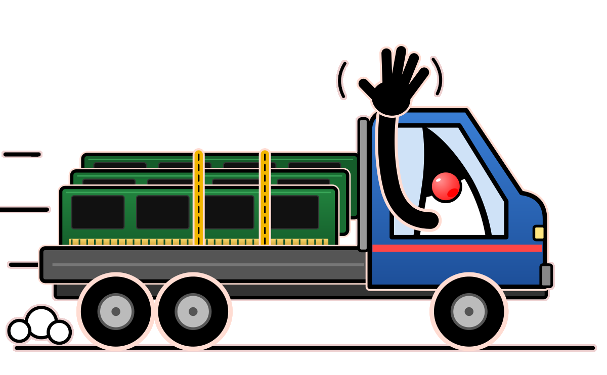

[.text-center]
= Who Moved My Heap?

:figure-caption!:

ifdef::env-github[]
++++

  

++++
endif::[]

ifndef::env-github[]

endif::[]

[.text-center]
Explore the Java Memory Heap for upleasant surprises and fix them  +
using the right patterns, tools, and runtime options!

[cols="15%,85%",grid=none,frame=none]
|===
^.^a|[qrcode, format="png", xdim=4, subs=attributes, float=left]
....
https://github.com/c-guntur/who-moved-my-heap
....
.^a| {empty} +
*Link to content*: link:https://github.com/c-guntur/who-moved-my-heap[] +
&#160;
|===
'''

ifndef::deck[]
[.deck-nav]
‹ Previous {nbsp}|{nbsp} xref:01_Intro_00_02.adoc[⌂ Index] {nbsp}|{nbsp} xref:01_Intro_00_01.adoc[Next ›] {nbsp}{nbsp} [.deck-pos]#00 · 1/1#
endif::[]

'''

[.text-center]
~Opinions&nbsp;are&nbsp;personal&nbsp;and&nbsp;do&nbsp;not&nbsp;represent&nbsp;views&nbsp;or&nbsp;opinions&nbsp;of&nbsp;speakers'&nbsp;employer.~

