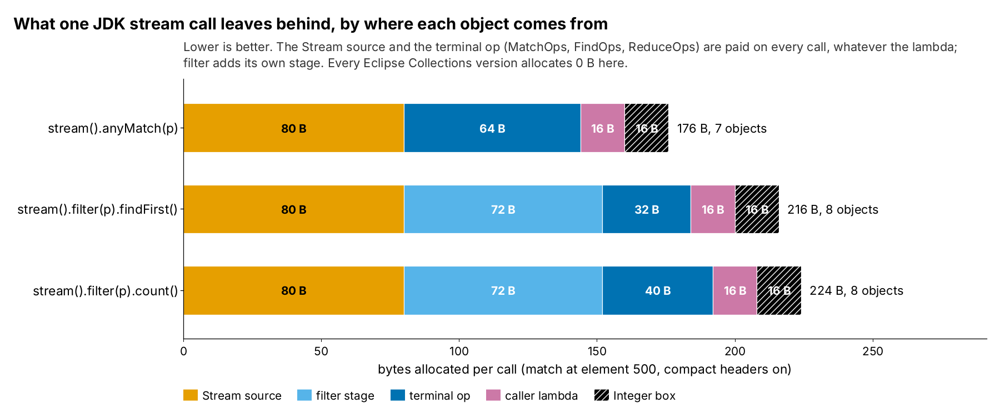
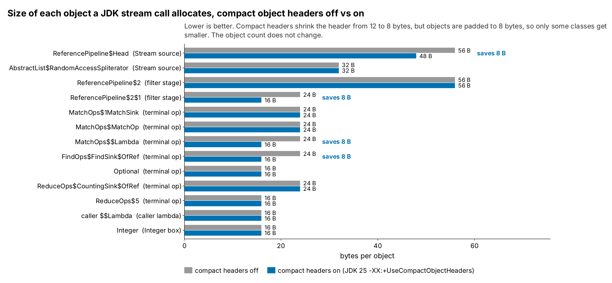
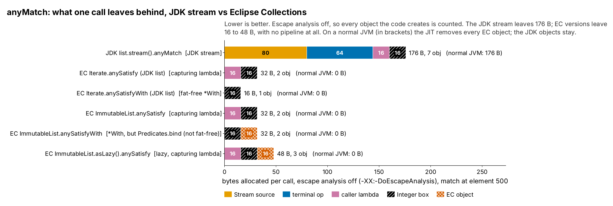
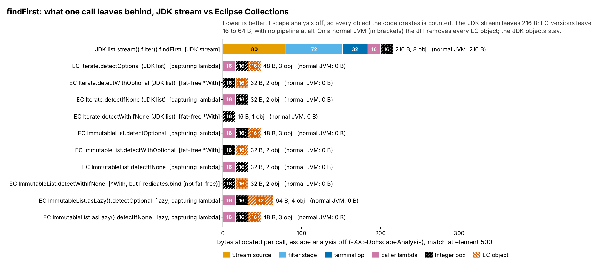
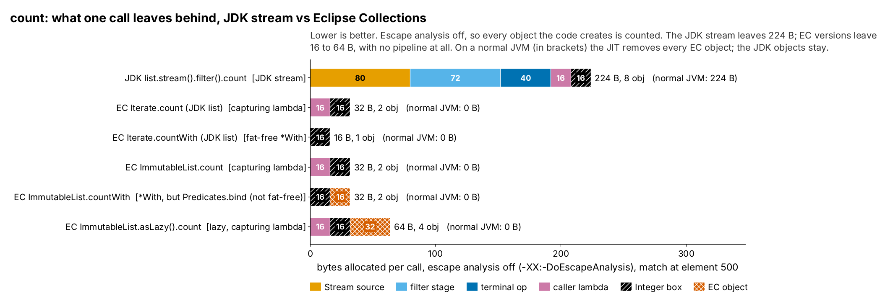

= JDK Stream, FindOps and MatchOps vs Eclipse Collections: where the garbage comes from (run 20261015-0406)
:toc:
:toclevels: 2

Fresh look at the raw results of run `20261015-0406` (`generated/runs/20261015-0406/shakers/raw/`): which objects one JDK `stream()` call allocates, which part of the Stream API makes each one, and what that costs; then the same numbers for the Eclipse Collections (EC) versions of each operation, with escape analysis on and off. Object counts come from the class-histogram runs (`all-histo-coh-on-histo.txt`, `all-histo-coh-off-histo.txt`, `all-histo-ea-off-histo.txt`, every iteration GC-free); bytes per call from `gc.alloc.rate.norm` in the main runs. Where each class comes from was checked with `javap` in the bytecode of the JDK that ran (openjdk version "25.0.4.1" 2026-08-18) and of EC 13.0.0. Environment: Claude cloud sandbox (KVM guest), not the local Mac. Bytes and object counts do not depend on the machine, timings do.

== Summary

* *Every JDK stream call allocates a fixed set of 6 to 8 objects (160 to 224 B), wherever the match is.* None of it is per element: it is the pipeline being built and thrown away on each call.
* *More than a third of it is the Stream source.* `list.stream()` alone costs 80 B (pipeline head 48 B + spliterator 32 B) before any operation is chosen.
* *The terminal op is the part that differs most.* `anyMatch` (MatchOps) allocates 3 objects, 64 B, because `MatchOps.makeRef` builds a new `MatchOp` and a new sink-supplier lambda on every call. `findFirst` (FindOps) allocates 2 objects, 32 B: its `FindOp` is a cached static, but the sink and the `Optional` result are new. `count` (ReduceOps) allocates 2 objects, 40 B: a new `ReduceOps$5` op on every call plus the counting sink.
* *`filter` adds a whole pipeline stage* (2 objects, 72 B). That is why `stream().anyMatch(p)` (160 B) is cheaper than `stream().filter(p).findFirst()` (200 B) for the same question: anyMatch puts the predicate in the terminal op and needs no filter stage.
* *Escape analysis removes none of it.* Bytes per call are identical with `-XX:-DoEscapeAnalysis` for every JDK benchmark. The same JIT removes every object in the Eclipse Collections loops, including the `Optional` that `detectOptional` returns.
* *Compact object headers shave 16 to 24 B (7 to 11%)* off a call by shrinking 2 or 3 of its objects by 8 B each. The number of objects stays the same.
* *Speed:* at match position 1, where almost no elements are scanned, a JDK call takes 29 to 38 ns against 2 to 3 ns for Eclipse Collections. Building and dropping these objects is most of that difference (inferred: allocation plus the virtual calls through the sink chain).
* *Eclipse Collections has no pipeline to build.* Its methods are a loop over the list that calls the predicate, so the Stream source, filter stage and terminal op have no EC counterpart. On a normal JVM every EC version, capturing or fat-free, eager or lazy, allocates 0 B and needed 0 garbage collections.
* *With escape analysis off, the lambda shape shows.* A fat-free `Iterate.*With` call leaves only the `Integer` box the caller passes in (16 B, 0 B at element 1); a capturing call adds its lambda (32 B); `asLazy()` adds a `LazyIterableAdapter`; the JDK stream leaves 176 to 224 B. On an EC 13.0.0 `ImmutableList`, `anySatisfyWith`, `countWith` and `detectWithIfNone` are not fat-free (`Predicates.bind` makes a wrapper per call).

== The three pipelines

[cols="1,4",options="header"]
|===
|Operation |Benchmark code
|`anyMatch` |`list.stream().anyMatch(Integer.valueOf(test)::equals)`
|`findFirst` |`list.stream().filter(Integer.valueOf(test)::equals).findFirst().orElse(0)`
|`count` |`list.stream().filter(Integer.valueOf(test)::equals).count()`
|===

The same JDK code runs in the `*Utility` and `*EagerLazy` benchmarks (both use a `List.copyOf` list), and the histograms are identical for both. The tables use the `*Utility` runs.

== Every object, and which part of the Stream API makes it

Compact headers on, match at element 500 (one call):

[cols="3,2,1,1,1,5",options="header"]
|===
|Class |Origin |anyMatch (B) |findFirst (B) |count (B) |Why it is allocated
|`AbstractList$RandomAccessSpliterator` |Stream source |32 |32 |32 |`list.stream()`: the spliterator that walks the list
|`ReferencePipeline$Head` |Stream source |48 |48 |48 |`list.stream()`: the pipeline head (AbstractPipeline fields: links, flags, depth, spliterator)
|`ReferencePipeline$2` |filter stage |- |56 |56 |`filter(p)`: the StatelessOp pipeline stage
|`ReferencePipeline$2$1` |filter stage |- |16 |16 |`filter(p)`: its Sink.ChainedReference, made when the terminal op runs
|`Optional` |terminal op |- |16 |- |`findFirst`: the `Optional` result, made by `FindSink.OfRef.get()`
|`FindOps$FindSink$OfRef` |terminal op |- |16 |- |`findFirst`: the sink that keeps the first value (the FindOp itself is a cached static, `OP_FIND_FIRST`)
|`MatchOps$$Lambda` |terminal op |16 |- |- |`anyMatch`: the `() -> new MatchSink()` supplier, capturing the predicate and MatchKind, made on every call
|`MatchOps$1MatchSink` |terminal op |24 |- |- |`anyMatch`: the sink that tests each element
|`MatchOps$MatchOp` |terminal op |24 |- |- |`anyMatch`: `MatchOps.makeRef` does `new MatchOp(...)` on every call
|`ReduceOps$5` |terminal op |- |- |16 |`count`: `ReduceOps.makeRefCounting()` does `new ReduceOps$5(...)` on every call
|`ReduceOps$CountingSink$OfRef` |terminal op |- |- |24 |`count`: the sink that counts (the `long` result is a cached `Long`)
|benchmark `$$Lambda` |caller lambda |16 |16 |16 |the benchmark's bound method reference `Integer.valueOf(test)::equals` (captures the Integer)
|`Integer` |Integer box |16 |16 |16 |`Integer.valueOf(test)`: outside the -128..127 cache, so only at test = 500 and 1000
2+h|Total per call |*176* (7 obj) |*216* (8 obj) |*224* (8 obj) |
|===

.Bytes per call by origin. Every Eclipse Collections version allocates 0 B.

Mermaid source: link:mermaid/20261015-0406-JdkStreamOps-bytes-by-origin.mmd[20261015-0406-JdkStreamOps-bytes-by-origin.mmd]

=== By origin, every match position (compact headers on)

[cols="2,1,1,1,1,1,1,1",options="header"]
|===
|Operation |test |Stream source |filter stage |terminal op |caller lambda |Integer box |Total (B / objects)
|`anyMatch` |1 |80 |0 |64 |16 |0 |160 / 6
|`anyMatch` |500 |80 |0 |64 |16 |16 |176 / 7
|`anyMatch` |1000 |80 |0 |64 |16 |16 |176 / 7
|`findFirst` |1 |80 |72 |32 |16 |0 |200 / 7
|`findFirst` |500 |80 |72 |32 |16 |16 |216 / 8
|`findFirst` |1000 |80 |72 |32 |16 |16 |216 / 8
|`count` |1 |80 |72 |40 |16 |0 |208 / 7
|`count` |500 |80 |72 |40 |16 |16 |224 / 8
|`count` |1000 |80 |72 |40 |16 |16 |224 / 8
|===

Only the `Integer` box changes with the match position (`Integer.valueOf(test)` is cached for 1, not for 500 or 1000), and that box belongs to the benchmark's lambda, not to the Stream API. The Stream API's own cost is the same for a match at element 1 as at element 1000.

== The terminal ops compared

[cols="1,2,1,1,3",options="header"]
|===
|Operation |Terminal op class |New objects per call |Bytes |What could be avoided
|`anyMatch` |MatchOps |`MatchOps$$Lambda`, `MatchOps$1MatchSink`, `MatchOps$MatchOp` |64 |The op and the supplier lambda depend on the predicate, so they cannot be cached as written.
|`findFirst` |FindOps |`FindOps$FindSink$OfRef`, `Optional` |32 |The op is already cached (`FindSink.OfRef.OP_FIND_FIRST`). The `Optional` is the result.
|`count` |ReduceOps |`ReduceOps$5`, `ReduceOps$CountingSink$OfRef` |40 |`ReduceOps$5` holds no per-call state, yet a new one is made each call (unlike FindOps). Caching it would save 16 B a call (inferred from the bytecode; not tested).
|===

== Escape analysis does not help the JDK stream

`gc.alloc.rate.norm` from the main runs, escape analysis on (normal) and off (`-XX:-DoEscapeAnalysis`), compact headers on:

[cols="2,1,1,1",options="header"]
|===
|Operation |test |EA on (B per call) |EA off (B per call)
|`anyMatch` |1 |160 |160
|`anyMatch` |500 |176 |176
|`anyMatch` |1000 |176 |176
|`findFirst` |1 |200 |200
|`findFirst` |500 |216 |216
|`findFirst` |1000 |216 |216
|`count` |1 |208 |208
|`count` |500 |224 |224
|`count` |1000 |224 |224
|===

The numbers are the same, so the JIT scalar-replaces none of the pipeline objects. They are linked to each other (head to spliterator, stage to stage, sink to sink) and passed through interface calls in `AbstractPipeline.evaluate`, so they escape (inferred: the usual reasons escape analysis gives up, not confirmed with JIT logs). Compare Eclipse Collections, where the same JIT removes every object, including the `Optional` from `detectOptional`: there the loop and the lambda are inlined into the caller.

== Compact object headers

Mermaid source: link:mermaid/20261015-0406-JdkStreamOps-class-sizes-coh.mmd[20261015-0406-JdkStreamOps-class-sizes-coh.mmd]

[cols="3,2,1,1,1",options="header"]
|===
|Class |Origin |Headers off (B) |Headers on (B) |Saved
|`ReferencePipeline$Head` |Stream source |56 |48 |8
|`AbstractList$RandomAccessSpliterator` |Stream source |32 |32 |-
|`ReferencePipeline$2` |filter stage |56 |56 |-
|`ReferencePipeline$2$1` |filter stage |24 |16 |8
|`MatchOps$1MatchSink` |terminal op |24 |24 |-
|`MatchOps$MatchOp` |terminal op |24 |24 |-
|`MatchOps$$Lambda` |terminal op |24 |16 |8
|`FindOps$FindSink$OfRef` |terminal op |24 |16 |8
|`Optional` |terminal op |16 |16 |-
|`ReduceOps$CountingSink$OfRef` |terminal op |24 |24 |-
|`ReduceOps$5` |terminal op |16 |16 |-
|`caller $$Lambda` |caller lambda |16 |16 |-
|`Integer` |Integer box |16 |16 |-
|===

[cols="2,1,1,1,1",options="header"]
|===
|Operation |test |Headers off (B per call) |Headers on (B per call) |Saved
|`anyMatch` |1 |176 |160 |16 B (9%)
|`anyMatch` |500 |192 |176 |16 B (8%)
|`anyMatch` |1000 |192 |176 |16 B (8%)
|`findFirst` |1 |224 |200 |24 B (11%)
|`findFirst` |500 |240 |216 |24 B (10%)
|`findFirst` |1000 |240 |216 |24 B (10%)
|`count` |1 |224 |208 |16 B (7%)
|`count` |500 |240 |224 |16 B (7%)
|`count` |1000 |240 |224 |16 B (7%)
|===

Object-count run (exact per-class sizes). Compact headers turn a 12-byte header into 8 bytes, and objects are padded to a multiple of 8 bytes, so a class only gets smaller when the 4 bytes saved cross that boundary: the pipeline head, the MatchOps lambda, the filter sink and the find sink do; the spliterator, the ops, `Optional` and `Integer` do not. Not allocating at all saves the whole 160 to 224 B.

== What it costs an application

Derived from bytes per call (compact headers on): allocation rate = bytes per call × calls per second.

[cols="2,1,1,1,1",options="header"]
|===
|Operation |Bytes per call (test=500) |MB/s at 1 M calls/s |MB/s at 10 M calls/s |GC runs per 1 billion calls (measured, G1 2 GB heap)
|`anyMatch` |176 |176 |1,760 |77
|`findFirst` |216 |216 |2,160 |141
|`count` |224 |224 |2,240 |199
|===

The Eclipse Collections versions of the same three operations allocate 0 B per call and caused 0 GC runs.

=== Time spent on the pipeline itself

At match position 1 the loop does almost no work, so the time is mostly setting up and tearing down the call.

[cols="2,1,1,1",options="header"]
|===
|Operation |JDK stream (ns per call) |Fastest EC version (ns per call) |Difference (ns)
|`anyMatch` |30.2 |2.5 |27.7
|`findFirst` |37.1 |2.3 |34.8
|`count` |1342.7 |642.6 |700.1
|===

`count` always scans all 1000 elements, so at position 1 it is not a setup measurement; the difference there includes the slower per-element path through the filter and counting sinks.

== The same three operations in Eclipse Collections

Every benchmark class also has Eclipse Collections (EC 13.0.0) versions of the same operation. In the `*Utility` classes EC's `Iterate` utility runs on the same JDK list as the stream; in the `*EagerLazy` classes the methods of an EC `ImmutableList` run, eagerly and through `asLazy()`. Two lambda shapes are compared: *capturing* (`Integer.valueOf(test)::equals`, a new object per call that holds the value) and *fat-free* (`Integer::equals` with the value passed as a parameter to a `*With` method, a constant lambda that is never allocated).

=== Where each JDK object goes in EC

An EC method is a plain loop over the list that calls the predicate, so most of what a stream builds has no EC counterpart at all (checked in the EC 13.0.0 bytecode with `javap`):

[cols="2,3,4",options="header"]
|===
|JDK stream object (B per call) |EC equivalent |Why
|Stream source: `ReferencePipeline$Head`, `RandomAccessSpliterator` (80 B) |none |`Iterate` checks the list type once and runs `for (i = 0; i < size; i++) list.get(i)` (`RandomAccessListIterate`); `ImmutableList` loops over its own array (`InternalArrayIterate`).
|filter stage: `ReferencePipeline$2`, `$2$1` (72 B) |none |The predicate is called directly in the loop.
|`anyMatch` terminal op: `MatchOp`, sink supplier, `MatchSink` (64 B) |none |The loop returns `true` at the first match.
|`count` terminal op: `ReduceOps$5`, `CountingSink` (40 B) |none |The loop counts in a local `int`.
|`findFirst` terminal op: `FindSink` (16 B) |none |The loop returns the element.
|`findFirst` result: `Optional` (16 B) |`Optional` only for `detectOptional` / `detectWithOptional`; none for `detectIfNone` |`detectIfNone` returns the element or the default.
|caller lambda `Integer.valueOf(test)::equals` (16 B) |same object for capturing EC calls; none for `*With` |`*With` takes a constant `Integer::equals` plus the value as a parameter.
|`Integer` box (16 B at test 500, 1000) |same |Belongs to the benchmark's value, not to either library.
|===

EC adds a few objects of its own in some methods: `asLazy()` makes a `LazyIterableAdapter` per call (and `asLazy().count` a `CountProcedure`), `detectOptional` returns an `Optional`, and on an `ImmutableList` three of the `*With` methods are not fat-free in EC 13.0.0 because they go through `Predicates.bind` (see below).

=== On a normal JVM

Main runs, compact headers on, escape analysis on (the default). Times were measured on: Claude cloud sandbox (KVM guest), not the local Mac; bytes and GC counts do not depend on the machine.

.anyMatch
[cols="4,2,1,1,1,1",options="header"]
|===
|Implementation |Lambda |ns per call (element 1) |ns per call (element 500) |B per call (element 500) |GC runs per 1 billion calls (element 500)
|JDK list.stream().anyMatch +
`list.stream().anyMatch(Integer.valueOf(test)::equals)` |JDK stream |30.2 |1549.0 |176 |77
|EC Iterate.anySatisfy (JDK list) +
`Iterate.anySatisfy(list, Integer.valueOf(test)::equals)` |capturing lambda |2.5 |331.7 |0 |0
|EC Iterate.anySatisfyWith (JDK list) +
`Iterate.anySatisfyWith(list, Integer::equals, test)` |fat-free *With |2.6 |338.3 |0 |0
|EC ImmutableList.anySatisfy +
`ecList.anySatisfy(Integer.valueOf(test)::equals)` |capturing lambda |2.1 |320.6 |0 |0
|EC ImmutableList.anySatisfyWith +
`ecList.anySatisfyWith(Integer::equals, test)` |*With, but Predicates.bind (not fat-free) |2.3 |322.1 |0 |0
|EC ImmutableList.asLazy().anySatisfy +
`ecList.asLazy().anySatisfy(Integer.valueOf(test)::equals)` |lazy, capturing lambda |2.4 |328.1 |0 |0
|===

.findFirst
[cols="4,2,1,1,1,1",options="header"]
|===
|Implementation |Lambda |ns per call (element 1) |ns per call (element 500) |B per call (element 500) |GC runs per 1 billion calls (element 500)
|JDK list.stream().filter().findFirst +
`list.stream().filter(Integer.valueOf(test)::equals).findFirst().orElse(0)` |JDK stream |37.1 |1411.4 |216 |141
|EC Iterate.detectOptional (JDK list) +
`Iterate.detectOptional(list, Integer.valueOf(test)::equals).orElse(0)` |capturing lambda |2.4 |332.4 |0 |0
|EC Iterate.detectWithOptional (JDK list) +
`Iterate.detectWithOptional(list, Integer::equals, test).orElse(0)` |fat-free *With |2.3 |338.5 |0 |0
|EC Iterate.detectIfNone (JDK list) +
`Iterate.detectIfNone(list, Integer.valueOf(test)::equals, 0)` |capturing lambda |2.5 |325.3 |0 |0
|EC Iterate.detectWithIfNone (JDK list) +
`Iterate.detectWithIfNone(list, Integer::equals, test, 0)` |fat-free *With |2.4 |341.5 |0 |0
|EC ImmutableList.detectOptional +
`ecList.detectOptional(Integer.valueOf(test)::equals).orElse(0)` |capturing lambda |2.3 |341.9 |0 |0
|EC ImmutableList.detectWithOptional +
`ecList.detectWithOptional(Integer::equals, test).orElse(0)` |fat-free *With |2.5 |340.2 |0 |0
|EC ImmutableList.detectIfNone +
`ecList.detectIfNone(Integer.valueOf(test)::equals, () -> 0)` |capturing lambda |2.2 |339.2 |0 |0
|EC ImmutableList.detectWithIfNone +
`ecList.detectWithIfNone(Integer::equals, test, () -> 0)` |*With, but Predicates.bind (not fat-free) |2.4 |338.2 |0 |0
|EC ImmutableList.asLazy().detectOptional +
`ecList.asLazy().detectOptional(Integer.valueOf(test)::equals).orElse(0)` |lazy, capturing lambda |2.3 |328.3 |0 |0
|EC ImmutableList.asLazy().detectIfNone +
`ecList.asLazy().detectIfNone(Integer.valueOf(test)::equals, () -> 0)` |lazy, capturing lambda |2.3 |364.2 |0 |0
|===

.count
[cols="4,2,1,1,1,1",options="header"]
|===
|Implementation |Lambda |ns per call (element 1) |ns per call (element 500) |B per call (element 500) |GC runs per 1 billion calls (element 500)
|JDK list.stream().filter().count +
`list.stream().filter(Integer.valueOf(test)::equals).count()` |JDK stream |1342.7 |1324.2 |224 |199
|EC Iterate.count (JDK list) +
`Iterate.count(list, Integer.valueOf(test)::equals)` |capturing lambda |642.6 |662.9 |0 |0
|EC Iterate.countWith (JDK list) +
`Iterate.countWith(list, Integer::equals, test)` |fat-free *With |680.7 |663.4 |0 |0
|EC ImmutableList.count +
`ecList.count(Integer.valueOf(test)::equals)` |capturing lambda |685.5 |686.0 |0 |0
|EC ImmutableList.countWith +
`ecList.countWith(Integer::equals, test)` |*With, but Predicates.bind (not fat-free) |678.0 |695.6 |0 |0
|EC ImmutableList.asLazy().count +
`ecList.asLazy().count(Integer.valueOf(test)::equals)` |lazy, capturing lambda |676.4 |673.6 |0 |0
|===

Every EC version leaves 0 B per call and needed no garbage collection, capturing or fat-free, eager or lazy, on either list. The JIT inlines the EC loop and the lambda into the caller and then removes every object they create (escape analysis). It cannot do that for the stream pipeline (see above), so the JDK side keeps its 160 to 224 B.

=== With escape analysis off: what each call creates

Escape analysis is a JIT optimisation, not a promise: it gives up when code is not inlined (cold code, large methods, deep call chains, megamorphic call sites). The object-count run with `-XX:-DoEscapeAnalysis` (`all-histo-ea-off-histo.txt`, every iteration GC-free) shows what the code itself creates, which is what an application pays whenever the JIT does not remove it. Match at element 500, compact headers on.

.anyMatch: bytes per call by origin, escape analysis off (normal JVM in brackets)

Mermaid source: link:mermaid/20261015-0406-JdkStreamOps-vs-ec-anyMatch.mmd[20261015-0406-JdkStreamOps-vs-ec-anyMatch.mmd]

[cols="3,2,5,1,1",options="header"]
|===
|Implementation |Lambda |Objects per call |Objects |B per call
|JDK list.stream().anyMatch |JDK stream |the JDK pipeline above, plus the caller lambda and `Integer` |7 |176
|EC Iterate.anySatisfy (JDK list) |capturing lambda |benchmark `$$Lambda` (16 B), `Integer` (16 B) |2 |32
|EC Iterate.anySatisfyWith (JDK list) |fat-free *With |`Integer` (16 B) |1 |16
|EC ImmutableList.anySatisfy |capturing lambda |benchmark `$$Lambda` (16 B), `Integer` (16 B) |2 |32
|EC ImmutableList.anySatisfyWith |*With, but Predicates.bind (not fat-free) |`Integer` (16 B), `Predicates$BindPredicate2` (16 B) |2 |32
|EC ImmutableList.asLazy().anySatisfy |lazy, capturing lambda |benchmark `$$Lambda` (16 B), `Integer` (16 B), `LazyIterableAdapter` (16 B) |3 |48
|===

.findFirst: bytes per call by origin, escape analysis off (normal JVM in brackets)

Mermaid source: link:mermaid/20261015-0406-JdkStreamOps-vs-ec-findFirst.mmd[20261015-0406-JdkStreamOps-vs-ec-findFirst.mmd]

[cols="3,2,5,1,1",options="header"]
|===
|Implementation |Lambda |Objects per call |Objects |B per call
|JDK list.stream().filter().findFirst |JDK stream |the JDK pipeline above, plus the caller lambda and `Integer` |8 |216
|EC Iterate.detectOptional (JDK list) |capturing lambda |benchmark `$$Lambda` (16 B), `Integer` (16 B), `Optional` (16 B) |3 |48
|EC Iterate.detectWithOptional (JDK list) |fat-free *With |`Integer` (16 B), `Optional` (16 B) |2 |32
|EC Iterate.detectIfNone (JDK list) |capturing lambda |benchmark `$$Lambda` (16 B), `Integer` (16 B) |2 |32
|EC Iterate.detectWithIfNone (JDK list) |fat-free *With |`Integer` (16 B) |1 |16
|EC ImmutableList.detectOptional |capturing lambda |benchmark `$$Lambda` (16 B), `Integer` (16 B), `Optional` (16 B) |3 |48
|EC ImmutableList.detectWithOptional |fat-free *With |`Integer` (16 B), `Optional` (16 B) |2 |32
|EC ImmutableList.detectIfNone |capturing lambda |benchmark `$$Lambda` (16 B), `Integer` (16 B) |2 |32
|EC ImmutableList.detectWithIfNone |*With, but Predicates.bind (not fat-free) |`Integer` (16 B), `Predicates$BindPredicate2` (16 B) |2 |32
|EC ImmutableList.asLazy().detectOptional |lazy, capturing lambda |benchmark `$$Lambda` (16 B), `Integer` (16 B), `Optional` (16 B), `LazyIterableAdapter` (16 B) |4 |64
|EC ImmutableList.asLazy().detectIfNone |lazy, capturing lambda |benchmark `$$Lambda` (16 B), `Integer` (16 B), `LazyIterableAdapter` (16 B) |3 |48
|===

.count: bytes per call by origin, escape analysis off (normal JVM in brackets)

Mermaid source: link:mermaid/20261015-0406-JdkStreamOps-vs-ec-count.mmd[20261015-0406-JdkStreamOps-vs-ec-count.mmd]

[cols="3,2,5,1,1",options="header"]
|===
|Implementation |Lambda |Objects per call |Objects |B per call
|JDK list.stream().filter().count |JDK stream |the JDK pipeline above, plus the caller lambda and `Integer` |8 |224
|EC Iterate.count (JDK list) |capturing lambda |benchmark `$$Lambda` (16 B), `Integer` (16 B) |2 |32
|EC Iterate.countWith (JDK list) |fat-free *With |`Integer` (16 B) |1 |16
|EC ImmutableList.count |capturing lambda |benchmark `$$Lambda` (16 B), `Integer` (16 B) |2 |32
|EC ImmutableList.countWith |*With, but Predicates.bind (not fat-free) |`Integer` (16 B), `Predicates$BindPredicate2` (16 B) |2 |32
|EC ImmutableList.asLazy().count |lazy, capturing lambda |benchmark `$$Lambda` (16 B), `Integer` (16 B), `CountProcedure` (16 B), `LazyIterableAdapter` (16 B) |4 |64
|===

=== Every object the EC versions allocate, and why

[cols="3,1,3,5",options="header"]
|===
|Class |Origin |Allocated by |Why
|benchmark `$$Lambda` |caller lambda |every capturing call |the benchmark's bound method reference `Integer.valueOf(test)::equals` (captures the Integer). The fat-free `Integer::equals` is a constant and never allocates
|`Integer` |Integer box |every call at test 500 and 1000 |`*With` methods: `this.test` is an `int` field, autoboxed to pass it as the parameter; capturing methods: `Integer.valueOf(test)`. Only at test = 500 and 1000 (outside the cache)
|`Optional` |EC object |Iterate.detectOptional (JDK list), Iterate.detectWithOptional (JDK list), ImmutableList.detectOptional, ImmutableList.detectWithOptional, ImmutableList.asLazy().detectOptional |`detectOptional` / `detectWithOptional`: the `Optional` result
|`Predicates$BindPredicate2` |EC object |ImmutableList.anySatisfyWith, ImmutableList.detectWithIfNone, ImmutableList.countWith |EC 13.0.0 `ImmutableArrayList` inherits `anySatisfyWith`, `countWith` and `detectWithIfNone` from `AbstractRichIterable`, which wraps the call in `Predicates.bind(predicate, parameter)`: a new capturing wrapper per call
|`CountProcedure` |EC object |ImmutableList.asLazy().count |`asLazy().count`: `LazyIterableAdapter` inherits `count` from `AbstractRichIterable`, which does `new CountProcedure(predicate)` and runs it through `forEach`
|`LazyIterableAdapter` |EC object |ImmutableList.asLazy().anySatisfy, ImmutableList.asLazy().detectOptional, ImmutableList.asLazy().detectIfNone, ImmutableList.asLazy().count |`asLazy()`: `LazyIterate.adapt(this)` makes a new lazy view of the list on every call
|===

=== Fat-free vs capturing

With escape analysis off the difference between the lambda shapes is plain:

* *Fat-free (`Iterate.anySatisfyWith`, `countWith`, `detectWithIfNone`):* only the `Integer` box, 16 B, and nothing at element 1 where the box is cached. The lambda is a constant.
* *Capturing (`Iterate.anySatisfy`, `count`, `detectIfNone`):* the lambda plus the box, 32 B. A new lambda is made on every call because it holds the value.
* *Lazy (`asLazy()`):* the capturing lambda plus a `LazyIterableAdapter`, 48 B; `count` also makes a `CountProcedure` (64 B).
* *`*With` on an EC 13.0.0 `ImmutableList`:* the `Predicates$BindPredicate2` wrapper plus the box, 32 B, as much as the capturing version. `ImmutableArrayList` does not override `anySatisfyWith`, `countWith` or `detectWithIfNone`; it inherits them from `AbstractRichIterable`, which binds the parameter into a new predicate. `detectWithOptional` is overridden and stays fat-free. `Iterate` on a JDK list has its own `*With` loops, so all of them are fat-free there.
* *JDK stream:* 176 to 224 B, with escape analysis on or off. Its pipeline objects are the bulk of it, and the stream has no `*With` form, so even a non-capturing predicate would still leave the pipeline behind.

So the fat-free claim holds: on the paths that are fat-free, the only allocation left is the boxed value the caller passes in, and with escape analysis on there is nothing at all. The JDK stream allocates its pipeline whatever lambda it is given.

== Caveats

* One machine (Claude cloud sandbox (KVM guest), not the local Mac), one JDK build (openjdk version "25.0.4.1" 2026-08-18), microbenchmarks.
* Origins of each class were read from the JDK 25 bytecode (`javap -c`); explanations of why escape analysis fails, and the saving from caching `ReduceOps$5`, are inferred.
* `gc.alloc.rate.norm` can sit a few bytes below the object-count totals in some forks, where the JIT removed one object some of the time; the object-count run is the reference.
* EC findings are for EC 13.0.0: the `Predicates.bind` path on `ImmutableList` may change in other versions.
* Escape analysis off is a bound, not a typical JVM: it shows what the code creates, while a normal JVM removes what it can inline. Which real call sites get inlined depends on the application.

== Reproduce

....
java src/main/java/tools/analysis/JdkOpsDocs.java . 20261015-0406
....

Inputs: `generated/runs/20261015-0406/shakers/raw/all-histo-coh-on-histo.txt`, `all-histo-coh-off-histo.txt`, `all-histo-ea-off-histo.txt`, `generated/runs/20261015-0406/shakers/summary.json`. `JdkOpsDocs.java`, `ShakersCharts.java`, `JmhParse.java` and `Layout.java` are in `src/main/java/tools/analysis/`.
