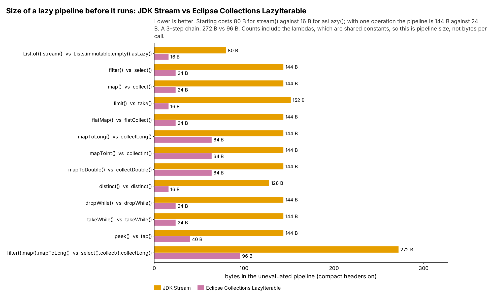
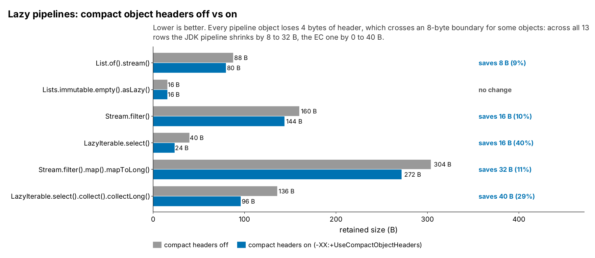

= Lazy pipelines: JDK Stream vs EC LazyIterable (run 20261015-1503)
:toc:
:toclevels: 2

`StreamVsLazyIterableMemoryTest` builds a pipeline on an empty list without running it, for 12 single operations and one 3-step chain, and measures the pipeline minus the list. Sizes are JOL retained sizes (`GraphLayout.parseInstance(x).totalSize()`): every object reachable from the collection, measured once it is filled. They show memory *footprint*, not what building the collection allocated along the way, and not speed. Environment: Run 2026-10-15 in the Claude cloud sandbox, not the local Mac. JOL retained sizes do not depend on the machine. (openjdk version "25.0.4.1" 2026-08-18). JOL sizes depend on the JVM layout (compressed references, object alignment, header size), not the machine. The raw files are `generated/runs/20261015-1503/movers/raw/StreamVsLazyIterableMemoryTest-coh-off.txt` and `StreamVsLazyIterableMemoryTest-coh-on.txt` (the Maven output of the test); they start with the JDK, JOL and Eclipse Collections versions and the full JVM details.

== Summary

* *Starting is 5x cheaper in EC:* `list.stream()` is 80 B (pipeline head plus spliterator; the same 80 B the shakers object counts measured per call), `ecList.asLazy()` is 16 B (one `LazyIterableAdapter`).
* *Each JDK operation adds a pipeline stage of 48 to 72 B; each EC operation adds 0 to 48 B.* The 3-step chain is 272 B against 96 B.
* *These are pipeline sizes, not allocations per call.* The lambdas in the test are non-capturing constants, which JOL counts but a real call does not allocate; and escape analysis can remove EC objects that are not used after the call. For bytes per call, see the shakers JDK Stream ops analysis.

.Size of each unevaluated pipeline, compact headers on

Mermaid source: link:mermaid/20261015-1503-StreamVsLazyIterableMemory-pipeline-size.mmd[20261015-1503-StreamVsLazyIterableMemory-pipeline-size.mmd]

.Compact headers off vs on: start, one operation, and the 3-step chain

Mermaid source: link:mermaid/20261015-1503-StreamVsLazyIterableMemory-coh.mmd[20261015-1503-StreamVsLazyIterableMemory-coh.mmd]

== Every measurement

[cols="3,1,1,3,1,1",options="header"]
|===
|JDK |Off (B) |On (B) |Eclipse Collections |Off (B) |On (B)
|`List.of().stream()` |88 |80 |`Lists.immutable.empty().asLazy()` |16 |16
|`Stream.filter()` |160 |144 |`LazyIterable.select()` |40 |24
|`Stream.map()` |160 |144 |`LazyIterable.collect()` |40 |24
|`Stream.limit()` |168 |152 |`LazyIterable.take()` |24 |16
|`Stream.flatMap()` |160 |144 |`LazyIterable.flatCollect()` |40 |24
|`Stream.mapToLong()` |160 |144 |`LazyIterable.collectLong()` |72 |64
|`Stream.mapToInt()` |160 |144 |`LazyIterable.collectInt()` |72 |64
|`Stream.mapToDouble()` |160 |144 |`LazyIterable.collectDouble()` |72 |64
|`Stream.distinct()` |144 |128 |`LazyIterable.distinct()` |16 |16
|`Stream.dropWhile()` |160 |144 |`LazyIterable.dropWhile()` |40 |24
|`Stream.takeWhile()` |160 |144 |`LazyIterable.takeWhile()` |40 |24
|`Stream.peek()` |160 |144 |`LazyIterable.tap()` |56 |40
|`Stream.filter().map().mapToLong()` |304 |272 |`LazyIterable.select().collect().collectLong()` |136 |96
|===

== Caveats

* JOL counts every reachable object once. Values 1 to 127 come from the `Integer` cache and are shared; with 100,000 or more elements that is under 0.13% of the `Integer`s.
* Retained size includes unused capacity (empty array slots), so a grown collection is larger than a presized one.
* Layout explanations marked "derived" are arithmetic from the measured totals and the JVM details, not separate measurements.

== Reproduce

....
mvn test -Dtest=StreamVsLazyIterableMemoryTest -Dsurefire.failIfNoSpecifiedTests=false \
  -DargLine="-XX:-UseCompactObjectHeaders -Djdk.attach.allowAttachSelf=true -XX:+EnableDynamicAgentLoading"
  > generated/runs/20261015-1503/movers/raw/StreamVsLazyIterableMemoryTest-coh-off.txt 2>&1
# then again with -XX:+UseCompactObjectHeaders into StreamVsLazyIterableMemoryTest-coh-on.txt
java src/main/java/tools/analysis/MoversDocs.java . 20261015-1503
....
