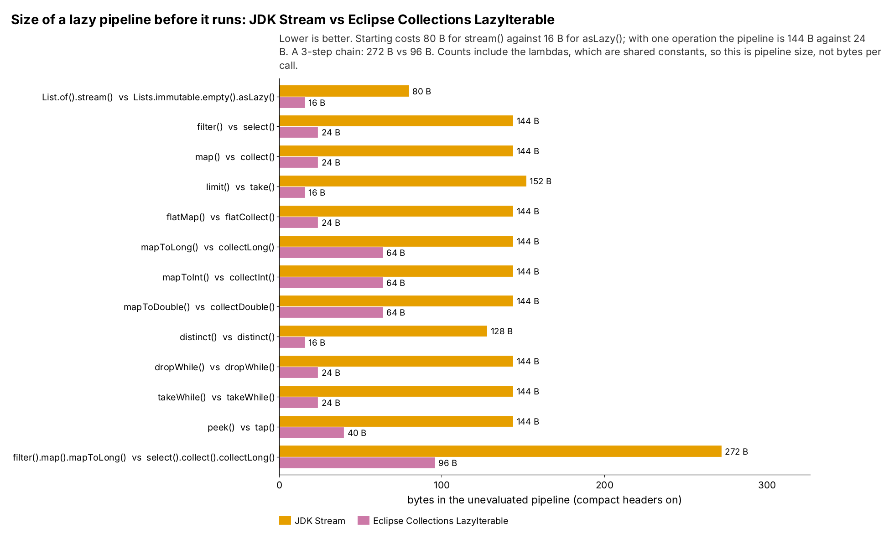
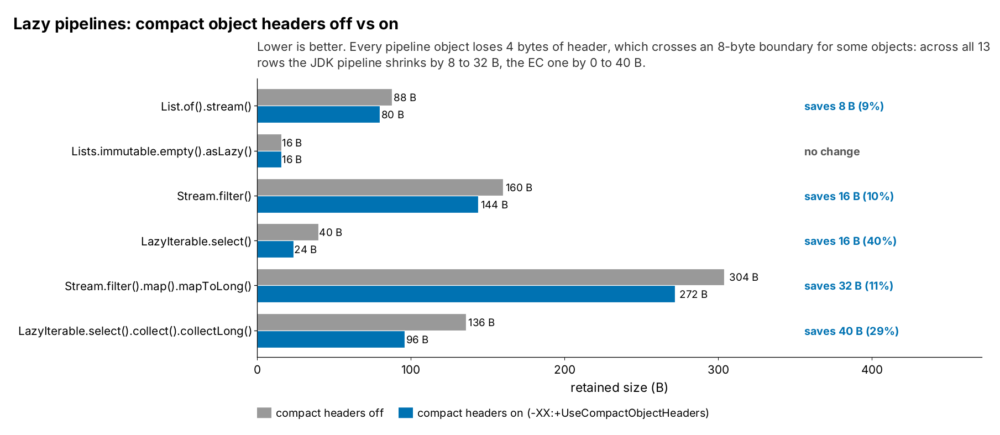

= Run 20261017-1708: full summary
:toc:
:toclevels: 2

Environment: cloud sandbox (Intel(R) Xeon(R) Processor @ 2.10GHz). Written by `RunSummary.java` from the summaries of each part.

== Shakers: garbage and speed per call (JMH)

From link:shakers/reports/20261017-1708-Summary.adoc[the shakers summary].

Environment: cloud sandbox (Intel(R) Xeon(R) Processor @ 2.10GHz) (openjdk version "25.0.4.1" 2026-08-18). Written from the run's numbers by `ShakersDocs.java`; each class has its own analysis with the tables and charts behind these numbers.

=== Garbage and speed per class (compact headers on)

[cols="3,2,1,1,1,1",options="header"]
|===
|Class |JDK method |JDK bytes per call |JDK objects per call |EC bytes per call (every EC version) |JDK time ÷ EC time
|link:shakers/reports/20261017-1708-AnyMatchUtilityAnalysis.adoc[AnyMatchUtility] |`jdkAnyMatch` |160 to 176 |6 to 7 |≈0 |4.7 to 11.3
|link:shakers/reports/20261017-1708-CountUtilityAnalysis.adoc[CountUtility] |`jdkCount` |208 to 224 |7 to 8 |≈0 |2.1
|link:shakers/reports/20261017-1708-FindFirstUtilityAnalysis.adoc[FindFirstUtility] |`jdkFindFirst` |200 to 216 |7 to 8 |≈0 |4.3 to 15.0
|link:shakers/reports/20261017-1708-AnyMatchEagerLazyAnalysis.adoc[AnyMatchEagerLazy] |`jdkAnyMatch` |140 to 176 |6 to 7 |≈0 |4.6 to 12.2
|link:shakers/reports/20261017-1708-CountEagerLazyAnalysis.adoc[CountEagerLazy] |`jdkCount` |208 to 224 |7 to 8 |≈0 |2.0 to 2.1
|link:shakers/reports/20261017-1708-FindFirstEagerLazyAnalysis.adoc[FindFirstEagerLazy] |`jdkFindFirst` |200 to 216 |7 to 8 |≈0 |4.5 to 15.5
|link:shakers/reports/20261017-1708-CollectorsAndCollectors2Analysis.adoc[CollectorsAndCollectors2] |`collectors` |384 |16 |≈0 |163.5
|===

=== Reports

* link:shakers/reports/20261017-1708-AnyMatchUtilityAnalysis.adoc[AnyMatchUtility analysis] and link:shakers/reports/20261017-1708-AnyMatchUtilityResults.adoc[results]
* link:shakers/reports/20261017-1708-CountUtilityAnalysis.adoc[CountUtility analysis] and link:shakers/reports/20261017-1708-CountUtilityResults.adoc[results]
* link:shakers/reports/20261017-1708-FindFirstUtilityAnalysis.adoc[FindFirstUtility analysis] and link:shakers/reports/20261017-1708-FindFirstUtilityResults.adoc[results]
* link:shakers/reports/20261017-1708-AnyMatchEagerLazyAnalysis.adoc[AnyMatchEagerLazy analysis] and link:shakers/reports/20261017-1708-AnyMatchEagerLazyResults.adoc[results]
* link:shakers/reports/20261017-1708-CountEagerLazyAnalysis.adoc[CountEagerLazy analysis] and link:shakers/reports/20261017-1708-CountEagerLazyResults.adoc[results]
* link:shakers/reports/20261017-1708-FindFirstEagerLazyAnalysis.adoc[FindFirstEagerLazy analysis] and link:shakers/reports/20261017-1708-FindFirstEagerLazyResults.adoc[results]
* link:shakers/reports/20261017-1708-CollectorsAndCollectors2Analysis.adoc[CollectorsAndCollectors2 analysis] and link:shakers/reports/20261017-1708-CollectorsAndCollectors2Results.adoc[results]
* link:shakers/reports/20261017-1708-JdkStreamOpsAnalysis.adoc[JDK Stream ops analysis] (written by `JdkOpsDocs.java`)

=== Caveats

One machine (cloud sandbox (Intel(R) Xeon(R) Processor @ 2.10GHz)), one JDK build (openjdk version "25.0.4.1" 2026-08-18), G1 with a fixed 2 GB heap. Microbenchmarks, not an application. Mechanisms are read from the class histograms where shown; anything else is labelled inferred.

== Movers: memory footprint (JOL)

From link:movers/reports/20261017-1708-Summary.adoc[the movers summary].

JOL retained sizes (memory footprint) of JDK and Eclipse Collections collections, compact object headers off and on. Written from the run's numbers by `MoversDocs.java`; each test has its own analysis with the tables and charts.

=== ListMemoryTest

link:movers/reports/20261017-1708-ListMemoryAnalysis.adoc[Full analysis]

* *Boxing is the cost.* At 1,000,000 elements a presized `ArrayList` or `FastList` holds 20.0 MB; `IntArrayList` holds 4.0 MB, 5x less. Per element that is 20 B (a 16 B `Integer` plus a 4 B reference in the array) against 4 B (derived).
* *`ArrayList` and `FastList` are the same size* (within 8 B) when presized: both are a small object around one `Object[]`.
* *Growing instead of presizing wastes up to 49%* (unused capacity after the last resize). The policies differ: `ArrayList` grows by 1.5x, so its waste is spread evenly; `FastList` and `IntArrayList` grow in bigger steps.
* *Compact headers change almost nothing here:* a 16 B `Integer` stays 16 B (12 B header + 4 B `int` without compact headers, 8 B + 4 B padded to 16 B with them), so only the list object itself shrinks, by 0 to 8 B (derived).

=== SetMemoryTest

link:movers/reports/20261017-1708-SetMemoryAnalysis.adoc[Full analysis]

* *The JDK `HashSet` holds twice as much as `UnifiedSet`:* 48.4 MB against 24.4 MB at 1,000,000 `Integer`s. `IntHashSet` holds 8.4 MB, about 6x less than `HashSet`.
* *Without the `Integer`s the gap is 4x:* `HashSet` itself takes 32.4 MB, `UnifiedSet` 8.4 MB. `HashSet` is a `HashMap` that makes a `HashMap$Node` per element (24 B with compact headers, 32 B without) next to its table; `UnifiedSet` puts the element straight into its table (derived: 1,000,000 × 24 B + 2^21 slots × 4 B ≈ 32.4 MB).
* *`IntHashSet` is the same size as `UnifiedSet` without its `Integer`s* (8.4 MB): an `int[]` instead of an `Object[]` of the same length, and no boxes.
* *Compact headers save 8.0 MB on `HashSet`* (one 8 B saving per node) and nothing on the EC sets, which have no per-element objects besides the `Integer`s.
* *The tables double at different sizes:* `HashSet` and `UnifiedSet` at 200k, 400k and 800k elements, `IntHashSet` at 200k, 300k and 600k, so it keeps more empty slots (a lower load factor, inferred from the steps).

=== MapMemoryTest

link:movers/reports/20261017-1708-MapMemoryAnalysis.adoc[Full analysis]

* *`HashMap<Integer, Integer>` holds 48.4 MB; `UnifiedMap` holds 32.8 MB* at 1,000,000 entries (the key and the value are the same `Integer`, so each map holds one `Integer` per entry). `IntIntHashMap` holds 16.8 MB, about 3x less than `HashMap`.
* *Without the `Integer`s:* `HashMap` itself takes 32.4 MB, `UnifiedMap` 16.8 MB. `HashMap` makes a `HashMap$Node` per entry (24 B with compact headers, 32 B without) next to its table; `UnifiedMap` stores key and value side by side in one `Object[]` (derived: 2^22 slots × 4 B ≈ 16.8 MB).
* *Half-primitive maps do not help here:* `IntObjectHashMap` and `ObjectIntHashMap` hold 32.8 MB, the same as `UnifiedMap`, because one side is still a boxed `Integer` and the other side's array is as long as before. Only `IntIntHashMap`, with no boxes at all, is smaller.
* *Compact headers save 8.0 MB on `HashMap`* (one 8 B saving per node) and nothing on the EC maps.

=== StreamVsLazyIterableMemoryTest

link:movers/reports/20261017-1708-StreamVsLazyIterableMemoryAnalysis.adoc[Full analysis]

* *Starting is 5x cheaper in EC:* `list.stream()` is 80 B (pipeline head plus spliterator; the same 80 B the shakers object counts measured per call), `ecList.asLazy()` is 16 B (one `LazyIterableAdapter`).
* *Each JDK operation adds a pipeline stage of 48 to 72 B; each EC operation adds 0 to 48 B.* The 3-step chain is 272 B against 96 B.
* *These are pipeline sizes, not allocations per call.* The lambdas in the test are non-capturing constants, which JOL counts but a real call does not allocate; and escape analysis can remove EC objects that are not used after the call. For bytes per call, see the shakers JDK Stream ops analysis.

.Size of each unevaluated pipeline, compact headers on

Mermaid source: link:movers/reports/mermaid/20261017-1708-StreamVsLazyIterableMemory-pipeline-size.mmd[20261017-1708-StreamVsLazyIterableMemory-pipeline-size.mmd]

.Compact headers off vs on: start, one operation, and the 3-step chain

Mermaid source: link:movers/reports/mermaid/20261017-1708-StreamVsLazyIterableMemory-coh.mmd[20261017-1708-StreamVsLazyIterableMemory-coh.mmd]
