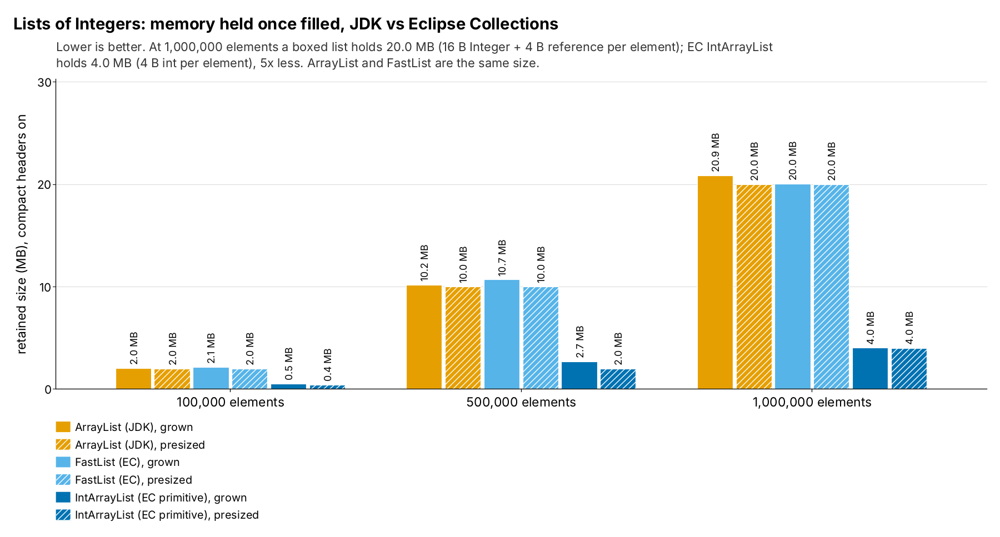
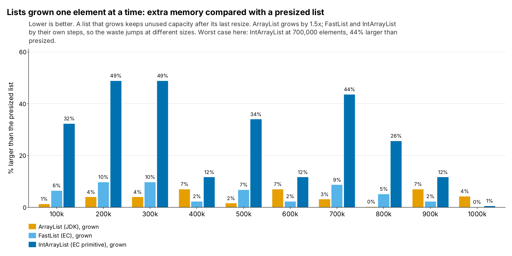

= Lists: JDK ArrayList vs EC FastList and IntArrayList (run 20261017-1708)
:toc:
:toclevels: 2

`ListMemoryTest` fills each list with the `Integer`s (or `int`s) 1 to n, for n = 100,000 to 1,000,000, once growing it from empty and once presized to n. Sizes are JOL retained sizes (`GraphLayout.parseInstance(x).totalSize()`): every object reachable from the collection, measured once it is filled. They show memory *footprint*, not what building the collection allocated along the way, and not speed. Environment: cloud sandbox (Intel(R) Xeon(R) Processor @ 2.10GHz) (openjdk version "25.0.4.1" 2026-08-18). JOL sizes depend on the JVM layout (compressed references, object alignment, header size), not the machine. The raw files are `generated/runs/20261017-1708/movers/raw/ListMemoryTest-coh-off.txt` and `ListMemoryTest-coh-on.txt` (the Maven output of the test); `meta.txt` in the same folder has the JDK and the machine.

== Summary

* *Boxing is the cost.* At 1,000,000 elements a presized `ArrayList` or `FastList` holds 20.0 MB; `IntArrayList` holds 4.0 MB, 5x less. Per element that is 20 B (a 16 B `Integer` plus a 4 B reference in the array) against 4 B (derived).
* *`ArrayList` and `FastList` are the same size* (within 8 B) when presized: both are a small object around one `Object[]`.
* *Growing instead of presizing wastes up to 49%* (unused capacity after the last resize). The policies differ: `ArrayList` grows by 1.5x, so its waste is spread evenly; `FastList` and `IntArrayList` grow in bigger steps.
* *Compact headers change almost nothing here:* a 16 B `Integer` stays 16 B (12 B header + 4 B `int` without compact headers, 8 B + 4 B padded to 16 B with them), so only the list object itself shrinks, by 0 to 8 B (derived).

== Memory held once filled

.Retained size of each list, compact headers on

Mermaid source: link:mermaid/20261017-1708-ListMemory-footprint.mmd[20261017-1708-ListMemory-footprint.mmd]

== Growing vs presizing

.Extra memory of a grown list compared with a presized one

Mermaid source: link:mermaid/20261017-1708-ListMemory-growth-slack.mmd[20261017-1708-ListMemory-growth-slack.mmd]

[cols="1,1,1,1",options="header"]
|===
|Elements |ArrayList |FastList |IntArrayList
|100,000 |1.3% |6.5% |32.4%
|200,000 |4.0% |9.8% |48.9%
|300,000 |4.0% |9.8% |48.9%
|400,000 |7.0% |2.3% |11.7%
|500,000 |1.6% |6.8% |34.0%
|600,000 |7.0% |2.3% |11.7%
|700,000 |3.2% |8.7% |43.6%
|800,000 |0.3% |5.1% |25.7%
|900,000 |7.0% |2.3% |11.7%
|1,000,000 |4.3% |0.1% |0.5%
|===

A grown list also threw away every smaller array it outgrew. JOL does not see that garbage; it shows only the final list.

== Compact headers off vs on (1,000,000 elements)

[cols="3,1,1,1",options="header"]
|===
|List |Headers off (B) |Headers on (B) |Saved (B)
|ArrayList (JDK), grown |20,861,992 |20,861,984 |8
|ArrayList (JDK), presized |20,000,040 |20,000,040 |0
|FastList (EC), grown |20,021,272 |20,021,264 |8
|FastList (EC), presized |20,000,040 |20,000,032 |8
|IntArrayList (EC primitive), grown |4,021,272 |4,021,264 |8
|IntArrayList (EC primitive), presized |4,000,040 |4,000,032 |8
|===

== Every measurement

[cols="3,1,1,1,1",options="header"]
|===
|Collection |Elements |Headers off (B) |Headers on (B) |B per element (on)
|ArrayList (JDK), grown |100,000 |2,026,880 |2,026,880 |20.3
|ArrayList (JDK), grown |200,000 |4,160,432 |4,160,424 |20.8
|ArrayList (JDK), grown |300,000 |6,240,624 |6,240,616 |20.8
|ArrayList (JDK), grown |400,000 |8,560,912 |8,560,904 |21.4
|ArrayList (JDK), grown |500,000 |10,160,912 |10,160,904 |20.3
|ArrayList (JDK), grown |600,000 |12,841,344 |12,841,336 |21.4
|ArrayList (JDK), grown |700,000 |14,441,344 |14,441,336 |20.6
|ArrayList (JDK), grown |800,000 |16,041,344 |16,041,336 |20.1
|ArrayList (JDK), grown |900,000 |19,261,992 |19,261,984 |21.4
|ArrayList (JDK), grown |1,000,000 |20,861,992 |20,861,984 |20.9
|ArrayList (JDK), presized |100,000 |2,000,040 |2,000,040 |20.0
|ArrayList (JDK), presized |200,000 |4,000,040 |4,000,040 |20.0
|ArrayList (JDK), presized |300,000 |6,000,040 |6,000,040 |20.0
|ArrayList (JDK), presized |400,000 |8,000,040 |8,000,040 |20.0
|ArrayList (JDK), presized |500,000 |10,000,040 |10,000,040 |20.0
|ArrayList (JDK), presized |600,000 |12,000,040 |12,000,040 |20.0
|ArrayList (JDK), presized |700,000 |14,000,040 |14,000,040 |20.0
|ArrayList (JDK), presized |800,000 |16,000,040 |16,000,040 |20.0
|ArrayList (JDK), presized |900,000 |18,000,040 |18,000,040 |20.0
|ArrayList (JDK), presized |1,000,000 |20,000,040 |20,000,040 |20.0
|FastList (EC), grown |100,000 |2,129,584 |2,129,568 |21.3
|FastList (EC), grown |200,000 |4,391,512 |4,391,504 |22.0
|FastList (EC), grown |300,000 |6,587,256 |6,587,240 |22.0
|FastList (EC), grown |400,000 |8,187,256 |8,187,240 |20.5
|FastList (EC), grown |500,000 |10,680,864 |10,680,848 |21.4
|FastList (EC), grown |600,000 |12,280,864 |12,280,848 |20.5
|FastList (EC), grown |700,000 |15,221,272 |15,221,264 |21.7
|FastList (EC), grown |800,000 |16,821,272 |16,821,264 |21.0
|FastList (EC), grown |900,000 |18,421,272 |18,421,264 |20.5
|FastList (EC), grown |1,000,000 |20,021,272 |20,021,264 |20.0
|FastList (EC), presized |100,000 |2,000,040 |2,000,032 |20.0
|FastList (EC), presized |200,000 |4,000,040 |4,000,032 |20.0
|FastList (EC), presized |300,000 |6,000,040 |6,000,032 |20.0
|FastList (EC), presized |400,000 |8,000,040 |8,000,032 |20.0
|FastList (EC), presized |500,000 |10,000,040 |10,000,032 |20.0
|FastList (EC), presized |600,000 |12,000,040 |12,000,032 |20.0
|FastList (EC), presized |700,000 |14,000,040 |14,000,032 |20.0
|FastList (EC), presized |800,000 |16,000,040 |16,000,032 |20.0
|FastList (EC), presized |900,000 |18,000,040 |18,000,032 |20.0
|FastList (EC), presized |1,000,000 |20,000,040 |20,000,032 |20.0
|IntArrayList (EC primitive), grown |100,000 |529,584 |529,568 |5.3
|IntArrayList (EC primitive), grown |200,000 |1,191,512 |1,191,504 |6.0
|IntArrayList (EC primitive), grown |300,000 |1,787,256 |1,787,240 |6.0
|IntArrayList (EC primitive), grown |400,000 |1,787,256 |1,787,240 |4.5
|IntArrayList (EC primitive), grown |500,000 |2,680,864 |2,680,848 |5.4
|IntArrayList (EC primitive), grown |600,000 |2,680,864 |2,680,848 |4.5
|IntArrayList (EC primitive), grown |700,000 |4,021,272 |4,021,264 |5.7
|IntArrayList (EC primitive), grown |800,000 |4,021,272 |4,021,264 |5.0
|IntArrayList (EC primitive), grown |900,000 |4,021,272 |4,021,264 |4.5
|IntArrayList (EC primitive), grown |1,000,000 |4,021,272 |4,021,264 |4.0
|IntArrayList (EC primitive), presized |100,000 |400,040 |400,032 |4.0
|IntArrayList (EC primitive), presized |200,000 |800,040 |800,032 |4.0
|IntArrayList (EC primitive), presized |300,000 |1,200,040 |1,200,032 |4.0
|IntArrayList (EC primitive), presized |400,000 |1,600,040 |1,600,032 |4.0
|IntArrayList (EC primitive), presized |500,000 |2,000,040 |2,000,032 |4.0
|IntArrayList (EC primitive), presized |600,000 |2,400,040 |2,400,032 |4.0
|IntArrayList (EC primitive), presized |700,000 |2,800,040 |2,800,032 |4.0
|IntArrayList (EC primitive), presized |800,000 |3,200,040 |3,200,032 |4.0
|IntArrayList (EC primitive), presized |900,000 |3,600,040 |3,600,032 |4.0
|IntArrayList (EC primitive), presized |1,000,000 |4,000,040 |4,000,032 |4.0
|===

== Caveats

* JOL counts every reachable object once. Values 1 to 127 come from the `Integer` cache and are shared; with 100,000 or more elements that is under 0.13% of the `Integer`s.
* Retained size includes unused capacity (empty array slots), so a grown collection is larger than a presized one.
* Layout explanations marked "derived" are arithmetic from the measured totals and the JVM details, not separate measurements.

== Reproduce

....
mvn test -Dtest=ListMemoryTest -Dsurefire.failIfNoSpecifiedTests=false \
  -DargLine="-XX:-UseCompactObjectHeaders -Djdk.attach.allowAttachSelf=true -XX:+EnableDynamicAgentLoading"
  > generated/runs/20261017-1708/movers/raw/ListMemoryTest-coh-off.txt 2>&1
# then again with -XX:+UseCompactObjectHeaders into ListMemoryTest-coh-on.txt
java src/main/java/tools/analysis/MoversDocs.java . 20261017-1708
....
