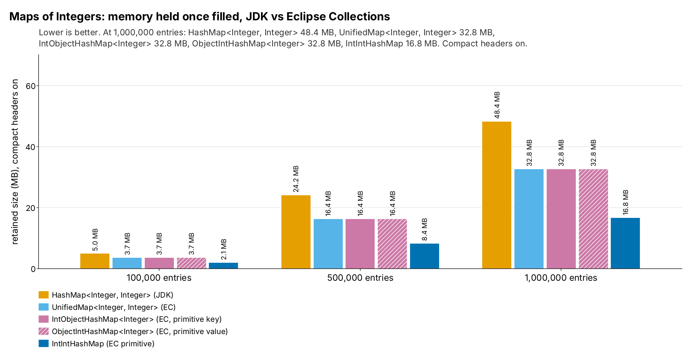
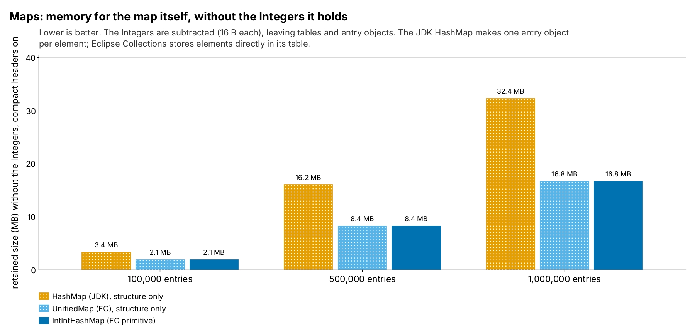
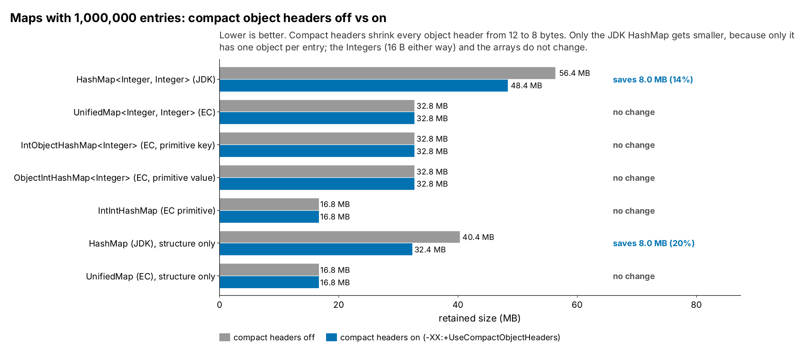

= Maps: JDK HashMap vs EC UnifiedMap and primitive maps (run 20261017-1708)
:toc:
:toclevels: 2

`MapMemoryTest` fills each map with n entries mapping i to i, for n = 100,000 to 1,000,000. In the boxed maps the key and the value are the same `Integer` object, so each map holds one `Integer` per entry; the "structure only" rows subtract them. Sizes are JOL retained sizes (`GraphLayout.parseInstance(x).totalSize()`): every object reachable from the collection, measured once it is filled. They show memory *footprint*, not what building the collection allocated along the way, and not speed. Environment: cloud sandbox (Intel(R) Xeon(R) Processor @ 2.10GHz) (openjdk version "25.0.4.1" 2026-08-18). JOL sizes depend on the JVM layout (compressed references, object alignment, header size), not the machine. The raw files are `generated/runs/20261017-1708/movers/raw/MapMemoryTest-coh-off.txt` and `MapMemoryTest-coh-on.txt` (the Maven output of the test); `meta.txt` in the same folder has the JDK and the machine.

== Summary

* *`HashMap<Integer, Integer>` holds 48.4 MB; `UnifiedMap` holds 32.8 MB* at 1,000,000 entries (the key and the value are the same `Integer`, so each map holds one `Integer` per entry). `IntIntHashMap` holds 16.8 MB, about 3x less than `HashMap`.
* *Without the `Integer`s:* `HashMap` itself takes 32.4 MB, `UnifiedMap` 16.8 MB. `HashMap` makes a `HashMap$Node` per entry (24 B with compact headers, 32 B without) next to its table; `UnifiedMap` stores key and value side by side in one `Object[]` (derived: 2^22 slots × 4 B ≈ 16.8 MB).
* *Half-primitive maps do not help here:* `IntObjectHashMap` and `ObjectIntHashMap` hold 32.8 MB, the same as `UnifiedMap`, because one side is still a boxed `Integer` and the other side's array is as long as before. Only `IntIntHashMap`, with no boxes at all, is smaller.
* *Compact headers save 8.0 MB on `HashMap`* (one 8 B saving per node) and nothing on the EC maps.

== Memory held once filled

.Retained size of each map, compact headers on

Mermaid source: link:mermaid/20261017-1708-MapMemory-footprint.mmd[20261017-1708-MapMemory-footprint.mmd]

== The structure alone

.Retained size without the Integers, compact headers on

Mermaid source: link:mermaid/20261017-1708-MapMemory-structure-only.mmd[20261017-1708-MapMemory-structure-only.mmd]

== Compact headers off vs on

.Retained size at 1,000,000 entries, compact headers off vs on

Mermaid source: link:mermaid/20261017-1708-MapMemory-coh.mmd[20261017-1708-MapMemory-coh.mmd]

[cols="3,1,1,1",options="header"]
|===
|Collection (1,000,000 entries) |Headers off (B) |Headers on (B) |Saved
|HashMap<Integer, Integer> (JDK) |56,388,672 |48,388,664 |8,000,008 B (14%)
|UnifiedMap<Integer, Integer> (EC) |32,777,264 |32,777,256 |8 B (0%)
|IntObjectHashMap<Integer> (EC, primitive key) |32,777,312 |32,777,304 |8 B (0%)
|ObjectIntHashMap<Integer> (EC, primitive value) |32,777,280 |32,777,272 |8 B (0%)
|IntIntHashMap (EC primitive) |16,777,288 |16,777,288 |0 B (0%)
|HashMap (JDK), structure only |40,388,672 |32,388,664 |8,000,008 B (20%)
|UnifiedMap (EC), structure only |16,777,264 |16,777,256 |8 B (0%)
|===

== Every measurement

[cols="3,1,1,1,1",options="header"]
|===
|Collection |Elements |Headers off (B) |Headers on (B) |B per element (on)
|HashMap<Integer, Integer> (JDK) |100,000 |5,848,640 |5,048,632 |50.5
|HashMap<Integer, Integer> (JDK) |200,000 |11,697,216 |10,097,208 |50.5
|HashMap<Integer, Integer> (JDK) |300,000 |16,497,216 |14,097,208 |47.0
|HashMap<Integer, Integer> (JDK) |400,000 |23,394,368 |20,194,360 |50.5
|HashMap<Integer, Integer> (JDK) |500,000 |28,194,368 |24,194,360 |48.4
|HashMap<Integer, Integer> (JDK) |600,000 |32,994,368 |28,194,360 |47.0
|HashMap<Integer, Integer> (JDK) |700,000 |37,794,368 |32,194,360 |46.0
|HashMap<Integer, Integer> (JDK) |800,000 |46,788,672 |40,388,664 |50.5
|HashMap<Integer, Integer> (JDK) |900,000 |51,588,672 |44,388,664 |49.3
|HashMap<Integer, Integer> (JDK) |1,000,000 |56,388,672 |48,388,664 |48.4
|UnifiedMap<Integer, Integer> (EC) |100,000 |3,697,200 |3,697,192 |37.0
|UnifiedMap<Integer, Integer> (EC) |200,000 |7,394,352 |7,394,344 |37.0
|UnifiedMap<Integer, Integer> (EC) |300,000 |8,994,352 |8,994,344 |30.0
|UnifiedMap<Integer, Integer> (EC) |400,000 |14,788,656 |14,788,648 |37.0
|UnifiedMap<Integer, Integer> (EC) |500,000 |16,388,656 |16,388,648 |32.8
|UnifiedMap<Integer, Integer> (EC) |600,000 |17,988,656 |17,988,648 |30.0
|UnifiedMap<Integer, Integer> (EC) |700,000 |19,588,656 |19,588,648 |28.0
|UnifiedMap<Integer, Integer> (EC) |800,000 |29,577,264 |29,577,256 |37.0
|UnifiedMap<Integer, Integer> (EC) |900,000 |31,177,264 |31,177,256 |34.6
|UnifiedMap<Integer, Integer> (EC) |1,000,000 |32,777,264 |32,777,256 |32.8
|IntObjectHashMap<Integer> (EC, primitive key) |100,000 |3,697,248 |3,697,240 |37.0
|IntObjectHashMap<Integer> (EC, primitive key) |200,000 |7,394,400 |7,394,392 |37.0
|IntObjectHashMap<Integer> (EC, primitive key) |300,000 |13,188,704 |13,188,696 |44.0
|IntObjectHashMap<Integer> (EC, primitive key) |400,000 |14,788,704 |14,788,696 |37.0
|IntObjectHashMap<Integer> (EC, primitive key) |500,000 |16,388,704 |16,388,696 |32.8
|IntObjectHashMap<Integer> (EC, primitive key) |600,000 |26,377,312 |26,377,304 |44.0
|IntObjectHashMap<Integer> (EC, primitive key) |700,000 |27,977,312 |27,977,304 |40.0
|IntObjectHashMap<Integer> (EC, primitive key) |800,000 |29,577,312 |29,577,304 |37.0
|IntObjectHashMap<Integer> (EC, primitive key) |900,000 |31,177,312 |31,177,304 |34.6
|IntObjectHashMap<Integer> (EC, primitive key) |1,000,000 |32,777,312 |32,777,304 |32.8
|ObjectIntHashMap<Integer> (EC, primitive value) |100,000 |3,697,216 |3,697,208 |37.0
|ObjectIntHashMap<Integer> (EC, primitive value) |200,000 |7,394,368 |7,394,360 |37.0
|ObjectIntHashMap<Integer> (EC, primitive value) |300,000 |13,188,672 |13,188,664 |44.0
|ObjectIntHashMap<Integer> (EC, primitive value) |400,000 |14,788,672 |14,788,664 |37.0
|ObjectIntHashMap<Integer> (EC, primitive value) |500,000 |16,388,672 |16,388,664 |32.8
|ObjectIntHashMap<Integer> (EC, primitive value) |600,000 |26,377,280 |26,377,272 |44.0
|ObjectIntHashMap<Integer> (EC, primitive value) |700,000 |27,977,280 |27,977,272 |40.0
|ObjectIntHashMap<Integer> (EC, primitive value) |800,000 |29,577,280 |29,577,272 |37.0
|ObjectIntHashMap<Integer> (EC, primitive value) |900,000 |31,177,280 |31,177,272 |34.6
|ObjectIntHashMap<Integer> (EC, primitive value) |1,000,000 |32,777,280 |32,777,272 |32.8
|IntIntHashMap (EC primitive) |100,000 |2,097,224 |2,097,224 |21.0
|IntIntHashMap (EC primitive) |200,000 |4,194,376 |4,194,376 |21.0
|IntIntHashMap (EC primitive) |300,000 |8,388,680 |8,388,680 |28.0
|IntIntHashMap (EC primitive) |400,000 |8,388,680 |8,388,680 |21.0
|IntIntHashMap (EC primitive) |500,000 |8,388,680 |8,388,680 |16.8
|IntIntHashMap (EC primitive) |600,000 |16,777,288 |16,777,288 |28.0
|IntIntHashMap (EC primitive) |700,000 |16,777,288 |16,777,288 |24.0
|IntIntHashMap (EC primitive) |800,000 |16,777,288 |16,777,288 |21.0
|IntIntHashMap (EC primitive) |900,000 |16,777,288 |16,777,288 |18.6
|IntIntHashMap (EC primitive) |1,000,000 |16,777,288 |16,777,288 |16.8
|HashMap (JDK), structure only |100,000 |4,248,640 |3,448,632 |34.5
|HashMap (JDK), structure only |200,000 |8,497,216 |6,897,208 |34.5
|HashMap (JDK), structure only |300,000 |11,697,216 |9,297,208 |31.0
|HashMap (JDK), structure only |400,000 |16,994,368 |13,794,360 |34.5
|HashMap (JDK), structure only |500,000 |20,194,368 |16,194,360 |32.4
|HashMap (JDK), structure only |600,000 |23,394,368 |18,594,360 |31.0
|HashMap (JDK), structure only |700,000 |26,594,368 |20,994,360 |30.0
|HashMap (JDK), structure only |800,000 |33,988,672 |27,588,664 |34.5
|HashMap (JDK), structure only |900,000 |37,188,672 |29,988,664 |33.3
|HashMap (JDK), structure only |1,000,000 |40,388,672 |32,388,664 |32.4
|UnifiedMap (EC), structure only |100,000 |2,097,200 |2,097,192 |21.0
|UnifiedMap (EC), structure only |200,000 |4,194,352 |4,194,344 |21.0
|UnifiedMap (EC), structure only |300,000 |4,194,352 |4,194,344 |14.0
|UnifiedMap (EC), structure only |400,000 |8,388,656 |8,388,648 |21.0
|UnifiedMap (EC), structure only |500,000 |8,388,656 |8,388,648 |16.8
|UnifiedMap (EC), structure only |600,000 |8,388,656 |8,388,648 |14.0
|UnifiedMap (EC), structure only |700,000 |8,388,656 |8,388,648 |12.0
|UnifiedMap (EC), structure only |800,000 |16,777,264 |16,777,256 |21.0
|UnifiedMap (EC), structure only |900,000 |16,777,264 |16,777,256 |18.6
|UnifiedMap (EC), structure only |1,000,000 |16,777,264 |16,777,256 |16.8
|===

== Caveats

* JOL counts every reachable object once. Values 1 to 127 come from the `Integer` cache and are shared; with 100,000 or more elements that is under 0.13% of the `Integer`s.
* Retained size includes unused capacity (empty array slots), so a grown collection is larger than a presized one.
* Layout explanations marked "derived" are arithmetic from the measured totals and the JVM details, not separate measurements.

== Reproduce

....
mvn test -Dtest=MapMemoryTest -Dsurefire.failIfNoSpecifiedTests=false \
  -DargLine="-XX:-UseCompactObjectHeaders -Djdk.attach.allowAttachSelf=true -XX:+EnableDynamicAgentLoading"
  > generated/runs/20261017-1708/movers/raw/MapMemoryTest-coh-off.txt 2>&1
# then again with -XX:+UseCompactObjectHeaders into MapMemoryTest-coh-on.txt
java src/main/java/tools/analysis/MoversDocs.java . 20261017-1708
....
