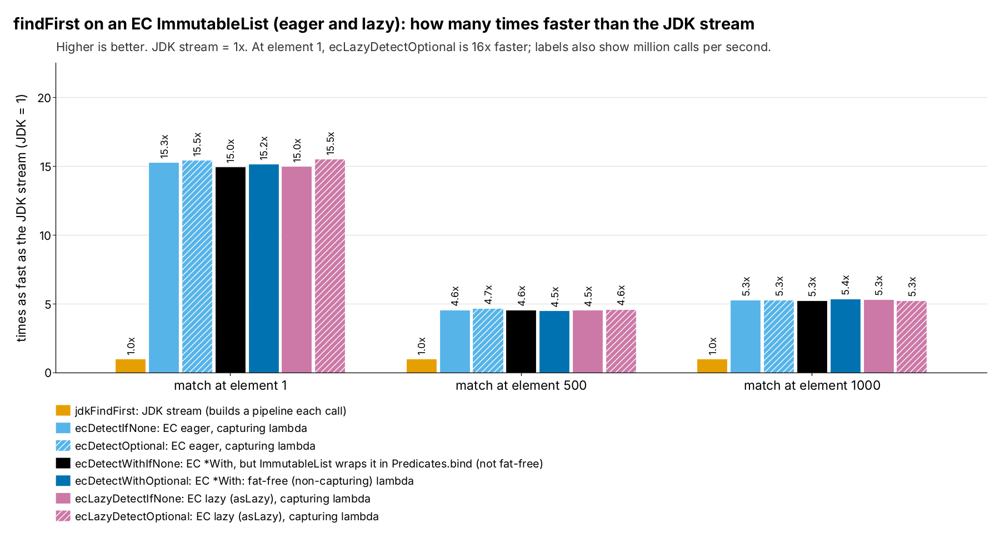
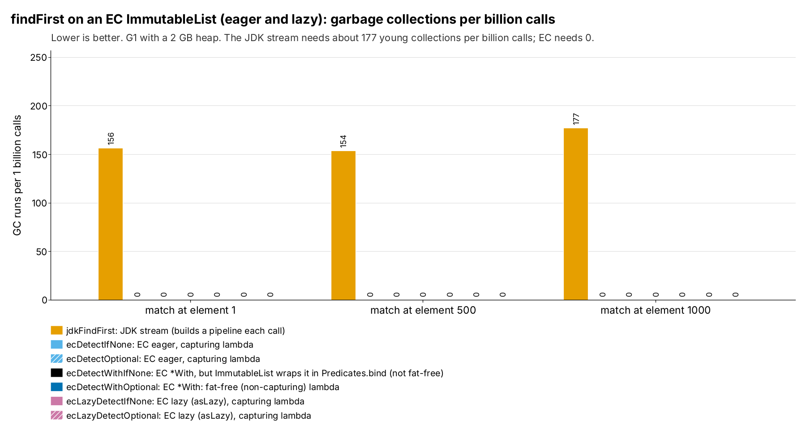
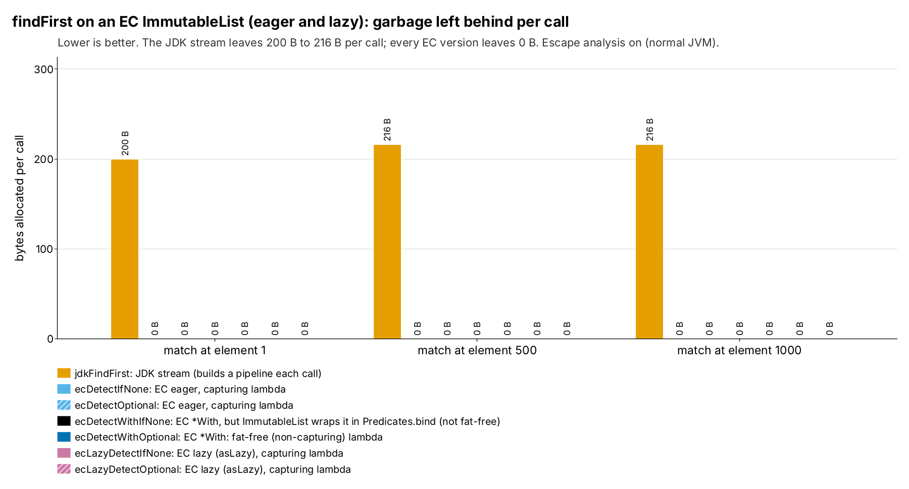
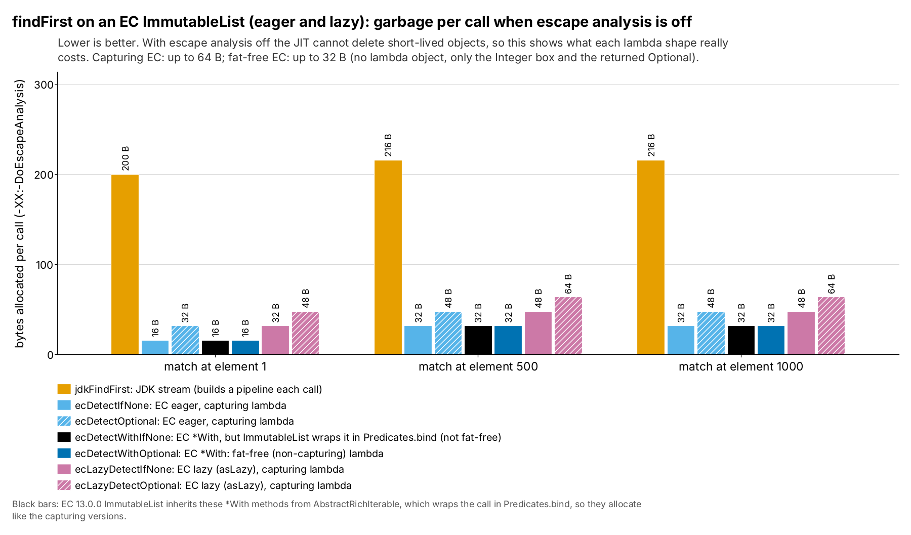
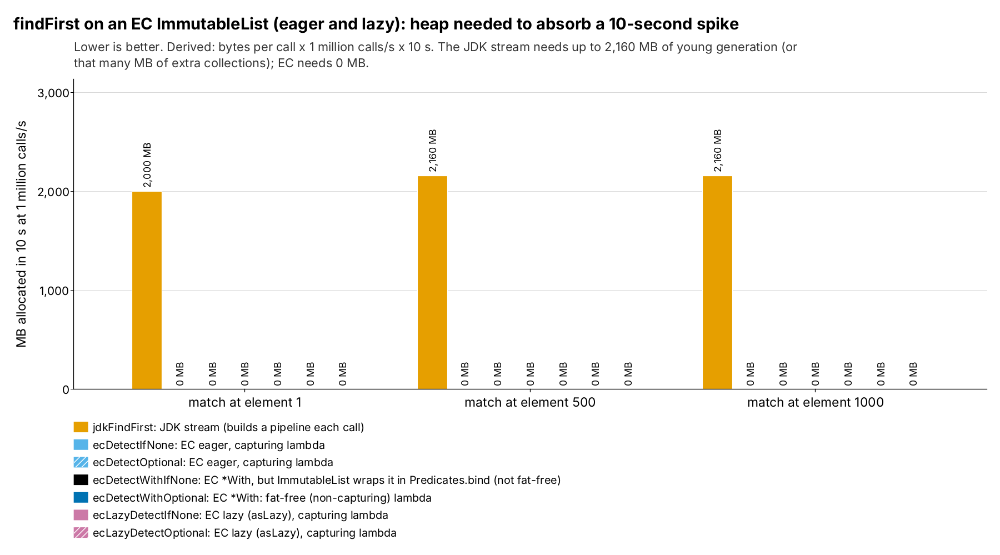
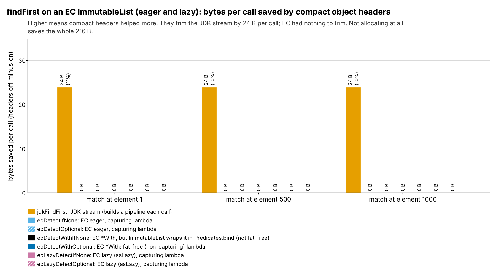

= FindFirstEagerLazy: fat-free lambdas and garbage (run 20261017-1708)
:toc:
:toclevels: 2

Input: link:20261017-1708-FindFirstEagerLazyResults.adoc[20261017-1708-FindFirstEagerLazyResults.adoc]. Environment: cloud sandbox (Intel(R) Xeon(R) Processor @ 2.10GHz) (openjdk version "25.0.4.1" 2026-08-18). Absolute timings depend on the machine; bytes and object counts do not.

== Summary

* `jdkFindFirst` (JDK stream) allocates 200 to 216 B (7 to 8 objects) per call across test = 1, 500, 1000.
* The Eclipse Collections versions allocate per call: `ecDetectIfNone` ≈0 B, `ecDetectOptional` ≈0 B, `ecDetectWithIfNone` ≈0 B, `ecDetectWithOptional` ≈0 B, `ecLazyDetectIfNone` ≈0 B, `ecLazyDetectOptional` ≈0 B.
* At 10 million calls per second the JDK version allocates 2.00 to 2.16 GB/s and the EC versions nothing: the young-generation space a 10-second spike at that rate needs is 10 times that.
* Time per call, JDK vs the fastest EC version: test = 1: 35.6 vs 2.29 ns; test = 500: 1,537 vs 328 ns; test = 1000: 3,542 vs 660 ns. The JDK version takes 4.5 to 15.5 times as long as an EC version.
* With escape analysis off (what each lambda shape costs when the JIT cannot remove it): `jdkFindFirst` 200 to 216 B, `ecDetectIfNone` 16 to 32 B, `ecDetectOptional` 32 to 48 B, `ecDetectWithIfNone` 16 to 32 B, `ecDetectWithOptional` 16 to 32 B, `ecLazyDetectIfNone` 32 to 48 B, `ecLazyDetectOptional` 48 to 64 B per call.
* Compact object headers, JDK version bytes per call: test = 1: 224 B without, 200 B with (11% less); test = 500: 240 B without, 216 B with (10% less); test = 1000: 240 B without, 216 B with (10% less).

== Head-to-head (compact headers on)

Throughput = 1000 ÷ ns per call. Calls measured = 40 s ÷ ns per call. Objects per call come from the object-count run; bytes per call from `gc.alloc.rate.norm`.

[cols="3,2,1,1,1,1,1,1",options="header"]
|===
|Implementation |Kind |Throughput (M calls/s) |Time per call (ns) |Objects per call |Bytes per call |GC runs per 1B calls |GC time per 1B calls (ms)
8+h|test = 1
|`jdkFindFirst` |JDK stream |28.1 |35.6 ± 1.14 |7.00 |200 |156 |370
|`ecDetectIfNone` |EC eager, capturing |430 |2.33 ± 0.16 |0 |≈0 |0 |0
|`ecDetectOptional` |EC eager, capturing |435 |2.30 ± 0.09 |0 |≈0 |0 |0
|`ecDetectWithIfNone` |EC fat-free (*With) |421 |2.37 ± 0.24 |0 |≈0 |0 |0
|`ecDetectWithOptional` |EC fat-free (*With) |427 |2.34 ± 0.11 |0 |≈0 |0 |0
|`ecLazyDetectIfNone` |EC lazy, capturing |422 |2.37 ± 0.11 |0 |≈0 |0 |0
|`ecLazyDetectOptional` |EC lazy, capturing |437 |2.29 ± 0.09 |0 |≈0 |0 |0
8+a|`ecDetectIfNone` vs JDK: 15.3x faster, 7.00 fewer objects and 200 fewer bytes per call, 0 vs 156 GC runs per billion calls +
`ecDetectOptional` vs JDK: 15.5x faster, 7.00 fewer objects and 200 fewer bytes per call, 0 vs 156 GC runs per billion calls +
`ecDetectWithIfNone` vs JDK: 15.0x faster, 7.00 fewer objects and 200 fewer bytes per call, 0 vs 156 GC runs per billion calls +
`ecDetectWithOptional` vs JDK: 15.2x faster, 7.00 fewer objects and 200 fewer bytes per call, 0 vs 156 GC runs per billion calls +
`ecLazyDetectIfNone` vs JDK: 15.0x faster, 7.00 fewer objects and 200 fewer bytes per call, 0 vs 156 GC runs per billion calls +
`ecLazyDetectOptional` vs JDK: 15.5x faster, 7.00 fewer objects and 200 fewer bytes per call, 0 vs 156 GC runs per billion calls
8+h|test = 500
|`jdkFindFirst` |JDK stream |0.65 |1,537 ± 118 |7.00 |216 |154 |653
|`ecDetectIfNone` |EC eager, capturing |2.96 |338 ± 13.9 |0 |≈0 |0 |0
|`ecDetectOptional` |EC eager, capturing |3.05 |328 ± 22.5 |0 |≈0 |0 |0
|`ecDetectWithIfNone` |EC fat-free (*With) |2.97 |337 ± 14.2 |0 |≈0 |0 |0
|`ecDetectWithOptional` |EC fat-free (*With) |2.93 |342 ± 11.5 |0 |≈0 |0 |0
|`ecLazyDetectIfNone` |EC lazy, capturing |2.96 |338 ± 11.1 |0 |≈0 |0 |0
|`ecLazyDetectOptional` |EC lazy, capturing |3.00 |333 ± 13.0 |0 |≈0 |0 |0
8+a|`ecDetectIfNone` vs JDK: 4.6x faster, 7.00 fewer objects and 216 fewer bytes per call, 0 vs 154 GC runs per billion calls +
`ecDetectOptional` vs JDK: 4.7x faster, 7.00 fewer objects and 216 fewer bytes per call, 0 vs 154 GC runs per billion calls +
`ecDetectWithIfNone` vs JDK: 4.6x faster, 7.00 fewer objects and 216 fewer bytes per call, 0 vs 154 GC runs per billion calls +
`ecDetectWithOptional` vs JDK: 4.5x faster, 7.00 fewer objects and 216 fewer bytes per call, 0 vs 154 GC runs per billion calls +
`ecLazyDetectIfNone` vs JDK: 4.5x faster, 7.00 fewer objects and 216 fewer bytes per call, 0 vs 154 GC runs per billion calls +
`ecLazyDetectOptional` vs JDK: 4.6x faster, 7.00 fewer objects and 216 fewer bytes per call, 0 vs 154 GC runs per billion calls
8+h|test = 1000
|`jdkFindFirst` |JDK stream |0.28 |3,542 ± 644 |8.00 |216 |177 |974
|`ecDetectIfNone` |EC eager, capturing |1.49 |671 ± 36.2 |0 |≈0 |0 |0
|`ecDetectOptional` |EC eager, capturing |1.50 |668 ± 26.2 |0 |≈0 |0 |0
|`ecDetectWithIfNone` |EC fat-free (*With) |1.48 |674 ± 34.5 |0 |≈0 |0 |0
|`ecDetectWithOptional` |EC fat-free (*With) |1.52 |660 ± 21.0 |0 |≈0 |0 |0
|`ecLazyDetectIfNone` |EC lazy, capturing |1.50 |665 ± 18.2 |0 |≈0 |0 |0
|`ecLazyDetectOptional` |EC lazy, capturing |1.48 |674 ± 34.4 |0 |≈0 |0 |0
8+a|`ecDetectIfNone` vs JDK: 5.3x faster, 8.00 fewer objects and 216 fewer bytes per call, 0 vs 177 GC runs per billion calls +
`ecDetectOptional` vs JDK: 5.3x faster, 8.00 fewer objects and 216 fewer bytes per call, 0 vs 177 GC runs per billion calls +
`ecDetectWithIfNone` vs JDK: 5.3x faster, 8.00 fewer objects and 216 fewer bytes per call, 0 vs 177 GC runs per billion calls +
`ecDetectWithOptional` vs JDK: 5.4x faster, 8.00 fewer objects and 216 fewer bytes per call, 0 vs 177 GC runs per billion calls +
`ecLazyDetectIfNone` vs JDK: 5.3x faster, 8.00 fewer objects and 216 fewer bytes per call, 0 vs 177 GC runs per billion calls +
`ecLazyDetectOptional` vs JDK: 5.3x faster, 8.00 fewer objects and 216 fewer bytes per call, 0 vs 177 GC runs per billion calls
|===

.Speed relative to the JDK stream, compact headers on.

Mermaid source: link:mermaid/20261017-1708-FindFirstEagerLazy-throughput.mmd[20261017-1708-FindFirstEagerLazy-throughput.mmd]

.Garbage collections per billion calls, compact headers on.

Mermaid source: link:mermaid/20261017-1708-FindFirstEagerLazy-gc-per-billion.mmd[20261017-1708-FindFirstEagerLazy-gc-per-billion.mmd]

== Garbage: where it comes from

=== Objects per call by class (object-count run, compact headers on)

....
jdkFindFirst test=1: 7.00 objects, 200 B per call
      1.00 x java.util.stream.ReferencePipeline$2  (56 B)
      1.00 x java.util.stream.ReferencePipeline$Head  (48 B)
      1.00 x java.util.AbstractList$RandomAccessSpliterator  (32 B)
      1.00 x java.util.Optional  (16 B)
      1.00 x java.util.stream.FindOps$FindSink$OfRef  (16 B)
      1.00 x java.util.stream.ReferencePipeline$2$1  (16 B)
      1.00 x conf.session.shakers.FindFirstEagerLazyBenchmark$$Lambda  (16 B)
ecDetectIfNone test=1: 0.00 objects, 0 B per call
ecDetectOptional test=1: 0.00 objects, 0 B per call
ecDetectWithIfNone test=1: 0.00 objects, 0 B per call
ecDetectWithOptional test=1: 0.00 objects, 0 B per call
ecLazyDetectIfNone test=1: 0.00 objects, 0 B per call
ecLazyDetectOptional test=1: 0.00 objects, 0 B per call
jdkFindFirst test=500: 7.00 objects, 200 B per call
      1.00 x java.util.stream.ReferencePipeline$2  (56 B)
      1.00 x java.util.stream.ReferencePipeline$Head  (48 B)
      1.00 x java.util.AbstractList$RandomAccessSpliterator  (32 B)
      1.00 x java.util.stream.FindOps$FindSink$OfRef  (16 B)
      1.00 x java.util.stream.ReferencePipeline$2$1  (16 B)
      1.00 x conf.session.shakers.FindFirstEagerLazyBenchmark$$Lambda  (16 B)
      1.00 x java.lang.Integer  (16 B)
ecDetectIfNone test=500: 0.00 objects, 0 B per call
ecDetectOptional test=500: 0.00 objects, 0 B per call
ecDetectWithIfNone test=500: 0.00 objects, 0 B per call
ecDetectWithOptional test=500: 0.00 objects, 0 B per call
ecLazyDetectIfNone test=500: 0.00 objects, 0 B per call
ecLazyDetectOptional test=500: 0.00 objects, 0 B per call
jdkFindFirst test=1000: 8.00 objects, 216 B per call
      1.00 x java.util.stream.ReferencePipeline$2  (56 B)
      1.00 x java.util.stream.ReferencePipeline$Head  (48 B)
      1.00 x java.util.AbstractList$RandomAccessSpliterator  (32 B)
      1.00 x conf.session.shakers.FindFirstEagerLazyBenchmark$$Lambda  (16 B)
      1.00 x java.util.Optional  (16 B)
      1.00 x java.util.stream.FindOps$FindSink$OfRef  (16 B)
      1.00 x java.util.stream.ReferencePipeline$2$1  (16 B)
      1.00 x java.lang.Integer  (16 B)
ecDetectIfNone test=1000: 0.00 objects, 0 B per call
ecDetectOptional test=1000: 0.00 objects, 0 B per call
ecDetectWithIfNone test=1000: 0.00 objects, 0 B per call
ecDetectWithOptional test=1000: 0.00 objects, 0 B per call
ecLazyDetectIfNone test=1000: 0.00 objects, 0 B per call
ecLazyDetectOptional test=1000: 0.00 objects, 0 B per call
....

.Bytes allocated per call (gc.alloc.rate.norm), compact headers on.

Mermaid source: link:mermaid/20261017-1708-FindFirstEagerLazy-bytes-per-call.mmd[20261017-1708-FindFirstEagerLazy-bytes-per-call.mmd]

=== Escape analysis off (upper bound for lambda garbage)

Same benchmarks with `-XX:-DoEscapeAnalysis`. Real applications cannot count on escape analysis (megamorphic call sites, code that is not inlined), so this shows what each lambda shape costs when it does not help. It is an upper bound, not typical production behaviour.

[cols="3,2,1,1,1,1",options="header"]
|===
|Implementation |Kind |Bytes per call, EA on |Bytes per call, EA off |Time per call EA on (ns) |Time per call EA off (ns)
6+h|test = 1
|`jdkFindFirst` |JDK stream |200 |200 |35.6 |35.5
|`ecDetectIfNone` |EC eager, capturing |≈0 |16 |2.33 |3.69
|`ecDetectOptional` |EC eager, capturing |≈0 |32 |2.30 |8.60
|`ecDetectWithIfNone` |EC fat-free (*With) |≈0 |16 |2.37 |4.01
|`ecDetectWithOptional` |EC fat-free (*With) |≈0 |16 |2.34 |3.72
|`ecLazyDetectIfNone` |EC lazy, capturing |≈0 |32 |2.37 |6.60
|`ecLazyDetectOptional` |EC lazy, capturing |≈0 |48 |2.29 |12.5
6+h|test = 500
|`jdkFindFirst` |JDK stream |216 |216 |1,537 |1,395
|`ecDetectIfNone` |EC eager, capturing |≈0 |32 |338 |356
|`ecDetectOptional` |EC eager, capturing |≈0 |48 |328 |341
|`ecDetectWithIfNone` |EC fat-free (*With) |≈0 |32 |337 |343
|`ecDetectWithOptional` |EC fat-free (*With) |≈0 |32 |342 |346
|`ecLazyDetectIfNone` |EC lazy, capturing |≈0 |48 |338 |331
|`ecLazyDetectOptional` |EC lazy, capturing |≈0 |64 |333 |335
6+h|test = 1000
|`jdkFindFirst` |JDK stream |216 |216 |3,542 |2,711
|`ecDetectIfNone` |EC eager, capturing |≈0 |32 |671 |700
|`ecDetectOptional` |EC eager, capturing |≈0 |48 |668 |689
|`ecDetectWithIfNone` |EC fat-free (*With) |≈0 |32 |674 |670
|`ecDetectWithOptional` |EC fat-free (*With) |≈0 |32 |660 |666
|`ecLazyDetectIfNone` |EC lazy, capturing |≈0 |48 |665 |654
|`ecLazyDetectOptional` |EC lazy, capturing |≈0 |64 |674 |663
|===

.Bytes per call with -XX:-DoEscapeAnalysis: the upper bound for lambda garbage.

Mermaid source: link:mermaid/20261017-1708-FindFirstEagerLazy-ea-off-bytes.mmd[20261017-1708-FindFirstEagerLazy-ea-off-bytes.mmd]

== Spikes and heap headroom (derived, not measured)

Formulas: allocation rate (MB/s) = bytes per call × calls/s ÷ 10^6. Young collections per minute = allocation rate ÷ 512 MB (example young generation) × 60. Allocated during a 10 s spike = bytes per call × calls/s × 10 s: the young-generation space the spike needs, or the collections it causes when that space is not there. Loads are application-wide, across all threads.

[cols="3,1,1,1,1,1",options="header"]
|===
|Implementation |Bytes per call |MB/s at 1 M calls/s |MB/s at 10 M calls/s |Young GCs per minute at 10 M calls/s |MB allocated in a 10 s spike at 10 M calls/s
6+h|test = 1
|`jdkFindFirst` |200 |200 |2,000 |234 |20,000
|`ecDetectIfNone` |≈0 |0 |0 |0 |0
|`ecDetectOptional` |≈0 |0 |0 |0 |0
|`ecDetectWithIfNone` |≈0 |0 |0 |0 |0
|`ecDetectWithOptional` |≈0 |0 |0 |0 |0
|`ecLazyDetectIfNone` |≈0 |0 |0 |0 |0
|`ecLazyDetectOptional` |≈0 |0 |0 |0 |0
6+h|test = 500
|`jdkFindFirst` |216 |216 |2,160 |253 |21,600
|`ecDetectIfNone` |≈0 |≈0 |0.01 |≈0 |0.10
|`ecDetectOptional` |≈0 |≈0 |0.01 |≈0 |0.10
|`ecDetectWithIfNone` |≈0 |≈0 |0.01 |≈0 |0.10
|`ecDetectWithOptional` |≈0 |≈0 |0.01 |≈0 |0.10
|`ecLazyDetectIfNone` |≈0 |≈0 |0.01 |≈0 |0.10
|`ecLazyDetectOptional` |≈0 |≈0 |0.01 |≈0 |0.10
6+h|test = 1000
|`jdkFindFirst` |216 |216 |2,160 |253 |21,601
|`ecDetectIfNone` |≈0 |≈0 |0.02 |≈0 |0.20
|`ecDetectOptional` |≈0 |≈0 |0.02 |≈0 |0.20
|`ecDetectWithIfNone` |≈0 |≈0 |0.02 |≈0 |0.20
|`ecDetectWithOptional` |≈0 |≈0 |0.02 |≈0 |0.20
|`ecLazyDetectIfNone` |≈0 |≈0 |0.02 |≈0 |0.20
|`ecLazyDetectOptional` |≈0 |≈0 |0.02 |≈0 |0.20
|===

JMH also reports `gc.alloc.rate` (MB/s), but that number scales with how fast the benchmark runs, so a faster method can show a higher MB/s while allocating the same per call. `gc.alloc.rate.norm` (bytes per call) is the number to size heaps with.

.Young-generation memory a 10 s spike at 1 million calls/s allocates (derived).

Mermaid source: link:mermaid/20261017-1708-FindFirstEagerLazy-spike-headroom.mmd[20261017-1708-FindFirstEagerLazy-spike-headroom.mmd]

== Compact object headers

[cols="3,1,1,1,1,1,1",options="header"]
|===
|Implementation |Bytes per call on |Bytes per call off |Saved |Objects per call on |Objects per call off |Time per call on / off (ns)
7+h|test = 1
|`jdkFindFirst` |200 |224 |11% |7.00 |7.00 |35.6 / 38.0
|`ecDetectIfNone` |≈0 |≈0 |n/a |0 |0 |2.33 / 1.91
|`ecDetectOptional` |≈0 |≈0 |n/a |0 |0 |2.30 / 1.99
|`ecDetectWithIfNone` |≈0 |≈0 |n/a |0 |0 |2.37 / 2.06
|`ecDetectWithOptional` |≈0 |≈0 |n/a |0 |0 |2.34 / 2.20
|`ecLazyDetectIfNone` |≈0 |≈0 |n/a |0 |0 |2.37 / 2.20
|`ecLazyDetectOptional` |≈0 |≈0 |n/a |0 |0 |2.29 / 2.09
7+h|test = 500
|`jdkFindFirst` |216 |240 |10% |7.00 |8.00 |1,537 / 1,198
|`ecDetectIfNone` |≈0 |≈0 |n/a |0 |0 |338 / 257
|`ecDetectOptional` |≈0 |≈0 |n/a |0 |0 |328 / 254
|`ecDetectWithIfNone` |≈0 |≈0 |n/a |0 |0 |337 / 263
|`ecDetectWithOptional` |≈0 |≈0 |n/a |0 |0 |342 / 257
|`ecLazyDetectIfNone` |≈0 |≈0 |n/a |0 |0 |338 / 263
|`ecLazyDetectOptional` |≈0 |≈0 |n/a |0 |0 |333 / 261
7+h|test = 1000
|`jdkFindFirst` |216 |240 |10% |8.00 |8.00 |3,542 / 2,578
|`ecDetectIfNone` |≈0 |≈0 |n/a |0 |0 |671 / 512
|`ecDetectOptional` |≈0 |≈0 |n/a |0 |0 |668 / 501
|`ecDetectWithIfNone` |≈0 |≈0 |n/a |0 |0 |674 / 499
|`ecDetectWithOptional` |≈0 |≈0 |n/a |0 |0 |660 / 516
|`ecLazyDetectIfNone` |≈0 |≈0 |n/a |0 |0 |665 / 501
|`ecLazyDetectOptional` |≈0 |≈0 |n/a |0 |0 |674 / 511
|===

Bytes per call here are `gc.alloc.rate.norm` from the main runs. Where that is a few bytes below the object-count total, the JIT scalar-replaced one pipeline object in some forks; the object-count run (exact per-class counts) is the reference for what each call allocates.

.Bytes per call saved by -XX:+UseCompactObjectHeaders (off minus on).

Mermaid source: link:mermaid/20261017-1708-FindFirstEagerLazy-coh-bytes.mmd[20261017-1708-FindFirstEagerLazy-coh-bytes.mmd]

== Supporting analysis

=== Raw GC totals (compact headers on, per 40 s measurement)

Raw totals are shown for completeness only. Do not compare them across implementations: a faster method fits more calls into the same 40 s.

[cols="3,1,1,1,1",options="header"]
|===
|Implementation |test |calls measured |gc.count |gc.time (ms)
|`jdkFindFirst` |1 |1.13e+09 |176 |416
|`ecDetectIfNone` |1 |1.72e+10 |0 |0
|`ecDetectOptional` |1 |1.74e+10 |0 |0
|`ecDetectWithIfNone` |1 |1.68e+10 |0 |0
|`ecDetectWithOptional` |1 |1.71e+10 |0 |0
|`ecLazyDetectIfNone` |1 |1.69e+10 |0 |0
|`ecLazyDetectOptional` |1 |1.75e+10 |0 |0
|`jdkFindFirst` |500 |2.6e+07 |4.00 |17.0
|`ecDetectIfNone` |500 |1.18e+08 |0 |0
|`ecDetectOptional` |500 |1.22e+08 |0 |0
|`ecDetectWithIfNone` |500 |1.19e+08 |0 |0
|`ecDetectWithOptional` |500 |1.17e+08 |0 |0
|`ecLazyDetectIfNone` |500 |1.18e+08 |0 |0
|`ecLazyDetectOptional` |500 |1.2e+08 |0 |0
|`jdkFindFirst` |1000 |1.13e+07 |2.00 |11.0
|`ecDetectIfNone` |1000 |5.96e+07 |0 |0
|`ecDetectOptional` |1000 |5.98e+07 |0 |0
|`ecDetectWithIfNone` |1000 |5.94e+07 |0 |0
|`ecDetectWithOptional` |1000 |6.06e+07 |0 |0
|`ecLazyDetectIfNone` |1000 |6.02e+07 |0 |0
|`ecLazyDetectOptional` |1000 |5.94e+07 |0 |0
|===

== Caveats

One machine (cloud sandbox (Intel(R) Xeon(R) Processor @ 2.10GHz)), one JDK build (openjdk version "25.0.4.1" 2026-08-18), G1 with a fixed 2 GB heap. Microbenchmarks, not an application. Mechanisms are read from the class histograms where shown; anything else is labelled inferred.

== Reproduce

Run folder: `generated/runs/20261017-1708/shakers/raw/`. Results: `generated/runs/20261017-1708/shakers/reports/20261017-1708-FindFirstEagerLazyResults.adoc`.

....
mvn -Pbench clean compile
mvn -Pbench package
# main runs, CONFIG/FLAGS = coh-on: -XX:+UseCompactObjectHeaders | coh-off: -XX:-UseCompactObjectHeaders
#                          ea-off: -XX:+UseCompactObjectHeaders -XX:-DoEscapeAnalysis
java -jar target-bench/microbenchmarks.jar "conf\.session\.shakers\.FindFirstEagerLazyBenchmark\." \
  -prof gc -jvmArgsAppend "-XX:+UseG1GC -Xms2g -Xmx2g ${FLAGS}" \
  -rf text -rff generated/runs/20261017-1708/shakers/raw/FindFirstEagerLazy-${CONFIG}.txt -o generated/runs/20261017-1708/shakers/raw/FindFirstEagerLazy-${CONFIG}-console.txt
# object counts, CONFIG/COH = histo-coh-on: -XX:+UseCompactObjectHeaders | histo-coh-off: -XX:-UseCompactObjectHeaders
#                            histo-ea-off: -XX:+UseCompactObjectHeaders -XX:-DoEscapeAnalysis
java -jar target-bench/microbenchmarks.jar "conf\.session\.shakers\." -f 1 -wi 5 -w 1s -i 3 -r 100ms \
  -jvmArgs "-XX:+UseParallelGC -Xms12g -Xmx12g -Xmn10g ${COH}" -prof prof.HistoProfiler -prof gc \
  -rf text -rff generated/runs/20261017-1708/shakers/raw/all-${CONFIG}.txt -o generated/runs/20261017-1708/shakers/raw/all-${CONFIG}-console.txt
# HISTO lines go to the console, not to the -o file; they were saved to generated/runs/20261017-1708/shakers/raw/all-${CONFIG}-histo.txt
....
